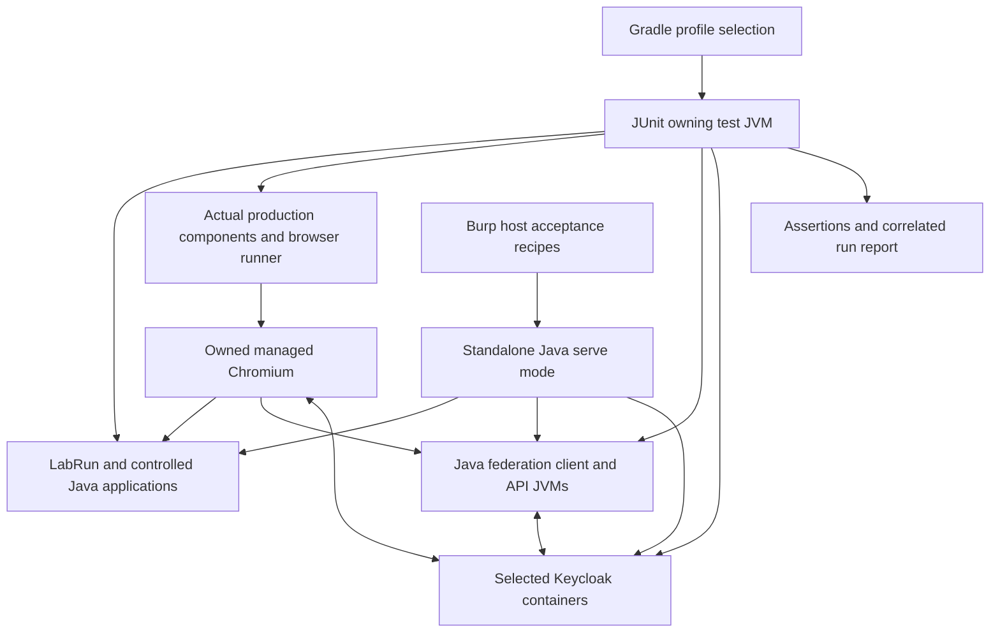

# Authentication test lab

> Integrated into main on 2026-11-07. This document preserves the reviewed design and historical phase terminology. Current commands and implementation status are in [the lab guide](../../test/authentication-lab/README.md). Production capture now defaults to this checkout; reviewed owner selection is portable, while exact source manifests and evidence are generated per invocation.

* **Author:** rfrisch
* **Status:** Finalized — author-approved on 2026-11-05 after independent EGM review. Implementation remains subject to the declared prerequisites, including the full fresh P2 predecessor audit. No implementation or passing-test claim.
* **Date:** 2026-11-04
* **Working branch:** `rfrisch/test-suite`
* **Implementation detail and definitions:** [Lab contracts](authentication-test-lab-contracts.md), [plain-English terms with examples](authentication-test-lab-terms.md).
* **Predecessors:** [Concepts brief](authentication-test-lab/concepts_brief.md), [delivery proposal](authentication-test-lab/delivery_proposal.md), [coverage candidates](authentication-test-lab/coverage_candidates.md), first review (historical reference), follow-up review (historical reference).
* **Finalization evidence:** Completed EGM review (historical reference), finalization record (historical reference), Predecessor reconciliation (historical reference), [existing-test reuse audit](authentication-test-lab/existing_test_audit.md), [baseline source provenance](authentication-test-lab/sources/README.md).

**Author scope correction (2026-11-06):** The extension is the product under test. Keycloak, Spring Security and OpenSAML are infrastructure. Do not test their protocol implementations or count their validator checks as extension coverage. Keep fixture sanity checks only where needed to trust an extension result. Real OAuth/SAML journeys must prove that outputs captured by the extension authenticate the intended identity, and failed journeys must prove accurate extension feedback and resource cleanup. Fourteen former protocol-validation entries are retained as EXCLUDED metadata, never executable acceptance or passing coverage. Before declaring the suite complete, audit every test for duplicate coverage, third-party behavior and fixture-only claims; retain a concrete extension failure it can detect or an explicitly necessary harness purpose.

## Overview

Build a repeatable authentication test lab for the Burp extension described by `docs/designs/bapp-owned-authentication.md` and the amendments agreed during this feature's brainstorming. The lab gives a tester prepared applications, login journeys, protected requests and expected observations. Its central question is whether credentials obtained by the extension actually authenticate the intended identity at the intended service, including when several credentials must be supplied together.

The lab combines controlled applications for precise credential, redirect and failure cases with the selected Keycloak provider for real OAuth/OIDC and SAML flows. Execution is primarily automated. Assign each behavior to the lowest layer that can establish it using the relevant production code, and reserve Burp integration for behavior that depends on the host. Do not repeat the full lower-layer matrix through Burp. Manual Burp checks cover observations or interactions for which a reliable automated check is unavailable.

### Test execution and allocation

| Layer | Responsibility | Expected execution |
| --- | --- | --- |
| Test applications | Establish that protected endpoints, identities, issued credentials and controlled faults behave as specified. These checks validate the test targets and acceptance checks. | Automated HTTP and fixture-contract checks. They do not establish extension behavior. |
| Production components and authentication journeys outside Burp | Exercise actual production logic wherever it can run independently: browser navigation, extraction, fresh contexts, output selection, request transformation and recovery coordination. Verify obtained credentials against protected endpoints. | Automated checks, with controlled faults, concurrency and observable resource cleanup where applicable. A separate implementation of extension logic in a test script is not a substitute. The technical plan must identify the production entry points and any genuinely host-dependent boundaries. |
| Burp integration | Establish behavior that requires the loaded extension and host: hook/tool dispatch, actual request suppression and sending, replay delivery and presentation, proxy self-traffic, UI actions/status, packaging and lifecycle. | A small set of representative integration cases plus host-specific edge cases. Automate where feasible; explicitly identify any manual checks. Do not rerun every account, credential subset or redirect variant solely because it passed below. |

For example, the redirect/cookie matrix belongs with the actual authentication runner and protected applications. Once covered there, Burp needs a representative case showing that its request path invokes that runner and uses the returned outputs. Similarly, test combinatorial tag transformation through the actual production transformer where possible, then verify that Burp applies its result and suppresses a failed tagged request. Exhaust recovery coordination below the host where possible; retain host checks for actual response callbacks, replay delivery and non-recursion.

Passing a lower-layer test establishes its stated contract for the tested conditions. A representative integration test establishes a different fact: the tested components are connected correctly in the host. The case matrix must state each assertion's owning layer and any matching existing test. Profiles select unique owning executions; they do not require every scenario at every layer or create a new test for an assertion already covered. See the [existing-test audit](authentication-test-lab/existing_test_audit.md).

The delivery proposal supplies the starting direction: one catalog and entry point, separate runnable profiles, exhaustive small credential combinations, selected integration combinations, and staged preservation of existing fixtures. The author subsequently selected Java applications and Java/JUnit operational tests under Gradle. The Technical Plan specifies that architecture; its new mechanisms remain subject to section review.

**Production dependency:** The approved authentication design has a single output per journey and no automatic replay. The agreed multiple-output, combined automatic injection and recovery/replay requirements need explicit production-design amendments. Preparing these tests does not establish that those capabilities exist. The lab must report dependent cases as blocked until their prerequisites are available; baseline success cannot satisfy revised-contract acceptance.

The baseline design is preserved as a [repository-local source snapshot](authentication-test-lab/sources/bapp-owned-authentication-baseline.md), SHA-256 `B3B6BF5C67886178178B0AACD62F48EA02C12231EE64FF874D60935201D8B5DE`. It was copied byte-for-byte from the read-only sibling `java-playwright` worktree; [source provenance](authentication-test-lab/sources/README.md) explains its archival links and limits. The snapshot records the prior contract, not an implementation in this checkout.

## The Problem

Authentication checks are spread across several applications and scripts. Existing fixtures can demonstrate a simple login or token substitution, but they do not provide a consistent acceptance contract for the future extension. A successful login page, extracted value or script that inserts a token itself does not establish that the extension selected, injected and maintained the intended credentials in Burp.

The most consequential mistakes can look successful in those checks: selecting another account's token, mixing outputs from different logins, duplicating a cookie or bearer value, publishing only part of a required credential set, or extracting a cookie that never grants access. Redirects and federation add further uncertainty because credentials belong to different services and some outputs are never visible to the browser.

Recovery introduces a separate risk. Concurrent rejected requests, delayed responses and retry timers can produce duplicate authentication work, repeated replays or recurring browser launches. A login counter alone cannot establish that browser resources closed, no timer remains, or later traffic respects a paused journey. The tester also needs persistent feedback explaining which journey failed and how ordinary requests and explicit tags are affected.

Misleading feedback can send the tester toward the wrong fix even when failure handling stops safely. Receiving a response without the selected cookie is an extraction failure; calling it a connection failure conceals the actual problem. Error titles, details, journey status and request feedback need to agree with the observed outcome and stage.

The solution needs broad, explicit coverage without claiming to exhaust an unbounded space of protocols, browser behavior and application implementations. Cheap credential combinations can be exhausted within a declared domain. Browser, provider and Burp combinations need a documented matrix with expected outcomes, exclusions and evidence requirements. Missing capabilities or incomplete evidence must remain visible.

## Goals

1. **Prove protected access.** Every successful credential-use case must verify the expected identity at its accepting service. Controlled cases must distinguish accounts and separate logins for the same account, and detect declared missing, duplicated, stale or substituted credentials. Validate the acceptance checks independently so a shared generator cannot make an incorrect fixture and expectation agree.

2. **Cover credential selection and combinations.** Exercise one, two and three tags, repeated references, distinct saved identities, and required subsets of several outputs. Include automatic bearer-plus-cookie injection. A combined automatic credential set comes from one complete journey; multiple-tag checks must not silently introduce composition of independent journeys into that feature. Exact selection and failure attribution require the production amendment.

3. **Exercise realistic browser and federation journeys.** Cover direct login, multi-page and JavaScript login, single and multiple redirects, and cookies required between redirect steps. Real-provider coverage includes OAuth/OIDC authorization-code flows, actual SAML SSO and a brokered flow. Distinguish browser-visible access tokens from backend-only exchanges rather than inventing an extractable token.

4. **Verify each output where it belongs.** In applicable federation cases, independently prove that an explicitly selected IdP cookie enables SSO at the authentication server, a client cookie grants client access, and an access token grants API access. Declare the identity/session relationship each case can establish. Every authentication attempt starts with fresh browser state; extracting an SSO cookie does not authorize reusing it in a later authentication browser.

5. **Prove bounded recovery and replay.** A configured session-loss match with automatic maintenance enabled authorizes shared recovery and at most one replay of each affected original request. Concurrent callers share the journey's recovery work. Within a shared recovery episode, positively classified temporary network failures permit at most three sequential authentication attempts, including the episode's first attempt; the preceding initial acquisition is recorded separately. Prior attempt resources close before retry. Non-temporary failures do not receive that retry allowance. A timeout on the original request alone never authorizes replay. Preserve the original request's intended identity and retain observable original/replay outcomes.

6. **Prove that recovery stops.** Exhausted recovery or rejection of replacement credentials pauses the affected journey. Continued ordinary traffic, tag evaluation and timers must not launch more login browsers. Unrelated journeys remain usable. With no usable credentials, new ordinary requests follow the unchanged-forwarding warning path; unresolved explicit tags stop the entire request with zero protected-origin ingress. Already-sent original/replay responses remain observable.

7. **Verify the operator's recovery controls.** Persistent feedback identifies the paused journey, known safe failure details, attempt count and effects on automatic requests and tags. Save validates and persists settings without authentication or clearing the pause. Test authentication explicitly runs the saved journey, including another bounded cycle for a paused journey. Neither action silently resends previous requests. Extraction success and confirmed protected access remain distinct results. The approved Technical Plan specifies the dirty-editor guard; recovery rearming remains a production-design dependency.

8. **Make evidence sufficient to assess a pass.** Applicable cases correlate the run, journey, output set, authentication attempts, original request and replay using safe identifiers. Count protected-origin ingress, routed requests and completed actions separately, and observe actual owned browsers, contexts, processes and cleanup through a declared completion boundary. Required evidence that is missing, truncated or from another run prevents a full pass. Diagnostic records must not expose passwords, PINs or raw credentials.

9. **Provide repeatable execution and honest coverage.** Supply a shared catalog with prerequisites, setup/reset instructions, prepared journeys and requests, expected results and cleanup. Separate baseline smoke from revised-contract acceptance and retain focused browser, federation, transport, recovery, Burp, TLS/mTLS and deployment coverage. Assign each assertion to the lowest sufficient layer, primarily automated, and avoid repeating its full matrix above that layer. Retain representative integration checks and genuinely host-specific assertions. Identify fixture-only, browser, extension and host/UI evidence; deduplicate equivalent executions without treating fixture success as evidence that production or host wiring ran.

10. **Bound and explain the matrix.** Exhaust the selected small credential domain and list the integration combinations that are required, unsupported, blocked or manual. Calculate case counts and runtime estimates when the matrix is defined. Include isolation between runs, faults, cancellation, unload, load/resource behavior and clock ownership so delayed work cannot contaminate another case. Preserve approved runtime defaults, including Unlimited waiters, while bounding the harness's own workload.

11. **Preserve existing usable assets and compatibility.** Map current fixtures, accounts, selectors, certificates and examples before replacement. Retire existing checks only after equivalent replacement coverage passes. Gate new native configuration examples on an approved contract covering project data, library data, exports, unsupported versions and rollback. Keep developer lab dependencies distinct from packaged-extension runtime requirements.

12. **Verify truthful user-visible output.** Check the actual production messages and status against independently controlled outcomes: failure stage and known cause, affected journey/output, retry/pause state and saved revision. A missing cookie must identify the missing selected output rather than claim the connection failed. Cancellation, extraction success and confirmed protected access remain distinct. Unknown causes stay explicitly unknown; retry wrappers and late results cannot replace a known cause with a misleading generic error or an outdated status. Relevant user-facing surfaces must agree and omit secrets.

## Non-Goals

* Exhaust every possible authentication implementation or the full cross-product of accounts, providers, browsers, tools, timing and transport conditions. The matrix must make its bounds and exclusions explicit.
* Establish the security isolation of the test applications as a product feature, or perform general OAuth/OIDC/SAML provider conformance testing. Fixture enforcement exists to reveal credential-selection and extension behavior.
* Implement a home-grown federation provider in place of the selected real provider, or treat a simplified redirect fixture as real SAML/OIDC evidence.
* Build combined automatic credentials by joining independent journeys, reuse prior authentication-browser cookies, or assume every extracted credential belongs on every destination.
* Infer support for every candidate in the coverage inventory. Flows such as WebAuthn, CAPTCHA, device authorization and token binding require explicit supported, unsupported or manual classification before acceptance cases promise them.
* Change the authentication contract implicitly through test fixtures. Multiple outputs, injection rules, storage compatibility, replay mechanics, retry classification and recovery rearming require reviewed production-design decisions.
* Replace actual Burp/extension acceptance with direct HTTP substitution, fixture-only tests or desktop UI automation alone. Physical-device evidence also remains distinct from software-token evidence.
* Repeat the full scenario matrix at every test layer. Higher-layer cases must establish an integration boundary or host behavior that lower-layer checks cannot establish.
* Test configured upstream proxy authentication in any form, including support, bad credentials, challenges or configuration rejection. The author explicitly excluded these tests. The extension-owned mTLS proxy's internal credentials remain in scope, as do ordinary unauthenticated routing, CONNECT and no-direct-fallback checks.
* Approve, extend or adopt the partial `test/auth-lab` prototype by creating this design. This phase changes design documents only; implementation follows a completed design and separate authorization.

## Open Questions

These dependencies are not invitations for a fixture to choose production behavior. Cases depending on an unresolved contract are blocked, while independent fixture preparation remains possible.

* **Production amendment:** Approve multiple-output selection, complete-set publication, per-output destinations, automatic injection and native project/library/export compatibility. Preserve failure stage/cause through acquisition, recovery and presentation where the current contract lacks it. Do not invent a second schema or failure classifier in this lab.
* **Recovery amendment:** Approve the host replay mechanism, template/provenance retention, attribution when explicit tags reference several journeys, successful-use rearming, temporary-failure classification and retry delays. The agreed three-total-attempt limit and one-replay limit are fixed inputs.
* **Host feasibility:** Establish actual callback/action ordering, supported tools, editable request behavior, original/replay representation and non-recursion on the supported Burp baseline. A Montoya interface on the test classpath is not a running Burp host.
* **Provider qualification:** Confirm the exact pinned Keycloak cookie selector and that the selected cookie alone supports the explicit SSO proof described below. Container/adapter metadata pins are recorded in the Detailed Implementation Plan; resolved dependency verification locks and actual interoperability still require implementation evidence.
* **Case execution and capability assessment:** The [implementation matrix](authentication-test-lab-cases.md) retains 980 catalog entries, including 28 exclusions, reused-test coverage, manual host checks and capability assessments. The 523 test-application checks validate our custom verification service separately from the 389 extension requirements. These are not a count of new tests. Runtime estimates remain unmeasured. Complete the 16 capability assessments before treating them as supported or unsupported features; unresolved assessments are not passes.

## Critical User Journeys (CUJs)

### CUJ 1: Run automated authentication scenarios without Burp

* **Given:** The Java lab is built and the production authentication runner required by the selected cases is available.
* **When:** The developer selects a browser profile through Gradle.
* **Then:** JUnit starts the required Java applications, runs the production journey and extraction, submits the resulting credentials to protected endpoints, checks expected identities, and closes the run's resources. No Python API or Burp process is required. Missing production capabilities are reported as blocked, not replaced by a test implementation.

### CUJ 2: Verify combined credentials and identity selection

* **Given:** A controlled application issues a bearer and two distinguishable cookies per login, and several accounts and sessions exist.
* **When:** Fixture checks exhaust the bounded acceptance matrix and production tests exercise output selection, tag expansion and automatic injection.
* **Then:** Expected identities and issuance relationships are verified, mandatory missing/mixed credentials are rejected, and duplicate or substituted outputs are detected. The combinatorial matrix runs at its owning layer rather than being repeated through Burp.

### CUJ 3: Verify real cross-application federation

* **Given:** The selected Keycloak containers, Java federation clients, local origins and TLS prerequisites are ready.
* **When:** The production runner performs an OIDC, SAML or brokered login.
* **Then:** Each available selected output is proven at its accepting service. Browser-visible and backend-only tokens remain distinct. An extracted IdP cookie can be tested explicitly for SSO, while the next production authentication attempt starts clean.

### CUJ 4: Establish that recovery cannot start a browser storm

* **Given:** A protected request has established a usable identity, and recovery/replay capabilities are implemented.
* **When:** Credentials are revoked, concurrent originals are rejected, and controlled network failures or replacement rejection are introduced.
* **Then:** Callers share recovery with at most three sequential authentication attempts per episode, including its first attempt; the preceding initial acquisition is recorded separately. Originals replay at most once, and continuing traffic cannot bypass a paused journey. Component tests prove scheduling rules; selected real-runner tests prove browser creation and cleanup; host checks prove actual Burp replay behavior.

### CUJ 5: Perform a focused Burp acceptance check

* **Given:** The lab is running in standalone serve mode and the supported extension is loaded in Burp.
* **When:** The tester follows a host-specific recipe using its prepared journey, request and observation checkpoints.
* **Then:** The host behavior is checked against fixture counters and visible Burp outcomes. The recorded manual result identifies the host and artifact used. It does not rerun or claim ownership of the complete lower-layer matrix.

## Technical Plan (Architecture)

**Reading guide:** The approved Java/Gradle architecture is defined by the two development modules and [execution commands](#3-gradle-commands-and-run-ownership), the [real-provider clients](#7-real-provider-applications-and-topology), explicit [hostname/HTTPS prerequisites](#8-origins-https-and-transport), and the [six initially manual Burp case families](#10-small-burp-acceptance-matrix). Production-contract dependencies remain blocked rather than being decided by fixtures.

### 1. Selected stack and component boundaries

Use the existing Java 21/Gradle build as the entry point. Add two development-only subprojects through `bapp/settings.gradle.kts`, with their source directories outside the production tree:

| Component | Proposed location | Responsibility and dependencies |
| --- | --- | --- |
| Controlled applications and lab support | `test/authentication-lab/`, Gradle project `:auth-lab` | Small Java HTTP/HTTPS servers, credential/session registry, forms and browser scripts, redirect applications, fault gates, counters, catalog, run lifecycle and standalone main. Uses JDK networking/crypto and a pinned JSON library. Contains no production token/parser/coordinator code. |
| Real federation clients and resource server | `test/federation-client/`, Gradle project `:federation-client` | Java Spring Boot application with separate client/resource roles, OAuth/OIDC login, SAML relying party, JWT resource validation and a served browser client. Runs in child JVMs so its dependencies and TLS settings do not alter the test host or extension. |
| Production operational tests | `bapp/src/test/java/` | Call actual production components, compose real journeys against the lab, and assert expected outputs and lifecycle. Reuse the suites planned by the approved authentication design. Test support depends on `:auth-lab`; main production code does not. |
| Real identity providers | Official `quay.io/keycloak/keycloak` containers | One downstream provider for ordinary federation; a second upstream provider only for brokered cases. Imported realms define fixture users, clients and protocol settings. |
| Host acceptance recipes | Catalog resources and generated run instructions | The small actual-Burp matrix, including prepared native configuration only after its schema exists. No generic remote-control endpoint is added to the production extension. |

Use JDK `HttpServer`/`HttpsServer` with explicit executors/lifecycle ownership. P1 creates the canonical controlled application implementation. After the P2 fresh audit, the predecessor Origin facade delegates common serving/lifecycle behavior to it while retaining test-specific callbacks. P3 extracts/reuses the existing unauthenticated ForwardProxy under the LittleProxy 2.9.1 pin; do not write a second HTTP/CONNECT parser. The [ownership contract](authentication-test-lab-contracts.md#4-canonical-fixture-ownership-and-phase-ordering) defines the order without importing sibling source before P2. Configured upstream authentication remains excluded. JDK servers do not supply real federation or complete visibility into parser-rejected bytes. [JDK HTTP server](https://docs.oracle.com/en/java/javase/21/docs/api/jdk.httpserver/com/sun/net/httpserver/HttpServer.html).

For federation clients, propose Spring Boot **4.1.2**, using its dependency management and Spring Security OAuth client, resource-server and SAML service-provider libraries. Java 21 and the existing Gradle 9.2.1 wrapper fit the documented build requirements; no wrapper upgrade is proposed. SAML uses OpenSAML through Spring Security, including its documented Shibboleth artifact repository restricted to the required groups. Lock and verify those development configurations. These are proposed dependency pins, not a claim that the application has compiled or interoperated. [Boot release](https://spring.io/blog/2026/10/23/spring-boot-4-1-2-available-now/), [requirements](https://docs.spring.io/spring-boot/system-requirements.html), [SAML dependencies and flow](https://docs.spring.io/spring-security/reference/servlet/saml2/login/overview.html).

Use Keycloak **26.8.1** with the metadata digest recorded in the Detailed Implementation Plan, and the official browser adapter **keycloak-js 26.2.5** for the browser-visible client. Download the pinned adapter package during explicit dependency preparation, verify its integrity and serve it locally; no CDN or system Node/npm installation is needed to execute the lab. Provider and adapter versions are separate pins. [Keycloak release](https://www.keycloak.org/2026/10/keycloak-2681-released), [official downloads](https://www.keycloak.org/downloads).

JUnit/Playwright/Montoya versions follow the production build and its reviewed amendments. Reuse the matching API/boundary doubles already present in the sibling tests. `NativeTagPipelineTest.ProductionHooks` installs an explicitly test-owned factory and invokes the real handler; this is useful component coverage, not actual Burp behavior. Do not bootstrap or claim the real host's factory implementation outside Burp, or create another competing fake-host scaffold.

**Dependency direction is one-way:** production test code may consume the lab; lab applications must not depend on production credential validation or request handling. Spring, provider clients, JUnit and lab resources must not enter the extension JAR. Verify its entries/classpath during deployment acceptance.

### 2. One catalog; explicit ownership of each assertion

Store every expanded requirement explicitly as JSON under the [catalog contract](authentication-test-lab-contracts.md#catalog-records), and independently validate complete finite matrix membership/counts. Case intent and inputs remain separate from Java executors. Do not add a formula/scripting language or duplicate native journey serialization.

Each case declares: contract revision; profile membership; owning layer; capability prerequisites; application/provider roles; input accounts and output roles; journey steps or recipe reference; request template; expected accepting service/identity/session relationship; fault/checkpoint sequence; evidence requirements; and cleanup/completion conditions. Results identify the exact production revision and resolved dependency pins. Unknown fields or duplicate IDs fail catalog validation.

For diagnostic assertions, expected facts also declare the independently induced outcome/stage, known cause or explicit uncertainty, affected safe identifiers, expected state and required/forbidden message meaning. Observe the actual production presentation; an assertion against only an internal error enum does not establish what the user sees.

Keep three separate data structures:

* `ScenarioSpec`: immutable case intent and expected facts, independent of native serialization.
* `LabRun`/`CaseLease`: endpoints, run/case identity, owned resources and typed controls. Native journey examples are rendered from a case only when the approved production schema supports it.
* `CaseResult`: capability classification, execution outcome, owning layer, expected/observed safe facts and evidence completeness. Manual evidence includes operator, host, artifact and completed checkpoints.

A scenario may have a lower-layer assertion and a distinct representative integration assertion. Give those separate execution identities and a reason for the higher layer. Deduplicate equivalent executions across profiles using case revision, assertion, backend/configuration, relevant tool and evidence layer. Profile membership alone must not cause a rerun.

Use result outcomes `PASS`, `FAIL`, `BLOCKED`, `NOT_RUN` and `INTERRUPTED`. Keep supported/unsupported/manual classification separate. Selecting a mandatory unavailable capability produces `BLOCKED` and prevents a successful profile result. An empty/all-skipped explicit suite, stale evidence or missing required observations cannot pass. Manual cases stay `NOT_RUN` until their evidence is recorded; an automated run may pass its own declared subset without declaring the full product accepted.

Test names, parameter labels and assertion failures use safe account/issuance/role IDs. Do not pass raw credentials to assertion helpers that print expected/actual values or to parameter records whose default string representation exposes them. Disable credential-bearing HTTP dumps, browser traces and provider/client request logging in publishable results. Any required raw material stays in memory for its assertion and is retired with the case.

### 3. Gradle commands and run ownership

The following are **planned commands**, not commands already implemented or executed:

| Operation from the repository root | Intended behavior |
| --- | --- |
| `.\bapp\gradlew.bat -p bapp authLabDoctor -PlabProfiles=baseline` | Check Java, requested capabilities, prepared assets and selected profile prerequisites. Docker, local origin aliases, TLS trust and native middleware are checked only when required. No login is started. |
| `.\bapp\gradlew.bat -p bapp authLabMatrix -PlabProfiles=all` | Expand the catalog into concrete execution IDs, owning layers, counts, estimated costs and blocked/manual cases. Starts no servers or browser. |
| `.\bapp\gradlew.bat -p bapp authLab -PlabProfiles=baseline` | Run the selected automated assertions and produce the scoped report. Other examples: `credentials`, `browser`, `federation`, `recovery`, `transport` and `deployment`. |
| `.\bapp\gradlew.bat -p bapp authLabServe -PlabProfiles=burp` | Start the targets in a foreground Java process and print the catalog/start page and Burp recipes. Keep them running until explicit stop or interruption. |
| `.\bapp\gradlew.bat -p bapp authLabReset -PlabRun=<run-id>` | Retire active case work and reset the selected owned standalone run. Provider reset is explicit; it is not inferred from a restart. |
| `.\bapp\gradlew.bat -p bapp authLabStop -PlabRun=<run-id>` | Stop only resources proven to belong to that run, including interrupted-run cleanup where ownership can be verified. |

Retain normal project regression commands separately. Add a scoped `authLabComponentTest` over the existing production test classes, fixture checks in `:auth-lab:test`, and scoped browser/native selection using the predecessor's integration setup. Lab profiles select audited owning methods/parameters, not an unfiltered whole suite. This avoids both duplicate executions and importing excluded upstream proxy-authentication assertions. Browser/federation tests remain explicit and outside default component tests. A real-provider profile prepares only its required artifact/container setup.

The executing JUnit JVM owns a `LabRun` through a suite-scoped lifecycle extension. Controlled servers run in that JVM. Child federation JVMs and provider containers are owned by that run. A Gradle invocation has an invocation ID; each test JVM gets its own child run ID and owns its own services. Aggregate their reports without sharing mutable application state across test processes. Standalone serve uses the same lifecycle code from a Java main. Avoid a second Gradle-daemon-owned application lifecycle: cancellation and cleanup should follow the process doing the test.

Use Gradle/JUnit results as the test result owner. Add a run report containing case/evidence records alongside normal JUnit XML/HTML. Explicit lab tasks execute fresh runs and are not satisfied by an up-to-date/build-cache result from another run. Produce a partial report on failure; absence of the final completion record means interrupted/incomplete. Gradle's test tasks support the JUnit execution and reporting model; exact filters and aggregation wiring belong in the implementation plan. [Gradle Java testing](https://docs.gradle.org/current/userguide/java_testing.html).

### 4. Controlled application model

`LabRun` creates a fresh registry of three fixture accounts, preserving the useful existing `user`, `user2` and `admin` identities and forms where compatible. Each successful login creates a new issuance ID and independently distinguishable bearer, first-cookie and second-cookie values. Keep credentials in memory. The registry records account, credential kind, issuance, expiry and revocation. Tests inspect safe IDs, never log the raw values.

Offer opaque outputs and a signed short-lived JWT variant for scheduling/JSON extraction cases. Use JDK cryptography and the fixture's own validation; do not import the production token-lifetime/parser code. Per-case acceptance rules specify the required output roles and whether a common issuance is mandatory. A protected endpoint reports the identity it actually authenticated. The tester's expected identity belongs in the assertion, not in a request parameter that tells the endpoint what identity to report.

Expose fixed protected variants for the seven nonempty subsets of bearer, cookie A and cookie B. Strict combined variants require all selected credentials from the same issuance. Preserve a separately named independent-cookie scenario where its intended semantics differ. Non-required credential behavior is explicit per case; it is not inherited accidentally from a global cookie jar.

For fixture-contract checks, pre-create two logins for each of three accounts: six issuances. For each required subset of size `k`, try each role's six correctly typed credentials or its absence. This gives:

`3 × 7 + 3 × 7² + 7³ = 511` distinct requests across the seven protected variants.

Exactly 42 combinations contain a complete same-issuance set (six per variant); 469 are missing or mixed and must fail. Successful responses must identify their actual account and issuance. Additional explicit cases cover wrong credential kinds, copied values in different roles, unknown/expired/revoked values, duplicate transport fields and non-required extras. Those cases are counted separately rather than hidden in the 511 claim.

The test expectation derives from the declared input assignments and independently seeded issuance labels, not by calling the server's acceptance function. Include hand-authored positive/negative cases to check the matrix generator itself. Exhaust this matrix at the fixture boundary. Production selection/transform tests exercise their own bounded inputs once; they do not rerun these 511 requests through browsers or Burp.

### 5. Login, redirect and browser fixtures

Provide separate route families for direct JSON and cookie login, username/password on separate pages, hidden CSRF plus cookie, JavaScript submission and an interstitial/consent step. Retain useful selectors such as `input#user`, `input#pass` and `button#login`. Record deliberate incompatible changes and correct the existing cookie-selector example rather than perpetuate it.

Redirect cases are state machines with an ordered hop ledger. Each mandatory checkpoint sets a nonce cookie that the next hop requires. The fixture can omit, rotate, delete or replace a cookie and can require the expected method after a redirect. No downstream route may silently issue credentials when a required earlier hop was skipped. Keep direct, one-hop, multi-hop, cross-origin and cross-site cases distinct.

Cookie families include early decoys, final rotation, same-name cookies at different paths/domains, host-only/domain cookies, Secure/HttpOnly/SameSite attributes, ambiguity and expiry. Browser-surface cases add fetch, popup, frame and service-worker behavior where supported. They use the real runner's response/cookie extraction, not a second Playwright login implementation in the test suite.

Typed test controls manipulate run/case state directly for in-process execution. Standalone mode exposes an independent loopback control listener for prepare, arm-fault, release-gate, snapshot, reset and stop. It requires an ephemeral run-control key stored in the run's private descriptor, never in journey configuration or application URLs. The application listener cannot invoke those controls. This is a lab lifecycle interface, not a new production BApp API.

Stalled application handlers use separate executors from controls. Gates are bounded and released/retired during cleanup. Reject controls for retired case generations. Use checkpoints and conditions instead of arbitrary sleeps. A fixture clock affects fixture expiry only; coordinator monotonic time, Chromium cookie expiry and Keycloak time have separate owners.

### 6. Production entry points and test allocation

The [preliminary source audit](authentication-test-lab/existing_test_audit.md) found 14 test classes and two shared helper files in the still-developing `java-playwright` worktree. They are not yet integrated into this checkout, and this inventory is not the final implementation baseline. Redo the complete audit at P2 against the actual integrated revision before adding/changing production tests or bindings. The owners below are provisional integration points: reuse current assertions first and extend only verified gaps, rather than act on stale method names or gap claims.

| Production boundary | Owning tests | What runs outside Burp | Small higher-layer obligation |
| --- | --- | --- | --- |
| `NativeTagParser`, `NativeTagResolver` and the request mutation plan | `NativeTagPipelineTest` | One/two/three tags, repeated references, identities, wrappers, byte preservation, invalid references and atomic failure using actual production code. | Confirm the host applies the planned bytes and maps a stop to actual non-delivery. |
| Automatic request mutation | Production request-policy/transform tests beside the pipeline suite | Bearer/cookie/combined injection, existing-field replacement, unrelated-cookie preservation, tagged precedence and filters through the real host-independent policy. If policy is still trapped in the hook, extract a narrow production boundary through the amendment. | Confirm Montoya adaptation, tool/scope information and actual wire output. |
| `AuthenticationCoordinator`, `TokenLifetime`, `SessionRecovery` | Existing coordinator/recovery suites | Fake runner and controlled clocks for state transitions, concurrent callers, generation changes, three-total-attempt limits, late responses, pause, cancellation and one-replay plans. | Confirm callback provenance, actual replay sending/presentation and lifecycle integration. |
| `BrowserFlowRunner`, `TokenExtractor` | `BrowserJourneyIntegrationTest` | Real managed Chromium, actual saved steps, extraction and protected-resource use against Java targets. Real-runner concurrency cases join through the production coordinator. | One representative acquisition-to-request-use path, plus proxy recursion cases. |
| Registry, library and native configuration | Planned registry/library/storage suites | Validation, persistence, revisions, unsupported-format preservation and generation invalidation. | Confirm saved/tested revisions and visible status in the actual UI. |
| Failure mapping and user-visible presentation | Existing `DiagnosticsTest` and editor/state tests, with bindings confirmed at P2 | Production failure propagation, formatted messages, warnings and presentation state; verify the diagnostic contract below with controlled outcomes. | H02/H05 establish that actual Burp surfaces show the same current facts. |
| PKCS#11 transport and traffic guard | `Pkcs11JourneyIntegrationTest` and focused guard/transport tests | Real local TLS/proxy targets, SoftHSM identity selection, resource authentication and cleanup; deterministic guard classification. | Actual Burp upstream interception/tunneling, marker handling and physical-device checks where selected. |

Reuse the existing thin host fixture and its test-owned factory for API interfaces/request metadata. Requested send/drop actions remain component results; invoking the actual handler against this fixture is not a real Burp dispatch or wire result. If an assertion cannot be reached through real production code outside the host, assign it to Burp until a reviewed seam exists.

Browser observations must distinguish attempt entry, successful browser launch, context creation and close completion. A narrow lifecycle observer at the real runner's creation/cleanup boundaries supplies safe IDs; it cannot replace the actual launch. Cross-check with the run-owned process tree during and after the case, recording maximum live resources and remnants. Do not infer browser counts from login HTTP requests or inspect/kill unrelated browser processes. If process ownership or observation is unavailable, report that evidence as incomplete.

#### User-visible diagnostic accuracy

The [diagnostic matrix](authentication-test-lab-cases.md#user-visible-diagnostic-contract) adds 18 bounded requirements for message meaning, attribution and state. Exercise actual production failure mapping and formatting in the existing diagnostic/editor suites. Derive expected meaning from the controlled fault or declared input, independently of the returned production category. For example, complete the response and omit only the selected cookie: the result must identify missing-cookie extraction, and must not say that connecting failed. Pair it with a genuine connection-refused case so generic output cannot pass both.

Check the complete displayed meaning across the existing title/summary, details, journey status and applicable request warning/annotation. A specific detail cannot excuse a contradictory generic headline. Cover missing/ambiguous outputs, failed navigation or steps, malformed responses, known login rejection, protected-use rejection, unresolved tags, cancellation, exhausted retries and unavailable capabilities. If the evidence establishes only a timeout or incomplete login, state that stage and uncertainty rather than invent bad credentials or a network diagnosis. Preserve the underlying known failure and attempt count when reporting exhausted recovery; successful extraction alone must not be labelled verified protected access.

Use semantic assertions with required facts and forbidden misleading claims; wording examples are illustrative, not frozen whole-message snapshots. Existing production failure cases also check relevant diagnostic coherence within their owning execution, including missing setup/secrets and PIN rejection or unknown PIN outcomes; the 18 representatives do not exempt other emitted feedback. Check safe journey/output attribution, saved revision and attempt ownership. Late failures must not overwrite a newer result or another journey; a current success clears stale active error/pause presentation according to the production state contract while history remains historical. Keep passwords, PINs, tokens, cookie values and sensitive URLs out of displayed diagnostics and publishable evidence.

CORE.diagnostics requirements own the component failure-mapping/presentation facts. Separate existing browser/transport requirements own actual failure propagation; each requirement has one test owner and no cross-test dependency list. For example, BROW.cookie-selection.deleted-mid-flow checks the actual missing-cookie cause, while CORE.diagnostics.missing-cookie checks the displayed wording/state for that supplied cause. Extend only verified missing assertions at P2; do not repeat every flow for each message. Missing actual presentation/cause seams stay blocked pending production amendment. H05 retains its real-host diagnostic contrast/revision checks and H02 its actual request feedback.

### 7. Real-provider applications and topology

The Java federation module has a **client role** and a **resource role**, started in separate child JVMs. Use maintained Spring Security implementations for protocol processing. The client role serves three independent entry points:

* **Browser OIDC client:** locally served HTML/JavaScript uses the pinned Keycloak adapter, authorization code and explicit S256 PKCE. The token exchange is visible in browser traffic. A same-origin session endpoint validates the access token and creates a client cookie; a combined protected route can require that cookie and the corresponding bearer. This app intentionally supplies the requested one-journey multi-output case. It is application behavior, not an assertion that every OIDC client issues such a cookie. [Adapter behavior](https://www.keycloak.org/securing-apps/javascript-adapter).
* **Backend OIDC client:** Spring performs the exchange server-to-server and retains tokens on the server. The browser receives its client session cookie. Verify that cookie at a protected client route and verify server-side API use separately. No route exposes the hidden token merely to make extraction pass.
* **SAML service provider:** Spring Security creates requests and validates responses at the assertion consumer. Successful login establishes a client session cookie. Verify its protected identity; do not invent an OAuth access token for this case. [SAML browser flow](https://docs.spring.io/spring-security/reference/servlet/saml2/login/overview.html).

The [federation contract](authentication-test-lab-contracts.md#5-federation-seed-session-binding-and-negative-controls) fixes realm/client names, routes, audience, lifetimes, cookies and broker links. The SPA combined route binds its client cookie to the exact validated token bytes used to create that session. Product tests use extension-captured outputs at these accepting services and check the expected identity and fresh issuance. Real SAML uses Keycloak-to-Spring login. The one backend rejection fixture supplies an immediate error so the extension's feedback and cleanup can be checked. Signed-message and provider protocol-validator regression suites are excluded.

The resource role uses maintained validation of Keycloak signatures, issuer, time bounds and the configured API audience, and reports verified subject/session evidence. This makes credential-use proofs credible; validation-library behavior is not extension acceptance. Keep only necessary fixture sanity checks, outside product coverage. [Spring JWT resource-server support](https://docs.spring.io/spring-security/reference/servlet/oauth2/resource-server/jwt.html).

Use one downstream Keycloak container/realm for normal real-provider cases. The brokered case adds a second container/realm with a separate origin and configures downstream OIDC login through the upstream SAML IdP. This exercises client → downstream provider → upstream provider → downstream → client, including real intermediate cookies. Configure accounts and linking/first-login behavior in the realm seed so unexpected registration/consent is an explicit variant.

Use **26.8.1** realm imports, strict redirect/client URLs and a fresh run-owned data volume. Health readiness is followed by protocol metadata and fixture-user/client checks. Keycloak supports startup import, but skips an existing realm; a restart is not a clean reset. Recreate the owned provider state for a full profile reset. Within a run, reset sessions/app state explicitly between cases as required and serialize provider-reset operations. [Container/import behavior](https://www.keycloak.org/server/containers), [existing-realm semantics](https://www.keycloak.org/server/importExport), [identity brokering](https://www.keycloak.org/docs/26.8.0/server_admin/#_identity_broker).

For the **selected IdP cookie proof**, use a separate verification client, not a subsequent production authentication attempt. Start a fresh application authorization transaction and supply only the explicitly extracted IdP authentication cookie on the IdP leg, using `prompt=none`. Complete the legitimate callback/exchange and verify the expected identity, with no password submission. The same transaction without the cookie must require login/fail, and another account's cookie must yield that account rather than the expected one. Start qualification with the pinned provider's `KEYCLOAK_IDENTITY` selector, but do not mark it supported until the single-cookie positive and negative controls pass. If the provider requires additional material, report the limitation and revisit the output contract; never silently add another cached cookie. `prompt=none` is documented by the [official adapter](https://www.keycloak.org/securing-apps/javascript-adapter).

This verification does not seed the production runner. Every actual journey attempt still starts a fresh context. Provider session reset and browser state reset are independent: retaining a provider session alone must not authenticate a fresh browser that has no corresponding cookie.

### 8. Origins, HTTPS and transport

Basic controlled profiles bind loopback on OS-assigned ports and need neither Docker nor hostname setup. Two ports on one host supply cross-origin cases only. The cross-site/provider/TLS profiles use distinct local names: `app.authlab.test`, `api.authlab.test`, `idp.federation.test` and `idp.upstream-sso.test`. Their sites/origins and cookie destinations are explicit in each case.

These names require documented local name resolution. Doctor verifies it and prints the required records; ordinary test execution does not edit the hosts file. For provider containers, use a run-owned network with the same provider names as network aliases and matching internal/published TLS ports, so broker metadata and issuer URLs remain consistent inside and outside Docker. Bind published host ports to loopback. Allocate/lease the full port set before startup; a collision blocks that run rather than attaching to another process. Cross-site/provider runs sharing the configured host/port set execute serially.

Generate dedicated lab CA/server material, separate from preserved mTLS assets. Standalone/browser HTTPS requires an explicitly prepared trust setup for that lab CA, starting with the user's Windows environment. Doctor must verify a real managed-browser trust probe, not only a Java HTTPS request. Java fixture/backend clients use run-local trust configuration, and mTLS journeys use the production additional-CA setting. No global trust-all setting, `ignoreHTTPSErrors` or fixture-certificate addition to the production proxy-key exception is permitted. The existing BApp exception remains limited to its generated mTLS proxy key. Platform-specific browser trust preparation and removal must be documented before declaring that platform's HTTPS cases runnable.

For exact **zero protected-origin ingress**, use a case-owned raw ingress sentinel, rather than relying on an application's routed/action counter. Its dedicated TCP/TLS listener counts received application bytes without retaining credential content; TLS handshake bytes and HTTP application bytes are distinct. Point failed-tag/non-delivery cases at that listener. Any application bytes fail the assertion, including malformed requests that a normal HTTP server might reject before routing. A positive control proves the sentinel sees an actual request. Normal application cases separately count accepted HTTP ingress, routed requests and completed actions; no claim of complete parser-rejection coverage is made from `HttpServer` handlers.

Transport fixtures include an unauthenticated local HTTP/CONNECT proxy with controlled availability/failures and a Java mTLS issuer plus separate non-mTLS protected resource. Do not implement an upstream proxy-authentication handler or tests, including rejection cases. Server-observed certificate fingerprints establish selected identity, including same-CN controls. Internal per-attempt credentials on the production mTLS proxy remain in scope, including binding and stripping before upstream/origin delivery. Reuse existing integration fixtures and assertions before adding new ones. Software-token and physical-device outcomes remain separate; never recreate or delete the user's existing token store as a routine reset.

### 9. Recovery operational recipe

Keep exhaustive coordinator/replay planning checks in the component suites. Add a small real-runner recipe to establish that the state machine actually controls browser resources:

1. Acquire the initial credential set through the real coordinator/runner and verify protected access. Record this initial acquisition separately from recovery.
2. Revoke the accepted issuance. Send a controlled batch of eight originals through the host-independent production request/recovery boundary, using a test transport for actual HTTP delivery. Hold their rejection responses at checkpoints so all eight belong to the intended recovery episode.
3. Release the configured session-loss observations. Assert one shared recovery. For the network variant, arm positively classified failures for the first two actual authentication attempts and allow the third. Count attempt/browser/context events separately from HTTP retries internal to Chromium.
4. After complete replacement publication, the production replay plan is submitted once per affected original through the test transport. Verify identity, preserved non-authentication data and one completed action per accepted replay. The original rejected requests must have caused zero controlled actions.
5. In separate cases, exhaust three network attempts or reject the replacement. Verify pause, then continue ordinary/tagged demand and advance relevant component timers/check real scheduler completion. No fourth automatic attempt may appear. Check the distinct ordinary/tagged outcomes and a healthy unrelated journey.
6. Save produces no acquisition and does not reset pause. Explicit Test authentication permits another bounded cycle and does not resend the eight previous originals. Associate its result with the saved revision.
7. Retire the case, release gates, close resources and require acknowledged quiescence. Check the real owned process tree after completion and after scheduled work has been cancelled/drained.

The test transport sends actual HTTP using production replay decisions. H03 owns the actual Montoya replay-delivery assertion. Exact temporary classifications, delays and rearming use the production amendment once approved; this lab does not silently adopt the old four-attempt policy or invent a success/probe setting. No replacement means no replay. A timeout on an application original alone never enables replay.

### 10. Small Burp acceptance matrix

H04 uses a short-lived, attempt-owned User-Agent suffix on explicitly proxied authentication traffic. The early guard recognizes owned traffic before acquisition, prevents recursion, strips the carrier as specified and excludes correlated responses from recovery while preserving ordinary interception. Native-tag/stale-marker behavior follows the preserved [Selected self-traffic policy](authentication-test-lab/sources/bapp-owned-authentication-baseline.md#technical-plan-architecture) and [Detailed Implementation item 7](authentication-test-lab/sources/bapp-owned-authentication-baseline.md#detailed-implementation). Refresh this reference if production changes it; keep detailed guard/carrier combinations below Burp.

Initially use explicit manual recipes with machine-readable fixture checkpoints for host-specific observations. Do not build a general Burp automation bridge as a prerequisite for the operational suite. Automate a host recipe later when there is a supported, validated mechanism; its evidence requirement stays the same.

| Host case | Distinct fact to establish in actual Burp |
| --- | --- |
| H01 — Request adaptation | One representative combined-injection request and one representative native-tag request reach the target with the production plan's exact output; unrelated bytes remain intact. Repeat only the host dispatch/eligibility probe across each supported tool. |
| H02 — Stop versus forward | A failed explicit tag produces zero sentinel application bytes; an ordinary acquisition failure sends the unchanged original with the agreed warning. These are real action-factory/wire checks. |
| H03 — Recovery delivery | A controlled rejected original obtains one actual replay, keeps its intended identity/template and leaves original/replay observable. Replacement rejection visibly pauses the journey and subsequent host traffic starts no browser. Component tests own the larger timing/retry matrix. |
| H04 — Self-traffic | Actual browser authentication through the user's Burp proxy/interception path avoids recursive acquisition, preserves normal interception policy and handles the selected marker correctly. Include the real mTLS tunnel path when that profile is selected. |
| H05 — Operator actions and revisions | Save versus Test, active/retrying/paused feedback, repeated Test presses and late results reflect the saved revision. Disable Test with unsaved fields and show Save-first guidance; edits made during a test remain visibly untested. In existing test/paused-test checkpoints, contrast missing-cookie extraction with a genuine connection failure and verify coherent title/details/status; late-result checks reject stale errors. |
| H06 — Artifact and lifecycle | The packaged platform JAR loads offline without Python/system Node, excludes lab dependencies and releases its owned resources on unload/reload. Repeat for each claimed platform/artifact, independently of developer-classpath success. |

Each tool probe uses a supported way to originate traffic from that tool. A script that emits HTTP through a proxy does not automatically establish a Repeater/Intruder/Scanner-specific result. Record the actual supported host version and tool. The previously opened Burp 2025.12.5 does not meet the sibling design's proposed 2026.4 baseline; no successful new-contract host test has been demonstrated.

Do not multiply H01–H06 by all credential/redirect/provider combinations. Add a host case only for a distinct host boundary or an observed integration defect. Selected mandatory manual host cases remain outstanding until performed; the automated suite must not turn them green.

### 11. Profiles, counts and runtime control

The [exact membership table](authentication-test-lab-contracts.md#2-exact-profile-selection-and-smoke-budget) fixes every named selection before P2 source binding. Baseline has exactly 12 entries and does not grow implicitly. Its provisional planning budget is startup 10–30 seconds, case work 10–60 seconds and cleanup 5–15 seconds (about 25–105 seconds), unmeasured and separate from production deadlines. Missing prerequisites stay BLOCKED; shared executions run once. The following table describes each selection's purpose.

Profiles select assertions, not a repeated stack of every layer:

| Profile | Primary execution | Coverage boundary |
| --- | --- | --- |
| `fixtures` | `:auth-lab:test` | Acceptance/fault negative controls, the 511-case credential matrix and explicit transport extras. No production pass claimed. |
| `baseline` | Exactly 12 IDs: four runner representatives and eight component requirements, listed in the contract | Declared BApp-owned smoke coverage without Docker/TLS/native middleware; production/presentation prerequisites remain explicit. |
| `revised` | Same-journey multi-output, combined injection and representative recovery/pause | Requires the revised production contract. Shares execution IDs with focused profiles. |
| `credentials` | Actual parser/resolver/transform component cases | Exhaust bounded tag/selection/encoding domains here; only representative wire checks belong to H01/H02. |
| `diagnostics` | Actual production component failure mapping/formatting/editor tests | The 18 component diagnostic requirements. Separate BROW/TLS requirements prove real propagation; H02/H05 prove actual-host display wiring. Each requirement has one owner. |
| `browser` | Real runner against controlled Java applications | Flow, extraction, cookie and fresh-context families, with protected access. |
| `federation` | Real runner plus selected Java client/API roles and Keycloak | Browser OIDC, backend OIDC, SAML, selected-output proofs and brokered chain. |
| `recovery` | Coordinator/recovery component matrix plus selected real-runner cases | Shared work, limits, pause, cancellation, late results, load and actual browser cleanup. |
| `transport` | Local TLS/proxy/SoftHSM integration | Trust, route, fingerprint and token-to-resource checks. Physical-device cases require explicit selection. |
| `burp` | H01-H05 manual host recipes | Host-specific dispatch/delivery/feedback/UI evidence. |
| `deployment` | H06 with linked automated package observations and mandatory host checkpoints | Package checks alone cannot complete a host requirement. |
| `all` | All 980 requirement/assessment IDs | Scope automated results separately from remaining host/manual/assessment work. |

The coverage inventory remains the source of candidate families. Before implementation handoff, each retained candidate maps to concrete execution IDs or an explicit unsupported/manual/deferred classification with a reason. This Technical Plan does not silently discard the additional MFA, integrated-authentication, device-flow or sender-constrained candidates.

`authLabMatrix` calculates concrete counts from declared finite inputs and detects unowned assertions. Separate estimated startup, case and teardown costs. For orientation only, the 511 HTTP checks at an assumed 10–50 ms each imply roughly 5–26 seconds of request time; this is arithmetic, not a measured runtime promise. Browser/provider startup and bounded waits are budgeted independently. Record observed timings after the first implementation and compare estimates before expanding profiles.

Start with serial browser/provider cases and parallelism only within explicit concurrency scenarios. Component tests can run independently. Keep provider session resets exclusive. The harness uses bounded batch sizes and observation storage without changing production Unlimited waiter defaults. Load profiles record pending callers, retained request bytes, heap/GC and resource maxima; report the workload used rather than extrapolate unlimited capacity.

### 12. Cleanup, migration and implementation boundary

Every run owns its contexts, listeners, executors, child JVMs, provider containers/volumes and generated files through explicit resource leases. Cleanup stops admission, retires case generations, releases gates, cancels scheduled work, settles callers, closes browsers/transports and finally stops fixture/provider services. Capture final counters before disposing state. Cleanup failure is visible and cannot yield a full pass.

Register ordinary termination cleanup and persist a small run descriptor with safe resource ownership information for interrupted-run recovery. Verify process identity/launch ownership and container labels before stopping anything; PID or port reuse alone is insufficient. Do not kill every Chrome/Java process, prune shared Docker resources or remove user certificate/token directories. The descriptor/control key is local test state, separate from publishable reports.

Create Java fixtures in the new `test/authentication-lab` location. Keep `test/mock-auth-app`, `test/mTLS-app`, their assets and the legacy integration driver until the preservation map and replacement acceptance establish parity. The partial `test/auth-lab` Python prototype stays unapproved. No new Python production dependency is introduced; after cutover the selected Java lab profiles require Java and optional Docker/native middleware only.

Implementation sequencing is: establish Java fixture/oracle contracts; add catalog/lifecycle and production component integration; qualify controlled real-browser cases; add actual federation clients/provider setup; complete the revised-production and real-Burp slices; then retire superseded drivers/examples. Native example generation waits for schema compatibility decisions. The Detailed Implementation Plan below lists the target files, dependency locks and verification tasks.

## Alternatives Considered

This section records choices already discussed in the [concepts brief](authentication-test-lab/concepts_brief.md#alternatives-weighed), execution comparison (historical reference) and subsequent author decisions. Production-policy choices below define acceptance expectations; the lab does not implement those policies in place of the extension.

### A. Keep Python applications and add a Python controller around the Java tests

* **Pros:** Existing Flask routes and Python service-launch patterns could be reused. Application setup, reset and fixture checks would stay in the same language as those targets. Production tests could still run through Gradle/JUnit.
* **Cons:** A complete run would depend on Python and Java and would need to coordinate selection, cancellation, child-process cleanup and results across them. The existing static-token fixtures still need changes for fresh issuance, session binding and fault control; keeping Python would not remove that work.
* **Reason for rejection:** Rejected by author in favor of Java test applications, Java/JUnit operational tests and Gradle execution. The accepted plan keeps the new controlled applications callable directly from JUnit and gives them a standalone Java serve mode. Useful Python fixture assets remain preserved until replacement parity passes; this choice does not justify deleting them immediately.

### B. Repeat the complete scenario matrix through Burp

* **Pros:** Every execution would include the loaded extension and the host's real request path. It could reveal an integration defect without a separate host representative for that combination.
* **Cons:** It repeats account, credential, redirect and failure combinations already assigned to lower layers and adds host setup to checks that do not need it. Failures become harder to locate because browser, fixture, core logic and host behavior run together.
* **Reason for rejection:** Rejected by author: test each assertion at the lowest layer capable of establishing it and reserve Burp for behavior that cannot be established elsewhere. The accepted plan retains representative wiring checks and host-specific cases. A fixture-only pass is not a production-code pass, and a component pass is not proof that Burp applied its result; these distinct assertions remain covered.

### C. Write a custom OAuth/OIDC/SAML provider for interoperability cases

* **Pros:** A custom provider could expose convenient fault controls and produce exactly the sequence or output shape a case needs. It would not require a maintained provider container for simple synthetic flows.
* **Cons:** The lab would own protocol behavior, session semantics and validation that are outside the extension's responsibilities. Tests could agree with an inaccurate protocol simulation and misrepresent it as real federation support.
* **Reason for rejection:** Rejected by author in favor of Keycloak for real OAuth/OIDC/SAML flows. Small Java fixtures remain the selected mechanism for precise redirects, credential combinations and failures. They are explicitly synthetic. Java protocol clients use maintained libraries; the lab does not replace provider interoperability with a simplified redirect flow.

### D. Assemble automatic bearer-plus-cookie authentication from independent journeys

* **Pros:** Existing single-output journeys could supply different credentials without first introducing multiple outputs from one completed flow. Each journey could be configured separately.
* **Cons:** Separate runs can produce credentials for different sessions or identities. Acquiring them independently also fails to exercise the complete cross-application flow the author wants to validate.
* **Reason for rejection:** Rejected by author: one journey must complete the required authentication flow and supply the combined automatic credential set. Navigation across an application and one or more identity providers is still one journey. This decision does not remove explicit-tag tests involving different saved identities in independently declared request slots. Their recovery attribution remains a production-design dependency.

### E. Never replay originals after session-loss detection, or require another replay opt-in

* **Pros:** Never replaying would leave all resends to the tester and preserve the earlier production design's future-demand-only behavior. A separate replay setting would let a tester opt into recovery without opting into resend.
* **Cons:** Never replaying does not provide the automatic session-maintenance behavior the author selected. A second setting would split a workflow the author wants controlled by the existing maintenance option and configured session-loss condition.
* **Reason for rejection:** Rejected by author: when automatic maintenance is enabled and the configured rule matches, share recovery and replay each affected original at most once. The pentester owns the rule's accuracy; there is no additional replay opt-in. The accepted plan tests repeated rejection, pause, concurrency and replay fidelity. This decision changes the prior no-replay design and still requires the production amendment and actual host verification.

### F. Treat every error or network timeout as session loss

* **Pros:** A broad trigger would be easy to configure and could react without an application-specific session-loss condition.
* **Cons:** Such observations do not establish a rejected session. In particular, losing an original response does not establish whether the application performed its action. Authentication-attempt transport failures and application-original replay authorization are different decisions.
* **Reason for rejection:** Not selected in the agreed brainstorm policy: recovery follows the configured session-loss condition, and a network timeout on the original alone never authorizes replay. The temporary-network allowance concerns at most three authentication attempts total; it does not broaden replay authorization. Fixtures provide distinct session-rejection, authentication-network-failure and original-timeout cases so those decisions cannot be conflated.

### G. Keep a combined Save and test action plus a separate Retry action

* **Pros:** One action could persist edits and immediately start authentication, while another could explicitly restart a failed journey.
* **Cons:** Saving and launching a browser would remain coupled, and explicit testing and retrying would present overlapping actions. This does not match the author-selected separation between persistence and authentication.
* **Reason for rejection:** Rejected by author in favor of Save and Test authentication. Save validates/persists without a browser or pause reset. Test authentication runs the saved journey and also provides explicit recovery of a paused journey, subject to the same limits. Neither action resends old Burp requests. The approved Technical Plan includes saved-revision feedback and a Save-first guard for unsaved edits.

### Existing Python prototype

The unapproved `test/auth-lab` prototype is excluded from the selected Java implementation. Existing assets are evaluated through the preservation/parity process.

## Non-Functional Requirements

* **Secrets and test evidence:** Keep credential values and private control keys out of reports, assertion diffs, process diagnostics and browser/provider traces. Public fixture account instructions are separate from runtime credential outputs. Keep server keys and transient raw values in run-owned private state, never in the release JAR or native exports.
* **Repeatability and resource ownership:** Every selected case has a finite observation/cleanup budget and explicit clock ownership. A failure cannot strand the following case behind its gate or silently reuse a provider/browser session. Default component tests stay independent of Docker, browsers and native devices. Load measurements state their bounded workload and do not change production defaults.
* **Compatibility and delivery:** Preserve prior fixture assets and native data on unsupported operations. New-format acceptance waits for the reviewed production format. Lab libraries and the optional host probe are development artifacts, excluded from production packaging. The offline packaged-extension result is established separately from a developer-runtime result.
* **Truthful presentation:** User-facing summaries, details, status and request feedback agree with the known outcome/stage and current journey revision. Unknown causes, cancelled operations and unverified extraction results must remain distinguishable. Message assertions check meaning, attribution and redaction through actual production presentation.

## Detailed Implementation Plan

**Reading guide:** This is the file-level plan, not implemented code. The [case matrix](authentication-test-lab-cases.md) retains 41 groups and **980 catalog entries** for the initial Windows artifact: **912 active automated requirements (389 extension behavior and 523 test-application checks), 24 manual host entries, 16 manual capability assessments and 28 excluded historical entries**. Existing tests satisfy covered requirements; these counts do not prescribe that many new tests or separate invocations. Upstream proxy-authentication tests remain excluded. A small test-only helper extension supplies the otherwise difficult `EXTENSIONS` tool-origin probe; it adds no production control endpoint.

### Contract boundary and implementation order

Implement the following stages in order, using the file inventory below as one change list:

| Stage | Buildable deliverable and exit condition |
| --- | --- |
| P0 — Build/catalog/preservation | Add the two development projects and catalog/ownership rules. Record route/account/selector/certificate provenance without changing legacy app code or user token stores. Metadata-only commands work in this checkout. |
| P1 — Controlled Java targets | Build the canonical JDK controlled applications under the exact HTTP/cookie/redirect/identity contracts, with 511 combinations plus extras, typed controls and lifecycle. No predecessor source is required. :auth-lab:test passes without Python, production runner, Docker or Burp and claims fixture correctness only. |
| P2 — Actual production components and browser runner | Integrate the actual predecessor revision and redo the full reuse audit before changing tests/adapters/bindings. Publish the fresh ledger. Delegate common Origin serving/lifecycle behavior to the canonical P1 lab, retain test-specific callbacks and demonstrate retained assertions/parity. Missing production seams remain amendment gates. |
| P3 — Real federation and transport | Apply the exact federation topology/seed/session/control contract, qualify provider-cookie proof and extract audited shared transport machinery once, with predecessor callers delegating. Establish actual browser trust, resource and protocol evidence; label isolated client controls separately. |
| P4 — Revised recovery and host/deployment acceptance | Require the multi-output/replay/pause amendments, their compatibility rules and supported host. Run the component and real-runner recovery matrices, then the small manual host matrix and packaged-artifact checks. Do not declare the new contract accepted while these prerequisites are unresolved. |
| P5 — Cutover documentation | Point the supported lab entry point and current examples at the Java lab after parity is demonstrated. Mark old API/Hackvertor checks as legacy. Retain old source/assets for previous-release reproduction; this change list contains no file deletions. Later removal requires a separately scoped parity-backed change. |

No changes to `bapp/src/main/java` or `api/` are authorized by this lab implementation plan. Required revised contracts remain owned by the authentication design. Existing callable parser/handler/coordinator seams and `CoordinatorFixtures.ManualRuntime` must be reused; request only missing multi-output/replay/resource-observation or diagnostic cause/presentation seams. Do not add a production test mode, implement recovery in an adapter, or turn an unavailable seam into a passing fake-host result.

### Reuse existing tests before implementation

The linked [reuse audit](authentication-test-lab/existing_test_audit.md) is a preliminary historical input, not the final coverage decision. **P2 must redo the audit** against the actual predecessor revision: full test/fixture inventory, relevant production interfaces, Gradle wiring and exact assertion/input witnesses. Record the revision and any accepted working-copy hashes, publish a fresh ledger and only then add/change production tests, adapters or bindings. Do not merely recheck files listed in the old report. Refresh the mapping if the underlying implementation changes before the edits.

After that gate, each catalog requirement records `reuse/extend/new/blocked/manual`, the current owning method/parameter witness and any missing assertion. Keep requirement ID separate from shared execution ID. Run an existing owner once per relevant artifact/backend/configuration and map its actual JUnit outcome to matched requirements. Skipped/missing/failed or stale bindings cannot establish passing coverage.

Do not create another encoder, cache/lifetime, reservation, registry/storage, PIN-state, diagnostics or packaged-driver suite for assertions the fresh audit confirms are already covered. Extend ordinary-browser protected identity only where it is still absent; retain existing mTLS proof. If the latest retry test still expects four attempts, update it in place after the amendment; it may already have changed by P2. Likewise, recheck recovery's actual current behavior rather than assume the historical invalidation-only implementation remains.

Source tests may combine retained and excluded assertions. Split such a method before lab selection rather than selecting its upstream-authentication subcase or recreating its retained assertions elsewhere. The audit identifies the mixed native no-fallback test explicitly. Existing unrelated project regression tests are not deleted by this lab; selected lab tasks use the reviewed scope.

### Data and control contracts

The [implementation contract companion](authentication-test-lab-contracts.md#1-catalog-bindings-controls-and-evidence) defines exact catalog/binding fields and enums, typed Java operations, private ownership descriptors, control paths/methods/payloads/error responses, snapshots and result/completion records. The [definitions](authentication-test-lab-terms.md) explain these terms. Use `lab.auth` for controlled code and `lab.federation` for protocol-client code; small records/enums are nested in their listed owning files. Production adapters remain in the predecessor's current test package, confirmed at P2.

The lab catalog version is 1, separate from native journey schemaVersion. All 980 expanded requirements live explicitly in the nine data files with the exact profile memberships. Validate unknown fields, duplicate IDs, full finite axis membership/counts and logical ownership. Null physical production bindings are valid P0 metadata and BLOCKED for execution; P2 supplies current method/parameter/assertion witnesses and hashes. Stale, missing, skipped or unexecuted bindings cannot pass.

The companion's RunSpec/CaseLease operations control owned fixture state, not production recovery or tag resolution. An independent loopback control listener and private key remain responsive while login handlers are held. Reject retired generations and check the expected run generation atomically before case allocation; the companion also fixes the private PRIME/PROBE operation for unchanged fresh-state journeys. Retain the 64 KiB control-request and 10,000-event limits with atomic totals. Required lost observations prevent a full pass.

Login/protected routes, credential/cookie names, rejection statuses, explicit FIX.extra assignments and browser hop/attribute parameters follow the [HTTP contract](authentication-test-lab-contracts.md#3-controlled-http-and-independent-expectations). The independent-cookie legacy route permits different issuances for the same account; the seven strict subsets require a complete common issuance. Expected identities are never request parameters telling the server what to report.

Use RUN_STARTED/CASE_RESULT/RUN_COMPLETED JSON Lines under the companion's exact schemas and binding-correlation rules. Diagnostic expectations remain independently induced and compare actual safe presentation. Host observations require operator/host/tool/platform/artifact/checkpoints. Raw credentials, templates and control keys stay private. Missing completion, matching witnesses, required evidence or cleanup acknowledgment prevents an overall pass.

Component cases use production clocks through existing test seams. Real-browser/provider cases use actual relevant time and an explicit wall-time budget; the default browser case budget is the configured production cycle deadline plus 30 seconds for cleanup, not a replacement for production deadlines. Protocol-expiry negative controls declare their observed validity interval and budget separately. Retire or cancel delayed work before resetting the case. Paused-state assertions occur while the coordinator is still alive, before final shutdown.

### Exact dependency and artifact preparation

Retain Java 21 and Gradle 9.2.1. Align production and controlled-module tests on the predecessor's JUnit dependency bill of materials (BOM) **6.1.3**, a version list aligning related JUnit API/engine/platform modules. The federation module uses Spring Boot **4.1.2** and its managed Spring Security **7.1.2**; override its test BOM to the same JUnit version rather than accidentally inheriting Boot's different test version. Resolve/verify those configurations before claiming they compile together.

Use **Gson 2.13.2** for the controlled module's JSON, separate from production Jackson. A Jackson 3 fixture dependency can still bring shared Jackson annotations onto the production test classpath, so namespace separation alone is insufficient. Gson's streaming reader with strict syntax, explicit duplicate-name detection and allowed-field/type checks implements the small catalog/control contracts; do not rely on a default deserializer ignoring unknown fields. Assert resolved production-test dependency graphs and keep Spring/Boot/Jackson 3 in the child application. No additional fixture web framework or JSON-schema engine is needed. The published [Gson release](https://github.com/google/gson/releases/tag/gson-parent-2.13.2) and [POM](https://repo.maven.apache.org/maven2/com/google/code/gson/gson/2.13.2/gson-2.13.2.pom) were checked read-only; actual resolved locks remain implementation work.

Read-only registry queries on 2026-11-04 resolved:

| Artifact | Exact pin | Evidence and qualification boundary |
| --- | --- | --- |
| Keycloak image | `quay.io/keycloak/keycloak:26.8.1@sha256:3f3c5f8e03c614774b4bd9173b88391fefa4153bfc010d8012d59ad825377332` | Official Quay metadata reports a manifest-list digest. Record the selected platform's child digest during preparation as well. The image has not been pulled or run by this design workflow. [Registry metadata](https://quay.io/api/v1/repository/keycloak/keycloak/tag/?specificTag=26.8.1&onlyActiveTags=true). |
| Browser adapter | `keycloak-js` **26.2.5**, tarball `https://registry.npmjs.org/keycloak-js/-/keycloak-js-26.2.5.tgz` | Registry integrity: `sha512-iTR3hmYXlGZbBTskgr2PrGIfIzLrts8nwja2+D1gW6Q/S83C487rhM+WvPV9dxqXv81N0QwNG9BJAM60eDQ1Yw==`. Verify before extracting the package's declared browser entry; serve it locally. [Package metadata](https://registry.npmjs.org/keycloak-js/26.2.5). |
| Federation dependency platform | `org.springframework.boot:spring-boot-dependencies:4.1.2` | Its published POM identifies Security 7.1.2 and Jackson 3.1.7. This is dependency metadata, not an interoperability result. [Published POM](https://repo.maven.apache.org/maven2/org/springframework/boot/spring-boot-dependencies/4.1.2/spring-boot-dependencies-4.1.2.pom). |

Explicit preparation may download Maven artifacts, the pinned adapter and the selected container image. Ordinary fixture/component execution uses prepared dependencies and never performs an implicit browser/container download. Verify archive paths before extraction and reject mismatched integrity. Lock Maven dependencies and verify artifacts/plugin dependencies in the shared build verification metadata; generate actual resolved values during implementation, never placeholder hashes. Restrict the additional SAML repository to the required OpenSAML/Shibboleth groups.

`LabTls` prepares dedicated lab CA material and per-run server keys using supported JDK keytool commands and declared SANs. Per-run certificates are signed by that prepared CA. Ordinary run/reset neither installs trust nor deletes the prepared CA; removal is explicit. Keep leaf keys under owned run state, separate from preserved mTLS assets. Document Windows current-user trust installation/removal by fingerprint and verify a managed-browser probe. [JDK keytool](https://docs.oracle.com/en/java/javase/21/docs/specs/man/keytool.html), [Windows certificate-store commands](https://learn.microsoft.com/en-us/windows-server/administration/windows-commands/certutil).

### Target files to create or modify

Paths are repository-relative. **Modify after predecessor** means integrate the selected predecessor revision, pass the fresh P2 reuse audit, then extend only its confirmed gaps. Reconfirm current file names/interfaces at that gate. Reused unchanged files need bindings rather than another implementation. The proposed parallel `TransportFixtureTest` and `PackagedDeploymentTest` suites remain removed; fresh auditing identifies their actual existing owners rather than recreating them.

| Stage | File | Action and rationale |
| --- | --- | --- |
| P0 | `bapp/settings.gradle.kts` | Modify: include `:auth-lab` and `:federation-client` with their explicit `../test/...` directories. Keep the existing root project and wrapper. |
| P0–P4 | `bapp/build.gradle.kts` | Modify: wire profile/catalog/doctor/serve/reset/stop/preparation, scoped `authLabComponentTest` and audited browser/native method selection. Reuse predecessor setup/no-empty-suite guards; deduplicate bindings across profiles. Add root test-only lab dependency, safe reports and artifact inputs to the existing packaged probe. Do not build a parallel bootstrap suite or select upstream-authentication assertions. |
| P0–P3 | `bapp/gradle/verification-metadata.xml` | Create or extend the predecessor's metadata: verify actual resolved artifacts, plugins and extra-repository dependencies across the included projects. Do not replace existing entries or bypass verification. |
| P2 | `bapp/gradle.lockfile` | Extend the predecessor's root locks for the test-only lab configuration; preserve main runtime versions. |
| P0 | `test/.gitignore` | Create: ignore only the new modules' build/runtime directories, including generated keys, native examples and private controls. Preserve existing test assets and environments. |
| P0–P1 | `test/authentication-lab/build.gradle.kts` | Create: Java library/application, Java 21, Gson 2.13.2, JUnit 6.1.3, `jdk.httpserver` and standalone main. Where the existing proxy helper is extracted, reuse the predecessor's LittleProxy 2.9.1 pin and verify the resolved root graph is unchanged. Add the optional compile-only Montoya host-probe source set, excluded from ordinary fixture/runtime artifacts. |
| P1 | `test/authentication-lab/gradle.lockfile` | Create from resolved main/test/host configurations; make development dependency changes reviewable. |
| P0 scaffold; P3 integration | `test/federation-client/build.gradle.kts` | Create: included-project scaffold first; then Boot 4.1.2, client/resource/SAML dependencies, restricted extra repository, aligned test BOM, test-only lab support, verified local adapter preparation and executable child-JVM artifact. Default tests exclude provider contract cases; an explicit `federationContractTest` task owns them and rejects empty results. No dependency on production BApp code. |
| P3 | `test/federation-client/gradle.lockfile` | Create from actual client/resource/test resolution; preserve separation from the root test/runtime graph. |
| P0 | `test/authentication-lab/src/main/java/lab/auth/ScenarioCatalog.java` | Create strict companion-format records, explicit finite membership/ID validation, exact profile routing and logical versus physical ownership. No expression language or native journey parser. |
| P1 | `test/authentication-lab/src/main/java/lab/auth/FixtureIdentityStore.java` | Create: fresh six-issuance fixture seeding, independently generated credential roles, expiry/revocation, JWT/opaque variants and strict subset acceptance. Return actual authenticated identity and safe labels. |
| P1 | `test/authentication-lab/src/main/java/lab/auth/ControlledApplication.java` | Create the canonical JDK controlled listener, exact HTTP/subset/independent-cookie contracts, counters and parsing. Retain it after P2; controls stay separate. |
| P1 | `test/authentication-lab/src/main/java/lab/auth/LoginFlows.java` | Create: form/JSON/cookie/JS/two-page/CSRF/interstitial and redirect checkpoint state machines, cookie variants and supported browser-surface routes. Enforce prerequisite hops rather than minting tokens at an unconditional final route. Add the common fresh-state entry, fixed private-phase dispatch and observation-before-form/login ordering. |
| P1 | `test/authentication-lab/src/main/java/lab/auth/LabRun.java` | Create: `AutoCloseable` run/case leases, typed faults/gates, isolated clocks/counters, service ownership, reset and independently responsive standalone control listener. The same lifecycle serves JUnit and manual mode. Exact RunSpec/CaseLease, descriptor and control schemas. Capture/check the expected run generation before case allocation, commit reset versions before reopening admission, and expose generation-checked selectFreshPhase with the exact transitions. |
| P1 | `test/authentication-lab/src/main/java/lab/auth/LabEvidence.java` | Create: safe result/event records, 10,000-event cap, completeness checks and invocation/child-run aggregation. Raw credentials must have no default printable representation in evidence objects. Exact result/completion schema and singular observedBinding/JUnit XML join. |
| P0 metadata; P1 service commands | `test/authentication-lab/src/main/java/lab/auth/LabMain.java` | Create: matrix/doctor first without references to not-yet-implemented service classes; then serve, reset, stop and explicit preparation subcommands. Unavailable execution commands report blocked. Validate run ownership before control/cleanup; bind serve to loopback and print safe start URLs/instructions. Exact catalog/descriptor/control formats and actual-result correlation. Include the caller's expected run generation in case creation; never automatically upgrade/retry a conflicting request. |
| P1–P3 | `test/authentication-lab/src/main/java/lab/auth/LabTls.java` | Create: JDK-keytool fixture material generation, run-local Java trust configuration, certificate fingerprint manifest and strict trust probes. Host-store preparation remains an explicit documented action. |
| P1 | `test/authentication-lab/src/main/java/lab/auth/IngressSentinel.java` | Create: case-owned raw TCP/TLS non-delivery listener, counting application bytes separately from connection/handshake events. Include positive-control support; never retain raw request contents. |
| P3 | `test/authentication-lab/src/main/java/lab/auth/TransportFixtures.java` | Create by extracting/reusing P2-audited unauthenticated proxy/mTLS machinery, with prior callers delegating to one implementation. P1 is independent. Observe actual production internal mTLS credentials without adding configured upstream authentication. |
| P3 | `test/authentication-lab/src/main/java/lab/auth/FederationEnvironment.java` | Create: invoke Docker with argument arrays, pinned image/network/volume ownership, generated realm/TLS/port configuration, child-JVM startup, protocol readiness and explicit provider reset/cleanup. No Docker daemon-wide pruning or attachment to arbitrary existing services. Exact topology/seed/port contract; reject unresolved placeholders. |
| P0 | `test/authentication-lab/src/main/resources/catalog/catalog.json` | Create: lab catalog version, exact index of the following nine data files and named profile membership; no production `schemaVersion` reuse. |
| P0 data; P1 execution | `test/authentication-lab/src/main/resources/catalog/fixtures.json` | Create: `FIX.matrix` and `FIX.extra` input domains and expected independent acceptance facts. |
| P0 data; P2 execution | `test/authentication-lab/src/main/resources/catalog/browser.json` | Create: `BROW.*` flows, hop/cookie/surface conditions, actual-time requirements and protected checks from the annex. |
| P0 data; P2–P4 execution | `test/authentication-lab/src/main/resources/catalog/credentials.json` | Create: `CORE.outputs`, tag/encoding/limit/injection/tool-policy/lifetime inputs, owning suite and conditional capabilities. No new native tag syntax is embedded here. |
| P0 data; P2–P4 execution | `test/authentication-lab/src/main/resources/catalog/recovery.json` | Create: `CORE.recovery`, retry/resources and `RUN.recovery` faults, concurrency/checkpoint plans and count expectations. |
| P0 data; P2–P4 execution | `test/authentication-lab/src/main/resources/catalog/registry.json` | Create: registry/storage cases, `CORE.diagnostics` expectations and version-transition prerequisites; unsupported writes preserve existing data. Diagnostic expectations include known stage/cause, required facts, forbidden misleading claims, state, attribution and redaction. |
| P0 data; P3 execution | `test/authentication-lab/src/main/resources/catalog/federation.json` | Create: `FED.*` client/provider role selections, selected-output proof requests and protocol negative controls. |
| P0 data; P3 execution | `test/authentication-lab/src/main/resources/catalog/transport.json` | Create: `TLS.*` origin/proxy/fingerprint/trust expectations, separating SoftHSM and selected physical-device evidence. |
| P0 data; P4 execution | `test/authentication-lab/src/main/resources/catalog/burp.json` | Create: H01–H06 expanded tool/action/artifact recipes, evidence fields and the 24 initial manual checkpoints. H04 recipes link the preserved marker contract; retain 24 manual entries. |
| P0 data; P4 assessment | `test/authentication-lab/src/main/resources/catalog/assessments.json` | Create: the 16 named capability assessments with no inferred unattended support; record conclusions with their evidence and reviewed contract. |
| P1 | `test/authentication-lab/src/main/resources/web/login.html` | Create: one parameterized form/interstitial template retaining useful selectors, with explicitly distinct stages and CSRF fields. |
| P1 | `test/authentication-lab/src/main/resources/web/fixture.js` | Create: controlled JS submission/fetch, frame/popup and state probes. It does not run a replacement authentication/extraction engine. Implement fresh-state prime/readback and pre-login probes through the common completion/form recipe. |
| P1 | `test/authentication-lab/src/main/resources/web/service-worker.js` | Create: scoped worker route/state behavior used by surface and fresh-context cases; reset retires the case scope. Preserve the fresh-state prime/control witness and probe-before-register/unregister ordering in that recipe. |
| P1 | `test/authentication-lab/src/test/java/lab/auth/FixtureContractTest.java` | Create: the 511 HTTP combinations, explicit extras and hand-authored independent oracle/generator witnesses. Check actual identity, not merely status 200. |
| P0–P1 | `test/authentication-lab/src/test/java/lab/auth/CatalogContractTest.java` | Create: duplicate/unknown-field/profile/ownership rejection and exact annex expansion counts. Catch loss of a required case without asserting that absent production capabilities exist. |
| P1 | `test/authentication-lab/src/test/java/lab/auth/LabLifecycleTest.java` | Create: held-login controls remain responsive, retired cases cannot mutate new state, interrupted-run ownership is verified, cleanup settles gates/resources and incomplete evidence prevents pass. Delay case creation across reset and require conflict without allocation, then accept a new-version request; reject missing versions. Check premature/reversed/stale phase changes and that repeated selection/navigation cannot advance phase. |
| P1 | `test/authentication-lab/src/test/java/lab/auth/IngressSentinelTest.java` | Create: positive HTTP/TLS controls and malformed application-byte detection, independent of successful route/action counts. |
| P3 | `test/federation-client/src/main/java/lab/federation/FederationApplication.java` | Create: child process entry with explicit client/resource role, resolved local settings and readiness; no browser automation belongs in this process. |
| P3 | `test/federation-client/src/main/java/lab/federation/FederationSecurity.java` | Create: maintained OAuth client/SAML/resource chains, exact issuer/audience/callback validation and explicit cookie/session settings. Keep Spring defaults from silently changing the intended fixture contract. Exact cookie/session/audience/registration and token-byte association rules. |
| P3 | `test/federation-client/src/main/java/lab/federation/FederationEndpoints.java` | Create: protected client/API identity routes, browser-token-to-client-session binding and safe backend API-use evidence. Do not expose backend-only tokens. |
| P3 | `test/federation-client/src/main/java/lab/federation/FederationControl.java` | Create: isolated loopback readiness/session-reset/evidence controls, safe protocol correlation and bounded fault checkpoints; no controls on the public client/API route. Exact private protocol-control/checkpoint operation and safe observation schema. |
| P3 | `test/federation-client/src/main/resources/application.yml` | Create: role-specific bind/session/security defaults with run-provided resolved origins and private secrets; no machine-specific URLs or real secrets committed. |
| P3 | `test/federation-client/src/main/resources/static/spa.html` | Create: minimal browser-client entry, explicit login/completion markers and protected-use display for manual reproduction. |
| P3 | `test/federation-client/src/main/resources/static/spa.js` | Create: locally pinned official adapter, S256 authorization code, visible token exchange and client-session establishment. No credentials/tokens in console diagnostics or CDN dependency. |
| P3 | `test/federation-client/src/main/resources/provider/downstream-realm.json` | Create: fixture users, OIDC public/backend/API and SAML clients, exact redirects/audiences, protocol windows and broker mapping placeholders populated from run topology. No wildcard deployment origins. |
| P3 | `test/federation-client/src/main/resources/provider/upstream-realm.json` | Create: brokered SAML IdP users/client/linking behavior for the second provider only. |
| P3 | `test/federation-client/src/main/resources/provider/provider-lock.json` | Create: exact image/index and selected-platform digest, server/adapter version and integrity values. Treat tag drift as a failed preparation check. |
| P3 | `test/federation-client/src/test/java/lab/federation/FederationContractTest.java` | Fixture readiness, ownership and cleanup only; no provider or signed-message validator regression suite and no product coverage claim. |
| P3 | `test/federation-client/src/test/java/lab/federation/FederationConfigurationTest.java` | Create: required role/origin settings, bounded controls, private readiness data and forbidden token-output/log routes. No superficial test for each getter/setter. |
| P2 | `bapp/src/test/java/AuthLabSupport.java` | Create: only lab lifecycle, invocation descriptor, capability and safe result-binding glue. Reuse `CoordinatorFixtures.ManualRuntime`, existing host doubles and real-runner setup; do not create another fake runtime or generic proxy/HTTP fixture. |
| P2–P4 | `bapp/src/test/java/ProductionLabAdapter.java` | Create only the new operational bridge: actual saved definitions/session secrets, native examples, real runner and production-generated replay plans. Existing component tests retain their direct production calls and fixtures; do not route them through a second parser/coordinator harness or implement recovery here. |
| P2–P4 | `bapp/src/test/java/NativeTagPipelineTest.java` | Modify after predecessor: map/extend existing pipeline assertions to the annex's 48-case matrix and selection/encoding/limit cases, avoiding duplicate tests of the same claim. |
| P2–P4 | `bapp/src/test/java/AuthenticationCoordinatorTest.java` | Extend the existing suite and ManualRuntime. After the fresh P2 audit, update any remaining four-attempt assertion in place to the amended three-total-attempt/pause expectation; reuse existing shared-caller/admission/cancellation tests and add only verified missing policy assertions. |
| P2–P4 | `bapp/src/test/java/SessionRecoveryTest.java` | Modify after predecessor: actual recovery policy, typed response provenance, 80-case controlled matrix and fidelity of produced replay plans. No host factory calls. |
| P2–P4 | `bapp/src/test/java/JourneyRegistryTest.java` | Modify after predecessor: assign existing registry assertions to case IDs and add missing identity/generation/paused-journey independence and actual presentation-state assertions only, including stale results and success after failure. |
| P2–P4 | `bapp/src/test/java/DiagnosticsTest.java` | Reuse after the fresh P2 audit: bind existing warning/annotation/rate-limit/redaction coverage, then extend only missing failure-to-message, cause-preservation and user-visible meaning assertions. Use actual production presentation; no parallel diagnostic suite or lab formatter. |
| P2–P4 | `bapp/src/test/java/UserLibraryStoreTest.java` | Modify after predecessor: supported native transition/project-library-export preservation and rollback cases after the format contract exists. |
| P2–P4 | `bapp/src/test/java/BrowserJourneyIntegrationTest.java` | Extend existing tests only for missing protected-use/fresh-state/resource and failure-propagation assertions and new flows. Record actual failure propagation under the existing BROW requirement owners, separate from CORE.diagnostics component presentation claims. Reuse marker/surface and packaged-classloader probes; parameterize the latter's selected artifact and add lab-dependency exclusions there. Do not rerun the 511 oracle or duplicate existing bootstrap/marker tests. For BROW.fresh, retain the exact saved definition/revision across A/B; prove A's positive prime and actual closure, B's distinct context and probe before writes/login, and both new outputs' protected identities. |
| P3 | `bapp/src/test/java/FederationJourneyIntegrationTest.java` | Real production journeys, usable captured outputs for the expected account, fresh state, broker chain, accurate failure feedback and cleanup. One immediate backend-rejection fixture; no provider/library validator suite. Reuse existing lower-layer owners. Explicit integration filter, no absent-class success. |
| P3 | `bapp/src/test/java/Pkcs11JourneyIntegrationTest.java` | Reuse existing same-CN fingerprints, protected-resource use, internal local credentials, trust and tunnel cases. Fill only missing witnesses. Split the mixed rejected/unavailable-upstream method to select only the unauthenticated-unavailable path; no replacement authentication/challenge/rejection case. Preserve the disposable fixture/user token boundary. |
| P2–P3 | `bapp/src/test/java/IntegrationFixtures.java` | Modify after the full P2 audit: delegate common Origin serving/lifecycle to the canonical P1 lab, retaining JUnit-specific callbacks and current retained assertions. At P3 delegate extracted unauthenticated proxy/mTLS machinery to its one lab owner. Keep excluded legacy assertions outside lab selection; do not port upstream authentication. Reuse prepared native manifests and the optional existing Python preparation utility. |
| P4 | `test/authentication-lab/src/hostProbe/java/lab/auth/HostProbeExtension.java` | Create: tiny manually triggered test extension for H01's `EXTENSIONS` origin. Load the prepared local request, call Montoya sendRequest in the real host and report only safe correlation/result metadata. No remote-control listener, journey engine or replacement injection logic. |
| P1–P5 | `test/authentication-lab/README.md` | Create: setup/preparation, command/profile reference, catalog/control/evidence formats, local hosts/trust installation and removal, native middleware instructions and explicit manual H01–H06 recipes. Include legacy parity/preservation and rollback instructions. |
| P3 | `test/federation-client/README.md` | Create: provider/client roles, precise code-exchange visibility, realm reset/qualification and accepted output/service evidence; explain selected-cookie limitations. |
| P1–P5 | `README.md` | Modify: add the current lab entry point and evidence boundaries, leaving prior-release API instructions clearly labelled until production cutover. Do not claim the replacement already runs. |
| P2–P5 | `bapp/README.md` | Modify: component versus explicit integration commands, prerequisites and scope of results. |
| P1–P5 | `test/mock-auth-app/README.md` | Modify: legacy qualification/pointer and the known cookie-login selector correction; preserve documented account/route provenance. |
| P1–P5 | `test/mTLS-app/README.md` | Modify: distinguish the older static-token script from the new issuer/resource cases and point to preserved assets/native setup. Do not alter private keys, certificates or token stores. |

The EGM documentation artifact boundary includes `docs/designs/authentication-test-lab.md`, `docs/designs/authentication-test-lab-cases.md`, `docs/designs/authentication-test-lab-contracts.md` and `docs/designs/authentication-test-lab-terms.md`. Companions are created during design review, not runtime resources or permission to modify production source.

All build products are generated under the owning module's `build/`: resolved adapter resources, provider seeds, keys, native journey examples, host-probe request files, invocation manifests, private run descriptors and safe reports. They are not additional tracked source files. Native examples are generated by the actual approved serializer with secret omission and explicit fixture-input instructions; do not commit speculative exports or a legacy API importer. The final design document and any source snapshot are handled by the separate EGM finalization gate.

### Verification plan and acceptance evidence

Run the following planned commands from the repository root. Check only completed stages; do not start unavailable ones to manufacture coverage. These commands are not claims of execution in this design session.

| Check | Required result |
| --- | --- |
| P0/P1: `.\bapp\gradlew.bat -p bapp :auth-lab:classes :auth-lab:test` | Java fixture/catalog/lifecycle/sentinel checks pass without Python, Docker, browser or production native classes. Establish 511 base acceptance requests with 42 successes/469 rejections and all named extras; verify generator witnesses independently. |
| Catalog: `.\bapp\gradlew.bat -p bapp authLabMatrix -PlabProfiles=all` | Expand all 980 requirements/assessments; show existing-test bindings, missing assertions, prerequisites and per-profile deduplication. Report unique executions separately from covered requirements. Missing capabilities are visible. Reject duplicates, unowned assertions and accidental case removal. |
| Production components: `.\bapp\gradlew.bat -p bapp classes authLabComponentTest` | Run the scoped existing-method bindings once, extend only missing assertions and omit configured upstream-authentication cases. Default project regression commands remain separate. Component checks need no provider/browser/native environment. |
| Diagnostics: `.\bapp\gradlew.bat -p bapp authLab -PlabProfiles=diagnostics` | Run the 18 component requirements against actual mapping/presentation/state, with independently induced facts and accurate missing-cookie versus connection-failure meaning. Report separate BROW/TLS propagation requirements independently; no hidden required execution or empty-suite success. |
| Controlled browser: `.\bapp\gradlew.bat -p bapp authLab -PlabProfiles=browser` | Real production runner, protected identity and browser/resource evidence. Missing runner/classes/assets/observation seam block or fail the profile, never pass an empty suite. |
| Federation: `.\bapp\gradlew.bat -p bapp authLab -PlabProfiles=federation` | Exact prepared provider/client versions, legitimate OIDC/SAML/brokered flows, actual selected-output acceptance and declared negative controls. An unqualified single-cookie proof remains blocked. |
| Recovery: `.\bapp\gradlew.bat -p bapp authLab -PlabProfiles=recovery` | Controlled policy matrix plus four selected real-runner executions. Count initial acquisition separately; at most three sequential recovery attempts, one replay/original, correct actions and pause under continuing demand. |
| Transport: `.\bapp\gradlew.bat -p bapp authLab -PlabProfiles=transport` | Actual trust/route/fingerprint/resource/lifecycle evidence. A Java-only trust probe or SoftHSM result cannot satisfy browser trust or physical-device claims. |
| Host/deployment | Complete selected H01–H06 manual entries on Burp 2026.4 or the explicitly reviewed later baseline. Use the helper only for the Extensions-origin probe; use actual Proxy/Repeater/Intruder/Scanner operations for the others. Correlate private templates with safe counters/results. |
| Dependency/package checks | Compare resolved root main/test graphs so lab JSON/Spring dependencies do not silently replace production dependencies. Inspect the actual JAR: no `lab/auth`, `lab/federation`, Spring, test engines, control keys or provider seed resources. Matching Montoya remains compile-only in release artifacts. |
| Interruption/reset controls | Fail/interrupt held, queued and backoff cases; demonstrate responsive reset, correct child process/container ownership and no late mutation of the next case. Incomplete teardown/evidence prevents full pass. |

Use compilation, strict catalog validation, existing project checks and the meaningful scenario assertions above. Do not add an arbitrary line-coverage percentage or a new lint framework solely for this lab. Report tested execution IDs, capability gaps, observed timings and resource/retained-byte measurements. Missing host/manual/physical evidence stays outstanding in the overall acceptance report.

Before fixture cutover, compare the three legacy saved-steps files and both old applications against the preservation map. Check account/selector/route equivalence or document deliberate replacement semantics. Native project/library/export compatibility and rollback must pass their production contract before examples become the advertised default. No unapproved Python prototype is used to establish any exit criterion.

---

*Drafted with EGM. Section approvals do not authorize implementation or resolve the explicitly listed production-design dependencies.*
