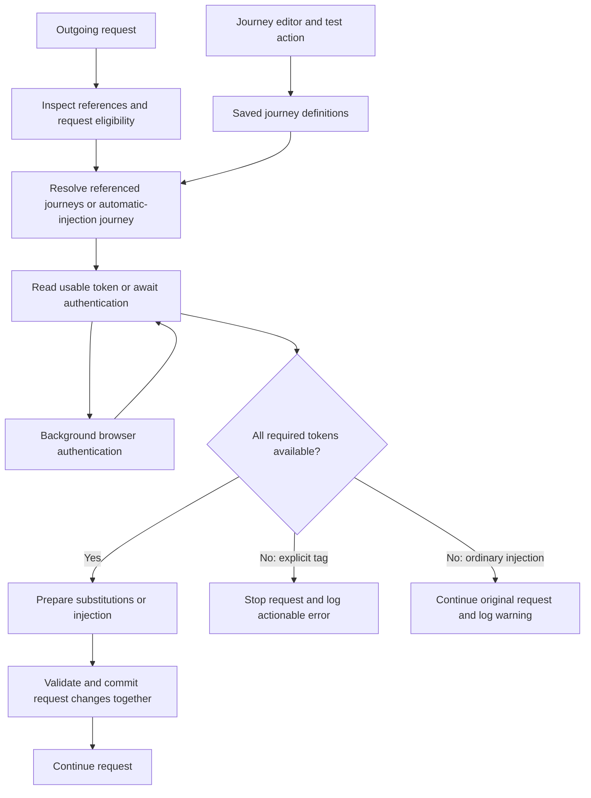
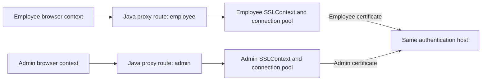

# BApp-owned authentication journeys and request tags

* **Author:** rfrisch
* **Status:** Approved - finalized by the author on 2026-11-04; EGM design review complete; implementation acceptance remains outstanding
* **Date:** 2026-11-03
* **Predecessor:** [Reviewed concept brief](../../concepts_brief.md)
* **Review evidence:** [Brainstorm report](../../goldfish_review_report_brainstorm.md); [Final readiness review](../../implementation_readiness_report.md); [Review completion record](../../egm_review_completion.md)

## Overview

Users configure, test and save browser authentication journeys in the Java Burp extension. The BApp manages login, extracts the resulting session token, and makes it available to outgoing requests. A saved journey can be referenced by a tag in a request, allowing users to test different identities without an API-backed Hackvertor tag.

The replacement removes the separate Python service from the normal runtime. The user selected Java-owned per-journey upstream TLS and dedicated LittleProxy 2.9.1 endpoints for mTLS-enabled journeys, with Playwright-managed Chromium for every journey. Ship platform-specific JARs containing the matching browser/helpers and platform driver/Node resources. First use extracts a verified local cache; no browser download occurs during setup. An optional explicit login proxy is supported, empty meaning direct; automatic Burp proxy discovery/reuse remains excluded. Ordinary journeys use Chromium directly or through that proxy without LittleProxy or PKCS#11 initialization. Vendor middleware remains necessary for mTLS and is used by Java. Scratch prototypes demonstrate bounded identity isolation with SoftHSM2 and both installed Chrome and managed Chromium; packaged BApp/Burp, proxy chaining and physical-device compatibility remain unverified.

Hardware-token authentication must support a configured PIN and explicit selection of the intended certificate when multiple certificates are available. The current Firefox/PKCS#11 workflow is evidence to compare against, rather than a required architecture.

## The Problem

The current extension depends on a Python service using FastAPI and Playwright. Its installation button cannot supply the Python interpreter, and hardware-token authentication depends on experimental Windows dialog automation and manual Firefox module setup. API-backed Hackvertor tags introduce another dependency for the advertised per-user token workflow.

The supplied application review also identifies blocking Swing operations, incomplete resource cleanup, ignored token expiry, and unrestricted response-body inspection. Replacing the API boundary must address these behaviors rather than reproduce them inside Java.

Waiting for authentication is intentional. An eligible request without a usable token must wait for the authentication outcome. The important distinction is how failures affect ordinary automatic injection versus explicitly selected journey tags. A request naming a journey must never be silently sent with unresolved or partially substituted tags.

## Goals

1. **Manage authentication in the BApp.** Users can configure and test a journey without starting a separate Python API. Required browser or vendor setup is explained through actionable setup feedback.
2. **Automate supported hardware-token logins.** Once configured, PIN entry and selection of the intended certificate require no interaction during login. Missing or ambiguous selection fails visibly. Support claims require a successful demonstration with the relevant device and platform.
3. **Save and reuse authentication journeys as native tags.** Users can save more than one journey and reference a particular journey in requests without Hackvertor for this workflow. Tokens, browser sessions and refresh results must remain associated with the intended identity.
4. **Preserve the agreed waiting behavior.** When an eligible request has no usable token, it waits for authentication within a defined deadline. Successful authentication supplies its token. Ordinary automatic-injection failure or timeout forwards the original request and logs a warning.
5. **Stop explicitly tagged requests on resolution failure.** Resolve all references before committing substitutions. If any reference is unknown, invalid, deleted, fails authentication or times out, stop the whole request. Do not transmit literal unresolved tags or a partially expanded request.
6. **Explain failures and recovery.** A tagged-request error states that the request was not sent, identifies the journey/reference and failed phase, explains the known cause, and gives a concrete next action. Unknown causes remain explicitly unknown. PINs, credentials and tokens are excluded from logs.
7. **Address the review's supporting requirements.** Keep blocking work off Swing's event dispatch thread; respect token expiry and configured refresh behavior; coordinate callers without duplicate login storms; bound response inspection; parent dialogs to Burp; and release owned resources and waiting requests on unload. The Detailed Implementation specifies the numeric limits and mechanisms.
8. **Explain manual upgrade setup.** Preserve useful login, extraction and request-selection behavior, but provide no legacy configuration/tag importer or profile reuse. Users recreate journeys and replace old request tags manually. Leave original stored data and user-owned files untouched, and document that API-backed tags require replacement.

## Non-Goals

* PKCS#12 certificate support in this migration.
* Retaining the separate Python API as the normal replacement runtime.
* Requiring Hackvertor for the new journey-tag workflow.
* Importing legacy BApp JSON or Hackvertor definitions, converting old request tags, or reusing old Firefox profiles. Native-format journey import/export remains supported.
* Literal-tag escaping, doubled-at unescaping or a literal block. Ordinary text within encoding wrappers remains supported.
* Universal hardware-token or operating-system compatibility without demonstrated support.
* Multiple production browser/TLS backends before evidence establishes a need.

## Outstanding Verification

The Detailed Implementation section supplies the approved design contracts. Finalization reconciliation found no unresolved contradiction with the user decisions in the predecessor brief. Additions made concrete during drafting include the User-Agent marker carrier, Bouncy Castle certificate builders, Commons Compress extraction, an initial HTTP/CONNECT/Basic upstream proxy contract and request-local ordinary cookie injection. Section approval covers these additions; it is not evidence of implementation or completed acceptance tests. The remaining items below are runtime verification requirements.

* **Marker integration:** Use a base-agent-preserving User-Agent suffix plus route override. It changes the owned context's agent and may be visible to destinations; request signatures/dedicated listeners remain excluded. The exact final suffix and Burp stripping still need integration tests. WebSocket frames are outside extension handling; only opening requests delivered to its HTTP hooks need recursion exclusion.
* **mTLS and proxy integration:** Direct SoftHSM2/managed-Chromium isolation is demonstrated within documented bounds. The plan specifies provider/key/process lifecycle and an initial HTTP/CONNECT/Basic upstream contract. Verify chained isolation, strict upstream trust, ordinary journeys avoiding the native layer, cancellation and packaged host behavior. Physical/vendor compatibility remains unverified.
* **Packaged deployment:** Safe extraction/version/manifest/cache contracts are specified below, replacing runtime downloads. Actual platform JARs, offline startup and classloader/resource/provider behavior remain release gates on each claimed platform.
* **Burp request behavior:** The selected baseline is Montoya/Burp 2026.4 with Java 21. Verify real-tool stopping with zero origin hits, editable repeated templates, all selected tag locations, self-traffic/manual-interception exclusion, response attribution and unload. The desktop-helper failure is not a passed host test.
* **Implementation verification:** Test the schema, alias/reassignment/import rules, text/size/proxy limits, finite deadlines/retries, secret/backup behavior and certificate/archive dependencies below. The one-second UI debounce remains local/background work. Legacy conversion/profile reuse, automatic Burp settings changes and runtime browser installation remain excluded.

## Technical Plan (Architecture)

### Established flow and logical responsibilities

The BApp must own saved journey definitions, authentication execution and token state. The responsibilities below summarize the ownership model; Detailed Implementation items 2 and 3 specify the classes and storage contracts.

The logical responsibilities are:

| Responsibility | Data and operations it owns | Integration with existing code |
| --- | --- | --- |
| Journey registry | Unique aliases, display names, definitions and configuration versions; validated save/import/delete. | Evolves `Config`/`ConfigManager`; UI selects a saved journey rather than mutating one global auth definition. |
| Authentication coordinator | Per-journey token validity, shared authentication attempt, refresh, wait deadlines and outcomes. | Replaces the API-shaped acquisition/cache path behind `LocalTokenCache`; callers do not launch browsers directly. |
| Journey mTLS transport | Dedicated loopback endpoint, local browser access, PKCS#11 identity, TLS context and upstream pools for one active mTLS-enabled journey, with optional explicit upstream proxy. | Replaces the native-dialog helper; ordinary journeys bypass this component, and Burp's TLS rules are not altered. |
| Browser flow runner | Browser lifecycle, journey steps and response/cookie extraction through the journey transport. | Ports the useful behavior from Python browser/auth/extractor code through the selected Playwright Java controller; packaged integration remains to be verified. |
| Native tag and request processing | Native reference parsing, encoding wrappers, atomic substitutions, stopping/errors and response attribution. | Extends `HttpSessionHandler`; does not call Hackvertor or the Python API. |

This table describes ownership; Detailed Implementation items 2 and 3 specify the concrete classes and persistence schema. The UI submits test/save actions and displays outcomes; it is not another token owner. `Extension` composes the responsibilities and owns shutdown.



**Selected self-traffic policy:** use one random, short-lived marker per actual authentication attempt when an explicit upstream proxy is configured. The owned browser reuses it across requests and redirects. The global outgoing handler checks it before token acquisition/injection/waiting, stops recognized native tags instead of recursively resolving or forwarding them, removes the marker and continues without automatic credential changes. Global request/response message IDs provide bounded response-recovery exclusion. Stale/unknown reserved markers stop with a useful retry/remove-marker error. Expire the marker on cleanup; keep response IDs briefly for late responses. No host-wide exemption or global login-in-progress bypass is selected. The selected carrier in Detailed Implementation item 7 uses a User-Agent suffix rather than the earlier dedicated-header prototype.

This is a recursion guard in user-controlled Burp, not an authentication/security boundary. The user accepted that an active marker can be copied to suppress extension handling and can reach destinations through external or TLS-passthrough proxy paths. Do not include credentials, PINs, tokens or stable user identity in it, and do not log/persist/export it. A dedicated-listener requirement, HMAC signatures, request-bound proofs and CDP signing were not selected. Direct attempts with no upstream proxy need no marker. Narrow Proxy hooks can keep marked login messages out of manual interception using doNotIntercept, without changing master interception; track IDs independently in each hook family. The global handler remains the owner of ordinary/tag processing for all tools.

The initial browser probe passed seven normal HTTP checks using route header overrides, including redirects, popup/frame requests, cross-origin fetch and context isolation. Context-wide custom headers introduced a CORS failure. A follow-up found a missing custom marker on the WebSocket handshake; context userAgent plus route override marked the tested initial/redirect/fetch/frame/popup/service-worker requests and handshake without an added preflight. This is a bounded carrier test, not a successful WebSocket session or a Burp integration test. The final exact suffix, HTTPS, actual Burp handling and mTLS proxy chaining remain required checks. Preserve explicit no-auto-download initialization before creating Playwright; the first scratch launch omitted it and triggered developer-machine cache downloads. Details and source evidence are in the decision note.

### Raw tag contract and request mutation

Saved journeys expose unique readable tag aliases, separate from their display names. A display-name edit leaves references unchanged; an alias edit requires updating affected request templates. Public tags do not use generated immutable IDs. The Detailed Implementation uses internal UUIDs plus generations for state ownership and explicit retirement/reassignment to avoid silently switching an existing alias to another identity.

**Selected alias comparison:** lookup and uniqueness use locale-independent ASCII case folding across the project and library. Employee and employee reference the same alias and cannot identify separate journeys. Preserve the entered spelling for display and Copy tag; a case-only edit does not change identity or break existing references. Apply the same canonical key to save, import, rename, load/conflict detection and request resolution. Preserve but block conflicting loaded definitions until explicitly resolved; never pick a winner. This does not silently change the case rules for namespace or wrapper names.

The author selected both project-scoped storage and a user-wide library, with aliases unique across the current project and library. There is no shadowing or override order. Saving/importing explicitly identifies the destination; the UI labels scopes and validates collisions. Preserve conflicting definitions found on load/import, report ambiguity and stop that alias until explicitly resolved. Do not scan unrelated project files or choose an identity silently. Project journeys use Montoya extensionData; without a project file they are in memory, and the UI must explain that lifetime. The user library uses a versioned JSON file with a separate edit lock, disk-version validation, temporary sibling/atomic replacement, defined backup recovery and external-change detection. Corrupt/unreadable data, lock timeout and failed atomic writes must not discard the prior library. Resolve references to scope/identity/configuration snapshots and keep runtime state separate between definitions.

Each journey has an unchecked-by-default Remember secrets control. Persist passwords/PINs only when selected, regardless of scope; otherwise retain them for the session and show an actionable missing-secret result after reload. Storage does not add an extension encryption guarantee. Exports omit secrets by default and have a separate explicit Include secrets choice, never preselected from Remember secrets. Included values are readable; unavailable secrets must not be invented or a partial export called complete. Native-format imported journeys default to session-only secrets until the user opts into remembering them. Live tokens/sessions, runtime proxy addresses/credentials/keys and hardware private keys are excluded. Detailed Implementation item 2 specifies cleanup of previously persisted values when disabling remembrance. Do not load legacy secrets or reuse the old persistence key: the user selected manual recreation without legacy imports.

A resolved tag inserts raw token text by default. The author selected the colon namespace: `Authorization: Bearer <@bpsh:employee/>` retains the user-supplied Bearer prefix, and `Cookie: session=<@bpsh:employee/>` retains its cookie name. `<@bpsh:url><@bpsh:employee/></@bpsh:url>` explicitly URL-component-encodes the inner result; bpsh:form and bpsh:json provide the other selected modes. No surrounding authentication syntax or encoding is inferred. Literal-tag escaping is excluded: implement neither doubled-at unescaping nor a literal block. Recognized native syntax resolves normally or stops the whole request on failure; token output is never parsed again. Detailed Implementation items 3 and 9 specify allowed alias characters and parser limits. The BApp parses tags itself; full Hackvertor compatibility or its general engine is not implied. Colon is outside the reviewed Hackvertor identifier grammar, but actual coexistence remains an acceptance check.

**Selected wrapper composition:** wrappers accept literal text, multiple journey references and nested encoding wrappers, with a maximum depth of eight. Evaluate from the inside out and encode the complete resolved content at each level. For example, `<@bpsh:url>Bearer <@bpsh:employee/></@bpsh:url>` encodes both the literal prefix and the token. Repeated references to one journey use the same token snapshot for that request. Token output is data and must never be reparsed as tag source. Validate the entire structure and all limits before starting authentication; malformed input or a failed reference stops the whole request. Nested wrappers may intentionally double encode and must not be simplified automatically.

Tags must be recognized and validated before authentication is started. Resolve every distinct required journey and prepare all replacements before committing any changed request. Repeated references to the same journey within one request must not acquire inconsistent token versions. If any reference fails, stop the whole request without sending partial results. Unknown or deleted references produce a direct configuration error instead of launching a browser.

Supported locations are header values, textual bodies, URL paths and query parameters. This does not authorize parsing arbitrary binary bodies as strings, changing scheme/authority/method, or inserting invalid header bytes. Preserve bytes outside recognized replacements and update message length after body changes. Detailed Implementation item 9 specifies byte-handling and text-format policies.

Encoding must be explicit rather than inferred from placement. The user selected all three modes: URL-component percent encoding, form encoding and JSON-string escaping. Spaces and reserved characters must follow the selected mode: URL-component spaces use `%20`, while form spaces use `+`; JSON escaping does not add surrounding quotes. Each wrapper transforms its complete resolved content; bytes outside the wrapper remain unchanged. Unknown encoding modifiers must fail before sending. Detailed Implementation item 9 specifies the wrapper grammar; no runtime capability is claimed.

**Selected by the user: tag-only handling, independent of URL scope, from every supported Burp HTTP tool including Proxy.** Detect native references before ordinary injection's enable/tool/URL-scope early returns. Resolve them without using those filters and skip ordinary injection for the entire tagged request, including automatic Authorization/Cookie changes and shared-cookie-jar updates. Preserve other pre-existing credentials. Untagged injection retains its controls. The user chose all-tool resolution after the page-generated trigger risk was explained; do not claim tags are necessarily manually authored. Internal authentication traffic remains excluded from recursion. No enforcement is possible after unload.

The following comparison is retained as decision history. Field-aware combined handling was not selected.

| Routing candidate | Mechanism | Trade-off and failure condition |
| --- | --- | --- |
| Tag-only handling for a tagged request | Once native journey tags are recognized, resolve them and skip ordinary automatic injection for that request. | Preserves explicit identity placement and keeps routing simple. It does not also add an unrelated automatic credential that the user omitted. Users requiring combined credentials must represent them explicitly. |
| Field-aware combined handling | Resolve tags, then permit ordinary injection only in authentication fields not controlled by tag placement. | Supports combined authentication without explicitly tagging every credential. Requires precise placement/provenance rules; otherwise a global Authorization header or shared cookie state can mix identities. |

### Waiting, cache and refresh constraints

Token validity and authentication results must be associated with a saved journey and the version of its configuration. Old login results must not replace a newer configuration's token. Response-based invalidation must identify the journey/token actually used by the request rather than whichever journey is currently selected in the UI.

The coordination design must share authentication work across concurrent callers for the same journey, respect JWT expiry and refresh skew, and separately define opaque-token lifetime. A request-wide deadline must include queueing and all required journeys; multiple tags must not multiply a full timeout indefinitely. Proactive refresh may reduce waiting, but cannot replace the agreed wait-on-missing-token contract. Detailed Implementation item 8 specifies cache ownership, scheduling, concurrency limits and deadlines. Waiting-request limits are optional advanced settings: a global limit and a uniform per-journey limit, each independently either a positive number or Unlimited. Both default to Unlimited pending post-implementation stress testing. Finite limits use non-blocking admission; exceeding an enabled limit is an explicit capacity failure with the existing ordinary unchanged-warning/tagged-stop outcomes. Admitted callers keep their shared attempt and original deadline. The browser-worker and distinct-cycle queue limits remain finite even when request-waiter limits are disabled. No measured Burp capacity or UI-freeze claim follows from this policy.

**Selected refresh behavior:** maintain separate refresh-due and expiry/cache-age boundaries. Start background authentication early while continuing to serve the previous token until expiry/cache-age limit, explicit invalidation or configuration change. Publish the new token atomically on success. A failed refresh alone does not invalidate an otherwise usable token. When no usable token remains, requests wait for the shared attempt and retain the agreed ordinary-warning/tag-stopping outcomes on failure or timeout. A response rejecting an older token must not invalidate a newer replacement.

Every pending caller must reach an outcome on failure, timeout, configuration change or unload. A timeout from one caller must not cancel authentication still required by other callers. Explicit PIN rejection requires a recovery policy that prevents repeated submissions from exhausting device retries.

**Selected retry behavior:** automatically retry positively classified temporary authentication/network failures with increasing delays and a finite limit. The detailed-plan defaults are three retries after the initial attempt, with 5, 15 and 30 seconds of backoff. One shared cycle owns those attempts/timers for a journey and configuration generation. Close each failed attempt's browser context/resources, schedule delays without holding a worker, and have callers share the cycle within their original request-wide deadline. A caller timing out does not cancel shared work. Exhausting retries completes the cycle and displays a recoverable failure; do not immediately restart it from the same past-due refresh timer. New demand without a usable token may start a new cycle after a cooldown, or the user may explicitly Retry. A new successful token resets transient-failure state. Detailed Implementation item 8 specifies the deadline and cooldown settings.

Missing setup/secrets/certificates and definite PIN/credential rejection are not temporary network failures. Pause automatic PIN resubmission after a definite rejection and require explicit recovery; other journey attempts using that selected token must not bypass the pause. Do not infer an incorrect PIN from an ordinary timeout or generic TLS error, or automatically retry an unknown outcome during PIN submission. Cancelling/replacing a journey or unloading the extension cancels backoff timers and rejects late publications.

**Selected response-body matcher:** RE2/J 1.8, with content-type and 64 KiB body guards before decoding. Compile/validate patterns when configuration is saved and reject unsupported constructs with a useful error rather than silently fall back to Java regex. Preserve find-style and DOTALL behavior for supported expressions. Proposed detailed-plan limits are a 4 KiB expression and 10,000 compiled instructions. Apply recovery only to the attributed journey/token version and skip responses with no reliable attribution. Status-code detection remains available; native-tag parsing and JSON-path extraction do not use this regex engine.

### Browser and hardware-token feasibility

**Selected browser-state lifetime:** create a fresh isolated browser context for each authentication attempt and close it after extraction, failure or cancellation. Do not reuse cookies/storage between attempts, load a previous storage-state snapshot, or persist browser sessions. Reuse valid cached tokens without a new attempt and reuse the extracted bundled Chromium installation. Journey steps must support clean browser state, while allowing for automatic certificate login or server-side redirects. Closing a context must not log out a native-token provider shared by other journeys or Burp. Remove only attempt-owned temporary browser artifacts during cleanup.

The user selected Java-owned upstream TLS as the design direction after questioning Burp's same-host identity isolation and Firefox setup overhead. The following comparison records decision history; packaged BApp/Burp integration remains unverified:

| Candidate | Mechanism | Trade-off and failure condition |
| --- | --- | --- |
| Browser owns hardware mTLS | Use a browser profile configured for the token and automate its PIN/certificate interaction. Firefox/PKCS#11 is the existing case. | Reuses the current approach, but native prompts and vendor setup may remain platform-specific or unsuitable for unattended use. |
| Burp owns upstream mTLS | Route the authentication browser through Burp; configure Burp's hardware certificate for upstream TLS. | Can avoid browser-native certificate prompts, but full BApp-driven configuration and same-host identity isolation remain unproven. Shared host rules may affect unrelated traffic. |
| Java owns token-backed TLS | Integrate a Java hardware-token TLS client with a browser-facing transport. | May allow explicit certificate/PIN control, but adds transport responsibilities and must prove browser, redirect, identity and protocol compatibility. It is not a simple replacement for the browser's TLS stack. |

The Burp-owned candidate was investigated first. Its documented host rules choose the first matching certificate; current Montoya request options expose no certificate identity selector. This does not establish journey-specific upstream identities for two certificates at the same host. Separate browser profiles or proxy listeners alone are insufficient evidence. Serially changing shared host rules remains an unselected workaround with unrelated-traffic and connection/session reuse concerns. See [the investigation note and primary sources](../../design_decisions.md). The user subsequently selected Java-owned TLS instead; this is not a claim that every possible Burp workaround is impossible.

### Java-owned TLS and the browser transport boundary

**Selected transport split:** LittleProxy is used only for mTLS-enabled journeys. Without mTLS, Chromium connects directly or uses the configured explicit proxy through Playwright; do not load PKCS#11, request a PIN, create a BApp proxy listener/certificate or add the BApp proxy-key exception. With mTLS, use Chromium -> journey LittleProxy -> optional configured upstream proxy -> destination, keeping Java's TLS connection end-to-end through any upstream CONNECT tunnel. Empty proxy means direct in either mode; proxy failure must not silently change routes. A Burp listener used upstream must pass destination TLS through for mTLS. Non-mTLS interception retains normal browser trust and still needs precise authentication-traffic exclusion. The identity diagram below shows the mTLS path; fresh contexts, step execution, extraction and token policies apply to both modes.

The BApp configures a PKCS#11 provider, logs into the chosen token using the configured PIN, and resolves the selected certificate/private-key entry. The native PKCS#11 module remains a vendor prerequisite; Java does not include the vendor implementation. Java must have the `jdk.crypto.cryptoki` module available. [Java PKCS#11 reference](https://docs.oracle.com/en/java/javase/21/security/pkcs11-reference-guide1.html).

Use explicit journey-owned key/trust configuration rather than JVM-wide default SSL settings or changes to Burp's TLS host rules. Certificate selection must be pinned to the configured certificate identity and checked against handshake compatibility. An `X509ExtendedKeyManager` can supply the selected alias for a socket/SSLEngine handshake; it must not fall back silently to a different certificate. [Java key-manager API](https://docs.oracle.com/en/java/javase/21/docs/api/java.base/javax/net/ssl/X509ExtendedKeyManager.html).

Each journey needs its own TLS identity and upstream connection/session-pool ownership. A connection authenticated as employee must never be reused for admin even at the same host. Restrict client-certificate presentation to configured authentication origins, including explicitly allowed redirect origins. Share neither the JVM default SSLContext nor a mutable global selected-alias variable. Separate TLS contexts do not prove separate native-token login state; same-module/device concurrency and logout need a provider-level lifecycle policy so closing one journey cannot invalidate another's token session.

A normal browser does not use a JVM SSLContext. The proposed browser-facing boundary is an in-process, loopback-only HTTPS interception proxy managed by the BApp. It terminates browser-side TLS and establishes independent upstream TLS using the journey's context. A plain CONNECT tunnel only relays encrypted bytes and cannot substitute the client certificate. This transport is authentication infrastructure, not a reintroduction of the separate Python token API.



Playwright supports per-browser-context proxy configuration. [Playwright Java networking](https://playwright.dev/java/docs/network). Mapping a browser context to a proxy route must be immutable for that authentication attempt. The local proxy endpoints are not additional certificate selectors inside Burp: the Java proxy itself owns the upstream identity and pools.

**Selected mTLS routing: dedicated loopback endpoint per active mTLS-enabled journey.** The browser uses only its journey's endpoint, and that endpoint remains bound to the same configuration version, selected certificate, TLS context and upstream pools while the attempt runs. Concurrent requests waiting for the same journey share its authentication attempt rather than creating one endpoint per intercepted request. A new journey/configuration must not inherit another's authenticated connections. No such endpoint is created for an ordinary journey.

Detailed Implementation items 6, 8 and 11 specify ephemeral port allocation, per-attempt local access credentials, creation limits and cleanup order. Stop accepting new work during shutdown, close the owning browser, cancel outstanding transport work and close listeners/pools; verify old browser work cannot reach a newly assigned identity even if a port is later reused. Do not persist ephemeral endpoint addresses or access credentials in request tags or saved journey definitions. Loopback binding alone is not authorization for use of a client certificate.

Browser-side trust and upstream trust are separate. **Selected by the user: a generated BApp proxy-key SPKI exception in BApp-owned managed Chromium processes/profiles.** Configure only BApp-generated keys, preserve strict upstream Java CA/hostname validation and certificate-destination controls, and do not install an OS/browser CA by default. Neither a broad ignore-certificate-errors flag nor Playwright ignoreHTTPSErrors is selected. The managed-browser prototype passed and rejected an unlisted proxy key. This is not conventional CA validation: Chromium exempts matching presented chains from verification. Detailed Implementation item 6 specifies key-generation dependencies, key lifetime and owned browser-process/profile lifecycle; maintain negative trust/bypass regression checks. See the decision note and source-backed report.

**Selected proxy implementation: io.github.littleproxy:littleproxy:2.9.1.** Use the released artifact from the passing bounded same-host identity-isolation prototype, with independently bootstrapped instances and journey-owned TLS contexts. Implement the journey-specific MitmManager around its TLS hooks rather than building a new proxy directly on Netty. Protocol coverage, missing-module/PIN/cancellation behavior and Burp packaging still require verification rather than treating token retrieval as complete browser integration.

During implementation-plan preparation, the maintained `LittleProxy/LittleProxy` source was checked, then the released 2.9.1 source and runtime were tested in a scratch project. Its MitmManager hooks carried separate journey SSLContexts using two certificate entries from one SoftHSM2 token. Two actual Chrome contexts reached the same authentication host; all 127 server-observed fingerprint checks matched their journeys. Persistent upstream reuse and resumed TLS sessions did not mix identities, and stopping one proxy left the other working. Cross-endpoint credentials were rejected. The [verification report](../../littleproxy_identity_verification.md) records source references, evidence and conditions. The user then selected LittleProxy; no BApp dependency or production source has yet been changed.

The final passing matrix used bounded concurrency and a temporary Chrome SPKI exception for browser-side local proxy trust; upstream CA and hostname verification remained enabled. Earlier higher-concurrency variants had unresolved connection failures. These results establish a feasible tested identity boundary, not general load capacity, finalized browser trust or safety of shared provider registration/login/logout inside Burp's JVM.

For any selected candidate, verify PIN entry, intended-certificate selection among multiple certificates, login, token extraction, and a protected request using SoftHSM2. Include missing/ambiguous certificates, rejected PIN, unavailable software token, redirects and cleanup. Browser controller and browser ownership are separate decisions; attaching to Burp's built-in browser is not implied by using Burp for upstream TLS.

### Available test evidence and its limits

SoftHSM2 is the only available PKCS#11 fixture; the user has no access to physical tokens for testing. It is a test dependency, not the production identity architecture. Production configuration must allow the selected integration to use an appropriate PKCS#11 provider/middleware rather than hard-code a SoftHSM module or test PIN.

Use a repeatable software-token setup containing at least two distinguishable client certificates. Verify selection against what the test server actually receives, not only what the client reports. Demonstrate login and a subsequent protected request with an issued test token, refresh/expiry behavior, concurrent callers and a failed journey's request-stopping behavior. Keep test-server Python dependencies separate from the extension's normal runtime requirements.

With explicit user authorization, the test fixture has now been updated: `test/mTLS-app/mtls-app.py` issues short-lived signed tokens using the SHA-256 fingerprint of the certificate actually received. A separate loopback HTTP `/protected` listener validates those tokens without requiring a client certificate. The mTLS root URL remains a token-issuance alias. The fixture's README documents setup and compatibility.

`test/mTLS-app/test_mtls_app.py` passes eight automated checks using temporary PEM certificates and ephemeral ports: real certificate-to-token-to-protected-request identity, same-CN certificate separation, exact expiry/fresh login, malformed/missing/tampered tokens, a different issuer key, missing/wrong-purpose certificates and route behavior. These are fixture checks, not a browser, PKCS#11, Burp-hook or physical-device demonstration. Test run: `python -m unittest discover -s test/mTLS-app -p test_mtls_app.py -v` (8 passed). It does not validate BApp proactive refresh or tag stopping; those still need integration tests.

SoftHSM2 can establish the implemented software path; it cannot establish reader/card behavior, physical removal/reinsertion, PIN-pad/touch policies, vendor-specific mechanisms or real-device retry/lockout handling. Keep physical-token support explicitly unverified and retain conservative rejected-PIN handling. Lack of hardware must not prevent completing software implementation/testing, and success with a software fixture must not become a universal hardware-support claim.

### Burp integration, UI and lifecycle constraints

Use a supported request-stopping action on a verified Montoya/Burp baseline. The user permits an API upgrade. Current documentation provides `RequestToBeSentAction.drop()`; the project's pinned 2025.11 interface appears to lack it. [Evidence and verification limits](../../design_decisions.md) remain explicit. A dependency upgrade alone is not a runtime demonstration for all supported tools.

The selected implementation baseline is Montoya 2026.4 and Burp 2026.4 with Java 21: the tagged API source and matching Burp release document global request dropping. Compile against that API without bundling it, check host capability before enabling hooks, and verify stopping in real supported tools. Keep older Burp versions outside the supported replacement baseline rather than silently forwarding unresolved tags.

Browser setup must not require a separate Java executable. The selected packaging now extracts browser/helper/driver assets from a platform-specific JAR locally rather than invoking a browser-download installer. A prior scratch probe extracted Playwright's bundled driver/Node and ran version/install dry-run commands with empty child PATH and no JAVA_HOME without terminating its host JVM; this is historical driver feasibility evidence, not the new deployment test. Never invoke Playwright CLI.main in Burp: its normal path calls System.exit. Isolate any pinned internal driver adapter and launch the owned Node driver/browser as child processes after verified local extraction. Verify the actual packaged JAR offline, cache reuse, cancellation and cleanup; source references and evidence are in the decision note.

This removes an additional end-user Java installation requirement: BApp Java code runs inside Burp's existing JVM, while the extension supplies/manages the bundled Playwright Node driver, Chromium and required helpers for its target platform. Users still need the configured vendor PKCS#11 middleware, loaded by Java rather than configured in the browser. Driver/browser child processes remain part of the architecture; no separately operated Python or token HTTP API is restored. Building the extension still requires developer JDK tooling and fetching pinned release assets.

The UI snapshots edited inputs before background work, keeps browser/network/setup work off Swing's event dispatch thread, and applies display changes on that thread. Configuration changes must not be overwritten by late background completion. Confine Playwright objects and event processing to their owning worker.

Shutdown must stop scheduling/timers, release callers according to their tagged or ordinary-injection outcome, close owned browser/workers, and reject late publications. Resource ownership must cover the new authentication component and UI, not just the retired subprocess.

Errors identify the journey/reference, phase, verified cause and concrete recovery. For tagged requests, they explicitly say the request was not sent. They must not expose token/PIN values or infer an incorrect cause from a generic timeout.

### Existing source responsibilities affected

* `Extension.java`: replace Python service construction/startup and register complete lifecycle cleanup.
* `Config.java` and `ConfigManager.java`: separate retained journey settings from retired API settings and define saved-journey persistence/migration.
* `UiController.java` and `StepsPanel.java`: retain journey editing while replacing API controls and Hackvertor code generation with native saved-journey actions.
* `LocalTokenCache.java`: replace the single-configuration cache with the coordinator specified in Detailed Implementation item 8.
* `HttpSessionHandler.java`: add native reference resolution and stopping behavior, preserve agreed ordinary-injection fallback, and attribute response recovery to the identity used.
* `ApiClient.java`, `ApiServiceManager.java` and Python runtime files: retire normal runtime usage after packaged replacement and migration checks pass.
* `build.gradle.kts`: update Montoya as required and package the selected browser/native dependencies after feasibility checks.

This maps existing responsibilities. The Detailed Implementation contains the complete file-change list, new component files, manual-upgrade rules and acceptance checks.

### Technical Plan review boundary

The independent design review covers this architecture and the approved Detailed Implementation. Outstanding production checks are listed in Outstanding Verification and Detailed Implementation item 12.

## Alternatives Considered

This section uses the predecessor brief's Alternatives Weighed and the subsequent author decisions in [design_decisions.md](../../design_decisions.md). A choice not selected by the author is not described as technically impossible. Pending choices are kept separate from rejected alternatives.

### Retain the Python API and patch installation/lifecycle

* **Benefits:** Reuses the existing browser flow and token API. Installation, error reporting, Swing calls and cleanup could be fixed without a full language migration.
* **Costs:** Python must still be supplied on the host, the extension must manage another process and HTTP boundary, and Java/Python token ownership remains divided.
* **Disposition:** Rejected by author: authentication should run through the BApp instead of a separate API. The design retires that normal runtime after the replacement and migration checks pass. Python-based test fixtures remain allowed and are not extension runtime dependencies.

### Keep API-backed Hackvertor tags as the per-user integration

* **Benefits:** Preserves the advertised workflow and existing transformation ecosystem.
* **Costs:** Generated tags currently contain independent per-user configuration and call the retiring Python endpoint. Preserving those calls would require a replacement boundary rather than merely replacing the active BApp cache. It would also retain Hackvertor as a dependency for this workflow.
* **Disposition:** Rejected by author for the replacement workflow: save journeys in the BApp and reference them with native tags. Hackvertor-like notation is selected for familiarity; full Hackvertor implementation or compatibility is not implied. The user declined both legacy importers; users recreate journeys and replace references manually, with original data left untouched.

### Let Firefox own the hardware-token certificate and PIN interaction

* **Benefits:** Builds on the existing PKCS#11/browser-profile approach and leaves browser protocols with the browser.
* **Costs:** Existing setup requires vendor-module configuration inside Firefox. The Windows helper automates native PIN/certificate dialogs; Java migration alone does not remove those dialogs, platform-specific dependencies or configuration requirements.
* **Disposition:** Not selected by author: the user preferred Java-owned TLS because the Firefox path still needs substantial configuration/install work. The selected approach moves certificate selection and PIN handling into Java, but still requires the vendor PKCS#11 module and a verified browser-facing transport. No claim of universal unattended hardware compatibility follows from this decision.

### Let Burp own upstream mTLS through its certificate host rules

* **Benefits:** Reuses Burp's existing PKCS#11 integration and may avoid native browser certificate dialogs.
* **Costs:** The documented rules select a certificate by destination host, not by journey. Reviewed Montoya request options expose no client-certificate selector. That does not establish different upstream certificates for two journeys authenticating against the same host. Changing shared settings also raises unrelated-traffic and connection/session-reuse concerns.
* **Disposition:** Investigated first at the author's request, then superseded by the author's Java-owned TLS selection. The investigation did not establish the needed same-host identity isolation; it did not prove every conceivable Burp workaround impossible. Serial rule changes and adding another listener are not accepted substitutes for a demonstrated identity boundary. Sources and their limits are recorded in the decision note.

### Use PKCS#12 client-certificate files

* **Benefits:** File-based certificate/private-key material can avoid native device-session and PIN-dialog integration.
* **Costs:** Does not address the requested PKCS#11 token workflow or the requirement to use configured token PINs and certificate selection.
* **Disposition:** Excluded by author for now. Temporary PEM certificates used to verify the local server fixture do not add PKCS#12 product support or establish PKCS#11 client compatibility.

### Share one local proxy endpoint across all journeys

* **Benefits:** Uses fewer listener ports. Journey-specific proxy credentials could select isolated routes behind that listener.
* **Costs:** Routing must preserve authenticated identity across CONNECT, keep-alive and pooling, reject stale/cross-journey credentials, and ensure that destination host alone is never the pool key.
* **Disposition:** Not selected by author; dedicated loopback endpoints per active journey were selected instead. The author chose the dedicated model without stating a separate rationale. Its design advantage is a direct endpoint-to-journey ownership boundary; its cost is more listener lifecycle and capacity management. Separate endpoints still need isolated upstream TLS contexts/pools and local access control.

### Forward requests immediately when no usable token exists

* **Benefits:** Avoids request-handler waiting and reduces the number of blocked callers during login.
* **Costs:** Requests can leave before the authentication result is known, violating the requested behavior for token-dependent traffic.
* **Disposition:** Rejected by author: eligible requests without usable tokens must wait. A bounded shared attempt and proactive refresh are supporting mechanisms, not replacements for waiting. Ordinary automatic-injection failure/timeout forwards unchanged with a warning; explicit native-tag resolution failure stops the whole request with an actionable error. Partial expansion, removing a failed tag, or substituting an empty value is not the agreed fallback.

### Other tag-interface alternatives

The following alternatives were discussed in the decision notes. The author selected the stated replacement behavior; technical trade-offs below explain the difference without inventing an author rationale.

| Alternative not selected | Selected behavior | Trade-off carried into the design |
| --- | --- | --- |
| Typed output that inserts Bearer prefixes or cookie names | Raw token text by default, with explicit URL-component/form/JSON-string encoding wrappers. | The caller supplies surrounding authentication syntax; encoding is explicit and does not infer context or add JSON quotes. The later encoding decision refines the initial raw choice rather than reintroduces automatic credential formatting. |
| Encoding arguments on journey tags | Enclosing transformation wrappers in the colon namespace, supporting ordinary text, multiple references and nesting up to depth eight. | Validate the whole structure before authentication and evaluate from the inside out; literal-tag escaping is excluded; Detailed Implementation item 9 specifies the remaining parser size limits. |
| Brace notation or attribute-style XML tags | Hackvertor-like `<@...>` notation. | Familiar appearance does not resolve ownership conflicts with installed Hackvertor; native recognition and migration remain explicit design work. |
| Generated immutable IDs as public request references | Unique readable aliases separate from display names. | Display-name changes preserve references; the Detailed Implementation uses internal UUIDs/generations and explicit alias retirement/reassignment without changing public tag references. |
| Ordinary automatic injection after resolving explicit tags | Tags-only handling for the whole tagged request. | Protects explicit placement from the extension's global injection path; existing user-supplied credentials remain intact. |
| Limit tag resolution to automatic injection's URL scope | Resolve explicit native tags regardless of URL scope. | Native recognition occurs before ordinary enable/tool/URL-scope filters; those filters do not restrict native resolution. Unrelated markup does not trigger authentication. |
| Limit tags to headers/text bodies or provide URL encoding alone | Support header values, text bodies, URL paths/query parameters and all three chosen encoding modes. | More locations and encodings require explicit byte preservation and output validation; arbitrary binary rewriting is not selected. |

### Selected alternatives and remaining verification

Automatic import of Burp upstream proxy rules, automatic listener discovery and automatic listener creation were explicitly scrapped. The user initially selected explicit-proxy-or-direct setup downloads, then replaced browser downloads entirely with platform-specific JARs containing browser assets. Keep the old download policy only as a constraint if a runtime download is separately introduced; do not retain an unused installer/proxy UI. The user separately selected an optional explicit login proxy, empty meaning direct, and clarified that only mTLS journeys use LittleProxy. Proxy chaining and self-traffic attribution remain verification tasks, not open routing selections.

Playwright Java controlled installed Chrome in the first successful scratch prototype. The author selected managed Chromium, and a follow-up downloaded revision 1248 with Playwright Java 1.64.0 and repeated 127 identity checks successfully. The author then selected the generated-proxy-key exception for browser-side trust instead of CA installation, followed by platform-specific JARs bundling Chromium/helpers for local extraction. The separate browser-download path and a universal browser JAR were not selected. Production trust, extraction and packaged BApp integration remain pending. Installed Chrome/Edge and Burp-browser attachment are not selected; no upstream-maintainer rejection is claimed.

The user selected LittleProxy 2.9.1 after its bounded feasibility experiment. Building a proxy directly on Netty was not selected: it would require owning CONNECT, forwarding, TLS and pooling machinery already supplied by the tested library. Detailed Implementation items 1 through 3, 6 and 9 specify certificate-generation dependencies/key lifecycle, saved-journey storage, secrets/manual-upgrade rules and request-processing limits. Revisit the integration if remaining checks fail.

## Detailed Implementation

This is the approved implementation plan, not a record of production changes or completed acceptance tests. The numbered list is the complete planned change list, including numerical defaults and the marker carrier. All Java source paths remain in the existing default package; this change does not include an unrelated package/layout refactor. A failed integration gate must be reported and resolved before the affected behavior is claimed as supported.

### Buildable implementation phases

These phases govern dependency order and build/test checkpoints. The numbered component items below remain the complete file allowlist and contracts; they are not independent commits executed in numeric order.

| Phase | Work and temporary state | Exit checkpoint |
| --- | --- | --- |
| P1: Build and models | Item 1 build/dependency work and new native model/schema/registry/storage/test files from items 2–3. Extract `AuthStep` without breaking its existing constructors/fields. Add native fields/parsers beside the legacy fields/parser paths in `Config`/`ConfigManager`; keep the existing production entry points using the old runtime for this development phase. No conversion from old data into new journeys. | `classes test` compiles both old callers and new components. Native validation, secret-policy and storage tests pass. Unit tests do not initialize Playwright or download assets. |
| P2: Browser and TLS components | Items 4–7, plus their existing listed integration helpers/tests. Build/test browser ownership, extraction, PKCS#11 and transport without registering them in production HTTP hooks. Existing UI/API operation stays unchanged until P4. | `classes test` passes. Explicit browser/SoftHSM integration tasks exercise production components and report missing required prerequisites as incomplete/failure, not passes. Assets are prepared through the pinned packaging task rather than installed at runtime. |
| P3: Coordinator and request logic | Create the coordinator, token lifetime, tag parser/resolver, recovery and diagnostics from items 8–10. Add caller-admission, retry and Cancel tests. Defer the existing `HttpSessionHandler` integration and legacy-cache deletion to P4. | `classes test` passes using deterministic clocks and fake browser execution. Token generations, atomic tags, admission/release, failure mapping, retries and cancellation assertions pass without touching live Burp. |
| P4: One production cutover | Change `Config`, `ConfigManager`, `UiController`, `StepsPanel`, `HttpSessionHandler` and `Extension` together. Remove the temporary legacy fields/parsers/constructors and delete `ApiClient`, `ApiServiceManager`, `LocalTokenCache` after all callers move. Read only the new project/library formats. Retain old stored data/files for reference, with no runtime fallback or conversion. | `classes test` passes after all legacy callers are removed; source search finds no production API/Hackvertor/Python startup references. A single release snapshot contains the entire cutover, not a mixture of old constructors and new models. |
| P5: Packaging and acceptance | Finish item 12 examples/docs/fixture work, actual platform JARs and explicit browser/PKCS#11/Burp checks. Remove the tracked legacy JAR only at the already specified verified release cutover. | Platform JAR loads offline inside Burp; required native/browser/Burp acceptance passes for each claimed platform. Stress testing runs after the app exists. Publish only after the existing release gates pass. |

Temporary source compatibility exists solely to keep P1–P3 development checkpoints buildable. Do not release it as an alternate backend or add legacy import. Any existing-file field removal that breaks an old caller belongs in P4. New native services must not call legacy normalization to obtain a native definition.

Name the separate Gradle tasks `browserIntegrationTest`, `pkcs11IntegrationTest` and `prepareBrowserAssets`. The default `test` task excludes the two integration groups and never auto-installs browsers. `prepareBrowserAssets` uses the pinned asset lock and is explicit developer packaging work. Generated outputs retain the existing manifest/archive paths; no new implementation files are introduced by these task names.

1. **Pin the runtime and package one browser platform per JAR.**

    | File | Action and reason |
    | --- | --- |
    | [bapp/build.gradle.kts](../../bapp/build.gradle.kts) | Modify: compileOnly Montoya 2026.4, Java 21, Playwright Java 1.64.0, LittleProxy 2.9.1 and RE2/J 1.8; configure JUnit Jupiter 6.1.3 and separate browser/PKCS#11 integration tasks. Add Bouncy Castle bcpkix/bcprov/bcutil 1.86 for certificate construction and Commons Compress 1.28.0 for archive metadata/extraction. Pin resolved transitives. |
    | [bapp/gradle/browser-assets.gradle.kts](../../bapp/gradle/browser-assets.gradle.kts) | Create: fetch pinned release assets during developer packaging, assemble only the requested platform's browser/helpers and driver/Node resources, generate the digest manifest and verify the output JAR. |
    | [bapp/browser-assets.lock.json](../../bapp/browser-assets.lock.json) | Create: exact platform, source URL, revision, archive digest and expected size for each packaged asset. Populate hashes from the actual pinned archives; reject an unlisted/unavailable target rather than guessing a compatible browser. |
    | [bapp/gradle.lockfile](../../bapp/gradle.lockfile) | Create from the resolved dependency graph, so a later build does not silently select different TLS/browser libraries. |
    | [bapp/gradle/verification-metadata.xml](../../bapp/gradle/verification-metadata.xml) | Create: checked dependency verification metadata, separate from browser-archive verification. |
    | [bapp/build/libs/browser-powered-session-handler.jar](../../bapp/build/libs/browser-powered-session-handler.jar) | Delete the tracked legacy unqualified artifact at the verified release cutover; current users must receive an explicitly named platform artifact rather than a stale Python/API build. |
    | [bapp/src/main/resources/browser-assets.schema.json](../../bapp/src/main/resources/browser-assets.schema.json) | Create: document/validate the bundled manifest's target, versions, file sizes, hashes, executable modes and safe relative links. |

    Produce browser-powered-session-handler-<version>-<os>-<arch>.jar from an explicit bundlePlatform build property; default local development to the current supported host target. Preserve the verified Windows x64 browser revision 1248, Chromium 156.0.8078.4, ffmpeg 1013 and winldd 1007 for that target. Use the pinned Playwright registry to obtain each other target's matching assets, not the Windows revisions/executable paths by assumption. Each claimed target needs its own native browser/software-token checks; a packaged but untested target is a candidate artifact, not a support claim. Physical tokens are not required for completing the software checks.

    Keep the existing fat-JAR approach but replace blind duplicate exclusion: merge service-provider resources, retain multi-release class metadata, omit dependency module descriptors and stale signature files, and retain third-party notices under distinct names. Keep Montoya out of the JAR. Use Bouncy Castle's certificate/ASN.1 builders with ordinary JDK RSA signing rather than registering its JCE provider globally. Verify that driver resource directories and the selected Node executable survive packaging. Generated resources are META-INF/bpsh/browser-assets.json and META-INF/bpsh/browser-assets.zip; they are build outputs, not separately tracked browser binaries. Do not alter the Gradle wrapper or unrelated IDE files. The currently tracked unqualified build/libs/browser-powered-session-handler.jar must be retired when platform artifacts replace it; publish verified platform artifacts through the repository's release process rather than silently leave that legacy binary advertised as current.

    ### Browser assets v1 contract

    The source lock, generated manifest, extractor, driver adapter and asset tests implement the same approved format and lifecycle contract below. Actual pinned source hashes/sizes/member paths are release data populated through the verified archive packaging step, not values invented from the examples.

    #### Shared v1 formats

    Use UTF-8 JSON with exact case-sensitive keys, strict types, duplicate/unknown-key rejection and `formatVersion: 1`. Unknown versions fail with rebuild/matching-JAR guidance. Hex digests are lowercase SHA-256. Entry/member/selector paths are relative POSIX paths inside their stated source or bundle root; reject absolute paths, backslashes, drive/UNC forms, empty/dot/parent components and NUL. The explicitly permitted empty source-root selector is an exception. A symlink target may contain relative dot/parent components only if bounded resolution stays inside the declared bundle tree. Do not infer executable paths from PATH, file searches or host browser installations.

    ##### Source lock: `bapp/browser-assets.lock.json`

    Required root fields: `formatVersion` integer 1; `playwrightJavaVersion` string; `platforms` array with unique platform records. Each record requires:

    | Field | Type/meaning |
    | --- | --- |
    | `platform` | Canonical `<os>-<arch>` string used by bundlePlatform, e.g. `windows-x64`; runtime requires exact normalized host match. |
    | `browserName`, `browserVersion`, `browserRevision` | Strings; selected name is `chromium`. Revision is a nonempty decimal string from the pinned registry. |
    | `driverPackageVersion`, `nodeVersion` | Strings read/verified against the selected pinned driver inputs. Do not assume the Java artifact and JS package labels are identical. |
    | `browserRoot`, `browserExecutable`, `nodeExecutable`, `driverEntryPoint` | Exact bundle-relative selectors. The browser root is a directory; the other selectors identify regular files. |
    | `helpers` | Array of `{name, revision, path}` strings. Include required helpers from that platform's pinned registry; Windows includes ffmpeg 1013 and winldd 1007. |
    | `sources` | Array of source records with unique `id`. Each requires `id`, `revision`, `source`, `sha256`, positive integer `bytes`, and nonempty `copies`. |

    `source` is either `{ "type": "https", "url": absolute HTTPS URL without userinfo }` or `{ "type": "maven", "coordinates": "group:artifact:version" }`. Maven sources use the exact resolved artifact covered by Gradle dependency verification. SHA/bytes refer to the complete original ZIP/JAR, before extraction. `copies` is an array of `{ "from": source-relative member prefix or empty root, "to": bundle-relative prefix }`; copy the selected member/subtree contents to the destination. Prefixes are literal, not glob patterns. Reject unmapped/missing required members, duplicate output paths and sources missing from the selected platform record.

    The build verifies original bytes against the lock before creating a new bundle. Source URLs/member paths/hashes are committed release data, not values guessed at runtime. Only the selected platform's Node/browser/helpers go into its asset ZIP. Driver package resources must remain available to the pinned Java adapter; packaging tests verify that actual resource lookup and launch succeed.

    ##### Generated manifest: `META-INF/bpsh/browser-assets.json`

    Required fields: `formatVersion`, `platform`, `playwrightJavaVersion`, `browserName`, `browserVersion`, `browserRevision`, `driverPackageVersion`, `nodeVersion`, the four path selectors and `helpers`, using the lock types above; additionally:

    | Field | Type/meaning |
    | --- | --- |
    | `archive` | `{ "resource": "META-INF/bpsh/browser-assets.zip", "sha256": hex64, "bytes": positive integer }`. |
    | `unpackedBytes` | Nonnegative integer sum of all regular-file byte sizes, checked with overflow-safe arithmetic. |
    | `entries` | Array of unique regular-file/symlink records covering every nondirectory ZIP entry. Directories are implicit parents. |

    A regular-file record is `{ "path": string, "type": "file", "bytes": nonnegative integer, "sha256": hex64, "executable": boolean }`. A symlink record is `{ "path": string, "type": "symlink", "target": nonempty relative string }`; do not allow file-only fields on it. Link payload bytes must equal the UTF-8 target. Its resolved destination must remain inside the bundle, exist in the declared tree and have no cyclic chain. Browser/Node/driver selectors must resolve to regular files; browser/Node files require executable=true. The helper selector identifies a declared file or its implicit parent directory.

    The schema resource describes these lock and manifest variants using one explicit discriminator: lock requires `platforms`; manifest requires `platform` and `entries`. Reject mixing fields from the other variant. Both retain `formatVersion: 1`. Validation tests cover both, with the packaging script and runtime using the same field contract.

    #### Digest and completion semantics

    Let `M = SHA256(exact bundled manifest bytes)` and `A = manifest.archive.sha256`, verified against the exact asset-ZIP bytes. Define the cache bundle digest as SHA256 of these concatenated bytes: UTF-8 `bpsh-assets-v1` followed by one LF byte, then the raw 32 bytes of M, then the raw 32 bytes of A. Render the result as lowercase hex. No JSON reserialization, self-referential digest field or platform-wide shared version folder is used.

    Published cache path stays `user.home/.bpsh/cache/<platform>/<bundleDigest>/`. After verifying the staged tree, write and force `.complete.json` inside staging with exactly `{ "formatVersion": 1, "platform": string, "bundleDigest": hex64, "manifestSha256": hex64, "archiveSha256": hex64 }`. Reject archive entries using the reserved root `.complete.json` name. Atomically rename staging into the final path only after that marker and tree validation succeed; unsupported/non-atomic publication fails rather than exposing a partial cache.

    On the first acquisition by each extension instance, a cache hit requires a matching complete marker plus full declared-file size/hash/executable/link validation. The manager can reuse that verified ready handle for later attempts in the same extension lifetime. No runtime source download occurs. A missing/mismatched/corrupt published cache produces a setup error naming its path; do not replace/delete it while other instances could be using it. Recovery guidance is to close instances using that bundle, remove only the identified broken bundle directory and retry extraction. Do not remove the sibling lock file or unrelated cache versions/profiles.

    #### Bounded extraction and locking

    Hard extraction ceilings: manifest 32 MiB; ZIP 2 GiB; at most 100,000 ZIP entries including directory entries; each regular file at most 1 GiB; combined regular bytes at most 4 GiB; relative path and symlink target at most 4,096 UTF-8 bytes; path depth at most 32 components; symlink chains at most 16 hops. These are engineering guardrails for the pinned assets, not measured capacity guarantees. Packaging must reject a platform whose actual inputs exceed them rather than silently relaxing the runtime contract.

    Before writing, validate versions, platform, selectors, declared sizes and ceilings; verify the complete ZIP digest. Extract into a unique owned sibling `<bundleDigest>.staging-<UUID>`, using create-new regular files and streaming per-entry hashes/counts/sums. Directory entries are allowed only for implicit parents of declared entries and count toward the archive-entry ceiling. Fail on other undeclared entries, missing declared entries, size/hash mismatch, duplicate paths or target-filesystem name collisions. Apply 0755 to executable files/directories and 0644 to data files where POSIX modes exist; keep user-restricted ownership/ACL behavior on other hosts. Create validated internal symlinks only after file extraction so writing cannot follow an attacker-controlled archive link. Unsupported symlink/mode requirements fail setup with guidance. Never mutate a published active cache in place.

    Use sibling lock `user.home/.bpsh/cache/<platform>/<bundleDigest>.lock`, opened through FileChannel and acquired with tryLock. Retry every 250 ms for at most 10 seconds or the caller's remaining setup/attempt budget, whichever is shorter; no HTTP polling or lock bypass. Handle same-JVM overlapping locks as busy, not as proof of corruption. Timeout returns a specific cache-busy setup error and tells the user to wait for other setup and retry. Only the lock owner creates/publishes its staging tree; release in finally. Cancellation/failure cleans only that invocation's checked owned staging directory and cannot publish a usable marker. Leftover staging is never considered a ready cache.

    #### Producer/consumer and test mapping

    * `bapp/gradle/browser-assets.gradle.kts` consumes the lock and produces/verifies the ZIP then manifest. The completed ZIP digest precedes manifest generation; no digest cycle exists.
    * `BrowserRuntimeManager` validates/extracts/publishes exactly this format, derives the bundle digest and owns its lock/readiness handle.
    * `PlaywrightDriverAdapter` receives the resolved selectors from that ready handle. Set the pinned driver's browser-root setting through the owned process/environment path and pass the exact verified Node/browser/driver entry selectors; do not change JVM-wide properties or infer paths. The existing pinned-classloader acceptance gate verifies actual driver resource behavior.
    * `BrowserAssetsTest` covers valid lock/manifest parsing, version/unknown-key/type failures, each selector, digest byte ordering, marker mismatch, cache hits, limits at/over boundary, traversal/duplicates/escaping/cyclic links, corrupt/missing/undeclared entries, lock contention/timeout, cancellation, atomic publication and owned-only cleanup. Use small synthetic archives, not multi-gigabyte test fixtures.
    * Actual platform-JAR acceptance still proves offline extraction, matching executable resources, helper lookup, cache reuse and launch. No downloaded browser or source hash is claimed as verified by writing this contract.

    This shared contract governs the already listed packager, runtime manager, adapter and BrowserAssetsTest; no additional implementation file or production dependency is introduced.

    #### Representative format examples

    The following examples show complete field shapes for a small illustrative Windows record. URLs, digests and byte sizes are placeholders, not release inputs or claims about actual archive members; production values must come from verified pinned archives. Runtime never resolves these source locations. Arrays list only the minimal example payload files, not a runnable Chromium distribution.

    ```json
    {
      "formatVersion": 1,
      "playwrightJavaVersion": "1.64.0",
      "platforms": [{
        "platform": "windows-x64", "browserName": "chromium", "browserVersion": "156.0.8078.4", "browserRevision": "1248",
        "driverPackageVersion": "1.64.1", "nodeVersion": "24.22.1",
        "browserRoot": "browsers", "browserExecutable": "browsers/chromium-1248/chrome-win64/chrome.exe",
        "nodeExecutable": "driver/node.exe", "driverEntryPoint": "driver/package/cli.js",
        "helpers": [{"name":"ffmpeg","revision":"1013","path":"browsers/ffmpeg-1013"},{"name":"winldd","revision":"1007","path":"browsers/winldd-1007"}],
        "sources": [
          {"id":"chromium","revision":"1248","source":{"type":"https","url":"https://example.invalid/chromium.zip"},"sha256":"aaaaaaaaaaaaaaaaaaaaaaaaaaaaaaaaaaaaaaaaaaaaaaaaaaaaaaaaaaaaaaaa","bytes":100,"copies":[{"from":"","to":"browsers/chromium-1248"}]},
          {"id":"ffmpeg","revision":"1013","source":{"type":"https","url":"https://example.invalid/ffmpeg.zip"},"sha256":"bbbbbbbbbbbbbbbbbbbbbbbbbbbbbbbbbbbbbbbbbbbbbbbbbbbbbbbbbbbbbbbb","bytes":100,"copies":[{"from":"","to":"browsers/ffmpeg-1013"}]},
          {"id":"winldd","revision":"1007","source":{"type":"https","url":"https://example.invalid/winldd.zip"},"sha256":"cccccccccccccccccccccccccccccccccccccccccccccccccccccccccccccccc","bytes":100,"copies":[{"from":"","to":"browsers/winldd-1007"}]},
          {"id":"driver","revision":"1.64.0","source":{"type":"maven","coordinates":"com.microsoft.playwright:driver-bundle:1.64.0"},"sha256":"dddddddddddddddddddddddddddddddddddddddddddddddddddddddddddddddd","bytes":100,"copies":[{"from":"driver/win32_x64","to":"driver"},{"from":"driver/package","to":"driver/package"}]}
        ]
      }]
    }
    ```

    ```json
    {
      "formatVersion": 1, "platform": "windows-x64", "playwrightJavaVersion": "1.64.0",
      "browserName": "chromium", "browserVersion": "156.0.8078.4", "browserRevision": "1248",
      "driverPackageVersion": "1.64.1", "nodeVersion": "24.22.1",
      "browserRoot": "browsers", "browserExecutable": "browsers/chromium-1248/chrome-win64/chrome.exe",
      "nodeExecutable": "driver/node.exe", "driverEntryPoint": "driver/package/cli.js",
      "helpers": [{"name":"ffmpeg","revision":"1013","path":"browsers/ffmpeg-1013"},{"name":"winldd","revision":"1007","path":"browsers/winldd-1007"}],
      "archive": {"resource":"META-INF/bpsh/browser-assets.zip","sha256":"eeeeeeeeeeeeeeeeeeeeeeeeeeeeeeeeeeeeeeeeeeeeeeeeeeeeeeeeeeeeeeee","bytes":100},
      "unpackedBytes": 5,
      "entries": [
        {"path":"browsers/chromium-1248/chrome-win64/chrome.exe","type":"file","bytes":1,"sha256":"aaaaaaaaaaaaaaaaaaaaaaaaaaaaaaaaaaaaaaaaaaaaaaaaaaaaaaaaaaaaaaaa","executable":true},
        {"path":"browsers/ffmpeg-1013/ffmpeg.exe","type":"file","bytes":1,"sha256":"bbbbbbbbbbbbbbbbbbbbbbbbbbbbbbbbbbbbbbbbbbbbbbbbbbbbbbbbbbbbbbbb","executable":true},
        {"path":"browsers/winldd-1007/winldd.exe","type":"file","bytes":1,"sha256":"cccccccccccccccccccccccccccccccccccccccccccccccccccccccccccccccc","executable":true},
        {"path":"driver/node.exe","type":"file","bytes":1,"sha256":"dddddddddddddddddddddddddddddddddddddddddddddddddddddddddddddddd","executable":true},
        {"path":"driver/package/cli.js","type":"file","bytes":1,"sha256":"ffffffffffffffffffffffffffffffffffffffffffffffffffffffffffffffff","executable":false}
      ]
    }
    ```

    ### Java test runtime and task wiring

    In bapp/build.gradle.kts, retain main compileOnly Montoya 2026.4 and additionally declare testImplementation of the same Montoya artifact/version. Align JUnit using testImplementation(platform("org.junit:junit-bom:6.1.3")), testImplementation("org.junit.jupiter:junit-jupiter") and testRuntimeOnly("org.junit.platform:junit-platform-launcher"). The BOM pins the Jupiter/Platform versions; lock and verify test compile/runtime configurations too. Montoya/JUnit test dependencies must not enter the release JAR, whose dependency assembly remains main runtimeClasspath only.

    All three Test tasks use useJUnitPlatform(), sourceSets.test.output.classesDirs as testClassesDirs and sourceSets.test.runtimeClasspath as classpath. The default test task excludes the class-name patterns BrowserJourneyIntegrationTest* and Pkcs11JourneyIntegrationTest*. browserIntegrationTest includes only BrowserJourneyIntegrationTest*; pkcs11IntegrationTest includes only Pkcs11JourneyIntegrationTest*. Use TestFilter failOnNoMatchingTests=true for explicit integration tasks. No extra tag-selection convention is required.

    Add verifyIntegrationTestClasses as a verification task in the same build file: it depends on testClasses and checks that both named integration test class files exist in the test output. Each explicit integration Test task depends on it, preventing a missing test tree from being silently reported as NO-SOURCE. A root-suite afterSuite check rejects zero discovered tests or an entirely skipped suite and records executed/skipped/failed counts. Required browser/module/fixture prerequisites fail the explicit task rather than being passed via assumptions. Default unit tests do not depend on this verifier, prepareBrowserAssets or browser/native initialization; explicit integration tasks prepare the pinned assets as required by their existing setup contract.

    IntegrationFixtures supplies the existing planned host-boundary doubles and local services without an additional mock library. Unit tests exercise registry persistence through fake PersistedObject/Logging boundaries, coordinator outcomes through fake browser execution, and parser/resolver byte plans directly. Do not invoke Burp-owned static HTTP/action factories as if the API JAR were a standalone host. Actual host-factory mapping and wire-level stopping remain part of the real-Burp acceptance matrix.

2. **Define native configuration, identity and secret ownership.**

    | File | Action and reason |
    | --- | --- |
    | [bapp/src/main/java/Config.java](../../bapp/src/main/java/Config.java) | Modify: extension-wide automatic-injection controls, selected journey reference and operational limits, including nullable global/per-journey waiter limits; remove Python/API settings and the single embedded authentication definition. |
    | [bapp/src/main/java/AuthStep.java](../../bapp/src/main/java/AuthStep.java) | Create by extracting the existing package-private class from Config.java; retain supported step types and separate secure-input values from persisted ordinary step data. |
    | [bapp/src/main/java/JourneyDefinition.java](../../bapp/src/main/java/JourneyDefinition.java) | Create: immutable saved journey, scope, internal UUID, generation, display name, alias, browser/proxy settings, extraction settings, mTLS selection and recovery policy. |
    | [bapp/src/main/java/ConfigManager.java](../../bapp/src/main/java/ConfigManager.java) | Modify: strict native v1 parsing/validation and project serialization; stop legacy normalization/import and secret-blind serialization of a mutable global object. |
    | [bapp/src/main/java/SecretStore.java](../../bapp/src/main/java/SecretStore.java) | Create: session-owned PINs, secure-input values and proxy passwords, accessed by journey/step identity and cleared when replaced/deleted/unloaded. |
    | [bapp/src/main/resources/journey-registry.schema.json](../../bapp/src/main/resources/journey-registry.schema.json) | Create: the native v1 project/library/export envelope and value limits, without live tokens, browser state or runtime endpoints. |

    Use immutable snapshots after validation. A runtime identity is scope + internal UUID + configuration generation; tags continue to use readable aliases. Generate UUIDs locally, increment generation on authentication/extraction/proxy/secret changes, and reject late results from the previous generation. Display-name and case-only alias spelling edits do not change the selected identity. Keep secure values out of ordinary toString/error/JSON paths. Regular input-step values remain normal saved configuration; the editor must clearly distinguish them from secure inputs whose values follow Remember secrets. Java strings created by browser/JSON APIs cannot be promised to be securely erased; clear owned mutable copies and references without making that claim.

    The native envelope has schemaVersion=1, a revision identifier, journey definitions and retired-alias metadata; project data also contains extension controls. In project controls, maxWaitingRequestsGlobal and maxWaitingRequestsPerJourney are each either null (Unlimited, also the default when absent) or a positive integer from 1 through 2147483647. Reject zero, negative, fractional or out-of-range values; do not silently convert invalid input to Unlimited. These operational controls do not belong in journey-library entries or journey exports. Remember secrets is false by default in either scope. Managed project/library persistence serializes the permitted secret fields only when it is true; explicit native export follows the separate Include secrets policy. Changing it to false removes them from the current owned persistence and owned temporary/backup files; historical Burp project copies and user exports are outside that cleanup. Native imports default back to false even when the file contains values. Reject old API-shaped JSON and unsupported schema versions with manual-recreation guidance; leave the old bpsh_config key and user-owned profiles/files untouched.

    ### Native v1 wire contract

    UTF-8 strict native parsing and the following field-level contract govern the already listed schema, models, configuration manager and transfer code. Manual validation in ConfigManager is authoritative; the JSON Schema resource and valid/invalid example tests express the same contract without adding a runtime schema-validator dependency.

    #### General parsing and envelopes

    UTF-8 JSON, one object, exact case-sensitive field names. Reject duplicate keys, unknown fields, type coercion, unsupported schema versions and invalid enum values. Errors identify a safe field path, not its secret value. Object members are required unless a default or optional/null rule below says otherwise. The writer emits the canonical defaults explicitly, except absent secrets.

    | Envelope field | Type and meaning |
    | --- | --- |
    | `schemaVersion` | Integer, exactly `1`. |
    | `kind` | Exactly `project`, `library` or `export`. Managed loaders require the appropriate kind. `JourneyTransfer` imports only `export`, with guidance to export journeys instead of opening managed project/library files. |
    | `revision` | Canonical lowercase UUID version 4 string. New on each successful write/export. An imported file's revision is not reused as the destination's revision. |
    | `journeys` | Array of Journey objects; empty allowed. IDs unique within an envelope. Canonical aliases unique within it and across the active project/library on merge. |
    | `retiredAliases` | Array of `{ "alias": string, "formerJourneyId": UUID, "retiredAt": UTC ISO-8601 string }`. Alias follows the same grammar; no canonical duplicates. Managed documents retain tombstones; exports always write an empty array and reject nonempty imported tombstones. |
    | `controls` | Required object for `project`, forbidden for `library`/`export`. Fields specified below. |

    Project and library scope derive from the managed container; do not serialize a journey's runtime scope or generation. A fresh load starts its runtime generation at 1. Each effective authentication/secret change increments it; current library revision is not a token generation. Native imports always allocate new journey/step IDs, remap any supplied step secrets, clear Remember secrets and create a fresh destination revision. Preserve display names/aliases subject to explicit collision resolution.

    Retirement blocks silent alias reuse. The explicit Reassign operation removes the applicable tombstone and writes the new owner within the same managed scope under its normal atomic-save rules. A tombstone in another scope stays protected: choose a fresh alias or perform reassignment in that scope. Do not invent a cross-project/library distributed transaction or silently clear another scope's retirement record. This is the author-approved clarification of the retirement policy.

    #### Project controls

    | Field | Contract |
    | --- | --- |
    | `enabled` | Boolean, default `false`; ordinary injection only. |
    | `selectedJourney` | Null by default, otherwise `{ "scope": "project" or "library", "id": UUID }`. Missing/deleted/conflicting selections produce an ordinary-injection configuration failure; never choose another identity. |
    | `tools` | Array of distinct supported Montoya tool names. Default `SCANNER`, `PROXY`, `REPEATER`, `EXTENSIONS`, `INTRUDER`. Unknown names fail validation. Native tags remain independent of this list. |
    | `urlMode` | `burp_scope` (default), `all_requests` or `single_url`. |
    | `urlPrefix` | Null by default; nonblank absolute HTTP(S) URL required with `single_url`. Case-sensitive string prefix comparison of the outgoing URL, retaining existing semantics. Other modes require null. |
    | `requestWaitTimeoutMs`, `attemptTimeoutMs`, `cycleTimeoutMs` | Positive integer milliseconds, defaults/ranges/cross-field rules under [item 8, Deadline validation](#deadline-validation). |
    | `maxWaitingRequestsGlobal`, `maxWaitingRequestsPerJourney` | Null/absent means Unlimited; otherwise integer 1 through 2147483647. Existing independent-limit/live-change rules remain. |

    The last configuration-file directory is UI session state, not a journey/export setting. No persisted browser/profile/token/cache/provider state is added.

    #### Journey fields

    | Field | Contract |
    | --- | --- |
    | `id` | Canonical lowercase UUID v4; locally allocated, stable until import/copy creates a new identity. |
    | `displayName` | Nonblank string, 1–128 characters after outer trimming; preserve its remaining spelling. |
    | `alias` | Existing 1–64 ASCII grammar and case-insensitive uniqueness rules. |
    | `authenticationUrl` | Absolute HTTP(S) URL without userinfo; query/fragment permitted for login routing. Logs exclude query/fragment. |
    | `rememberSecrets` | Boolean, default false. Export writer sets false; import always resets false regardless of the supplied flag. |
    | `steps` | Ordered array of Step objects; empty allowed, maximum 256. IDs unique within journey. |
    | `browser` | Object: `headless` boolean default false; `proxy` null by default or `{ "url": absolute HTTP proxy origin, "username": string or null }`; `navigationTimeoutMs` integer 1000–300000 default 30000; `tokenWaitTimeoutMs` integer 1–300000 default 3000. Timeouts are capped by the attempt's remaining budget at execution. |
    | `extraction` | One of the two objects below. |
    | `injection` | `{ "type": "bearer" }`, or `{ "type": "cookie", "cookieName": nonempty valid HTTP cookie-name token }`. Independent of extraction type; native tags return normalized token text. |
    | `cache` | Object: `maxAgeSeconds` integer 5–86400 default 1800; `refreshSkewSeconds` integer 0–3600 default 10. Existing runtime half-lifetime cap still applies. |
    | `recovery` | Object: `enabled` boolean default true; either `mode: "status_code"` with integer `statusCode` 100–599 default 401, or `mode: "regex"` with `pattern` satisfying the existing RE2/J size/program limits. Forbid fields from the other mode. |
    | `mtls` | Null by default (off), or the PKCS#11 object below. |
    | `secrets` | Optional SecretValues object below; omitted when no included values exist. No runtime secret values elsewhere. |

    Proxy URL accepts only `http://host:port` (default port 80 may be omitted), no userinfo/path beyond `/`, query or fragment. Username is optional; password uses SecretValues. A supplied password requires a supplied username. Existing HTTP/CONNECT/Basic support and fail-without-direct-fallback rules apply. Optional nonsecret selectors/paths use null when not configured; empty strings do not mean another implicit mode.

    #### Steps and secret identity

    Every Step has required `id` UUID v4 and exact `type`. Fields not listed for its type are forbidden:

    | Type | Remaining fields |
    | --- | --- |
    | `click` | Nonblank `selector`. |
    | `input` | Nonblank `selector`; string `value`, including empty string. Ordinary saved input. |
    | `secure_input` | Nonblank `selector`; no value field. Runtime lookup is by journey identity plus this step ID. |
    | `wait_load_state` | `state`: `load` (default), `domcontentloaded` or `networkidle`. |
    | `wait_url` | Nonblank Playwright `urlPattern`. |
    | `wait_selector` | Nonblank `selector`. |
    | `wait_time` | Integer `durationMs`, 0–300000. UI retains millisecond/explicit-seconds input and converts it to canonical integer milliseconds; no truncation of fractional milliseconds. |

    Step moves preserve the ID and secret association. A duplicated step gets a new ID and no copied secret by default. Changing away from `secure_input` removes its owned secret; never copy a secure value into an ordinary saved input automatically. Removed step IDs cannot leave serialized dangling secrets.

    `SecretValues` contains only optional `mtlsPin` string, `proxyPassword` string and `stepValues` object mapping secure-step UUIDs to strings. The reference names are fixed fields; no arbitrary cross-journey secret-reference language. Reject keys for nonexistent/nonsecure steps and unrelated secret keys. Missing required runtime values are permitted in a saved/exported definition and produce actionable Test/authentication errors, not invented values.

    Managed project/library writers include SecretValues only with Remember secrets true; reject managed JSON containing values with it false. Export values may be present with Remember secrets false only after the separate Include secrets choice. Import reads those values into the session SecretStore and does not persist them unless the user subsequently opts in. Existing secret cleanup, readable-storage and backup rules remain.

    #### Extraction and PKCS#11 objects

    JSON extraction: `{ "type": "json_path", "responseOrigin": origin, "pathSubstring": string, "jsonPath": path }`. Origin is canonical absolute HTTP(S) scheme/host/effective port only; path substring is nonempty and case-sensitive against the response's encoded URL path, excluding query/fragment. No origin wildcard. JSON-path grammar accepts dotted key/numeric segments and bracket numeric indices: first segment is a key, index, or bracket index; subsequent segments use `.` or `[index]`. Keys use `[A-Za-z_][A-Za-z0-9_-]*`, indices use `0` or a nonzero digit followed by digits and fit a signed 32-bit integer. For objects, a dotted numeric segment is a literal member name; for arrays it is an index. No `$`, wildcard, quoting or recursive descent. This supports `access_token`, `data.tokens[0].value` and `data.tokens.0.value` without adding a general JSONPath dependency.

    Cookie extraction: `{ "type": "cookie", "originUrl": absolute HTTP(S) URL, "name": valid cookie name, "domain": string or null, "path": string or null }`. Domain/path are optional exact selectors over Playwright's applicable-cookie results; existing ambiguity failure remains. Other-mode fields are forbidden.

    PKCS#11 object: `{ "modulePath": absolute path, "slot": { "kind": "index" or "id", "value": integer }, "certificateSha256": 64 lowercase hex characters, "origins": nonempty unique array of canonical HTTPS origins, "trustedCaBundlePath": absolute PEM path or null }`. Omitted slot defaults to index 0. Index is 0–2147483647; slot ID is 0–9223372036854775807. PIN is SecretValues.mtlsPin. Parse paths as absolute strings; file/module/device availability is checked asynchronously during setup/test rather than preventing portable import. No common-name fallback, PKCS#12 or exported private keys.

    #### Required schema/transfer assertions

    Assert round trips for project/library/export and every step/extraction mode; strict unknown/duplicate/type rejection; default/null behavior; stable secret associations after reorder; fresh/remapped imported IDs; managed secrets rejected when unremembered; export inclusion independent of remembering; import values session-only; retired alias validation/reassignment; scope-specific controls; and deadline/limit boundaries. Keep these in the existing listed registry/storage/coordinator tests; no new generic configuration framework.

    The independent examples below illustrate this contract. They are not a combined dataset: loading both project and library examples with the same alias correctly produces a collision. The `.example` endpoints are illustrative, not working authentication targets.

    #### Native v1 examples

    The project example deliberately omits the secure-input value; Test must ask for it through the existing missing-secret feedback. The library example shows explicit remembered plaintext. The export example represents Include secrets selected; import still makes the example value session-only. All values and domains below are fictitious.

    ##### Project

    ```json
    {
      "schemaVersion": 1,
      "kind": "project",
      "revision": "11111111-1111-4111-8111-111111111111",
      "journeys": [
        {
          "id": "22222222-2222-4222-8222-222222222222",
          "displayName": "Employee",
          "alias": "employee",
          "authenticationUrl": "https://login.example/login",
          "rememberSecrets": false,
          "steps": [
            {
              "id": "33333333-3333-4333-8333-333333333333",
              "type": "secure_input",
              "selector": "#password"
            }
          ],
          "browser": {
            "headless": false,
            "proxy": null,
            "navigationTimeoutMs": 30000,
            "tokenWaitTimeoutMs": 3000
          },
          "extraction": {
            "type": "json_path",
            "responseOrigin": "https://login.example",
            "pathSubstring": "/token",
            "jsonPath": "access_token"
          },
          "injection": {
            "type": "bearer"
          },
          "cache": {
            "maxAgeSeconds": 1800,
            "refreshSkewSeconds": 10
          },
          "recovery": {
            "enabled": true,
            "mode": "status_code",
            "statusCode": 401
          },
          "mtls": null
        }
      ],
      "retiredAliases": [
        {
          "alias": "former",
          "formerJourneyId": "44444444-4444-4444-8444-444444444444",
          "retiredAt": "2026-11-03T12:00:00Z"
        }
      ],
      "controls": {
        "enabled": false,
        "selectedJourney": {
          "scope": "project",
          "id": "22222222-2222-4222-8222-222222222222"
        },
        "tools": [
          "SCANNER",
          "PROXY",
          "REPEATER",
          "EXTENSIONS",
          "INTRUDER"
        ],
        "urlMode": "burp_scope",
        "urlPrefix": null,
        "requestWaitTimeoutMs": 60000,
        "attemptTimeoutMs": 60000,
        "cycleTimeoutMs": 300000,
        "maxWaitingRequestsGlobal": null,
        "maxWaitingRequestsPerJourney": null
      }
    }
    ```

    ##### Library with remembered example secret

    ```json
    {
      "schemaVersion": 1,
      "kind": "library",
      "revision": "55555555-5555-4555-8555-555555555555",
      "journeys": [
        {
          "id": "22222222-2222-4222-8222-222222222222",
          "displayName": "Employee",
          "alias": "employee",
          "authenticationUrl": "https://login.example/login",
          "rememberSecrets": true,
          "steps": [
            {
              "id": "33333333-3333-4333-8333-333333333333",
              "type": "secure_input",
              "selector": "#password"
            }
          ],
          "browser": {
            "headless": false,
            "proxy": null,
            "navigationTimeoutMs": 30000,
            "tokenWaitTimeoutMs": 3000
          },
          "extraction": {
            "type": "json_path",
            "responseOrigin": "https://login.example",
            "pathSubstring": "/token",
            "jsonPath": "access_token"
          },
          "injection": {
            "type": "bearer"
          },
          "cache": {
            "maxAgeSeconds": 1800,
            "refreshSkewSeconds": 10
          },
          "recovery": {
            "enabled": true,
            "mode": "status_code",
            "statusCode": 401
          },
          "mtls": null,
          "secrets": {
            "stepValues": {
              "33333333-3333-4333-8333-333333333333": "EXAMPLE_PASSWORD_NOT_A_REAL_SECRET"
            }
          }
        }
      ],
      "retiredAliases": [
        {
          "alias": "former",
          "formerJourneyId": "44444444-4444-4444-8444-444444444444",
          "retiredAt": "2026-11-03T12:00:00Z"
        }
      ]
    }
    ```

    ##### Export with explicit secret inclusion

    ```json
    {
      "schemaVersion": 1,
      "kind": "export",
      "revision": "66666666-6666-4666-8666-666666666666",
      "journeys": [
        {
          "id": "22222222-2222-4222-8222-222222222222",
          "displayName": "Employee",
          "alias": "employee",
          "authenticationUrl": "https://login.example/login",
          "rememberSecrets": false,
          "steps": [
            {
              "id": "33333333-3333-4333-8333-333333333333",
              "type": "secure_input",
              "selector": "#password"
            }
          ],
          "browser": {
            "headless": false,
            "proxy": null,
            "navigationTimeoutMs": 30000,
            "tokenWaitTimeoutMs": 3000
          },
          "extraction": {
            "type": "json_path",
            "responseOrigin": "https://login.example",
            "pathSubstring": "/token",
            "jsonPath": "access_token"
          },
          "injection": {
            "type": "bearer"
          },
          "cache": {
            "maxAgeSeconds": 1800,
            "refreshSkewSeconds": 10
          },
          "recovery": {
            "enabled": true,
            "mode": "status_code",
            "statusCode": 401
          },
          "mtls": null,
          "secrets": {
            "stepValues": {
              "33333333-3333-4333-8333-333333333333": "EXAMPLE_PASSWORD_NOT_A_REAL_SECRET"
            }
          }
        }
      ],
      "retiredAliases": []
    }
    ```

3. **Implement the registry, project/user storage and native transfer.**

    | File | Action and reason |
    | --- | --- |
    | [bapp/src/main/java/JourneyRegistry.java](../../bapp/src/main/java/JourneyRegistry.java) | Create: merge project/library snapshots, resolve canonical aliases, preserve load conflicts, publish generations and coordinate lifecycle changes. |
    | [bapp/src/main/java/UserLibraryStore.java](../../bapp/src/main/java/UserLibraryStore.java) | Create: versioned JSON, locking, conflict checks, atomic writes, redacted backup and external-change detection. |
    | [bapp/src/main/java/JourneyTransfer.java](../../bapp/src/main/java/JourneyTransfer.java) | Create: native import preview/validation and export, with explicit destination and independent Include secrets choice. |

    Project persistence uses a new bpsh_project_v1 key in extensionData. The default user library is user.home/.bpsh/library-v1.json, with library-v1.lock, library-v1.json.bak and uniquely named temporary siblings. Create owned directories/files with user-restricted permissions where the platform supports them; report a permissions failure instead of claiming encryption. No project file means project storage is temporary, which the UI/help must explain.

    Library writes take the separate lock for at most two seconds, reread/validate the disk revision under lock, reject a stale edit and require reload/reapplication, write/force a temporary sibling, then atomically replace the primary. Prepare a single previous-version backup with secret values removed; a backup-write failure aborts the primary update. If atomic replacement is unavailable/fails, preserve the primary and report the error; there is no unlocked/non-atomic overwrite fallback. On corrupt/unknown-schema input preserve the file, disable library resolution/writes and show its path plus the backup recovery instructions. Recovery is an explicit manual repair/restore followed by Reload, not silent replacement with an empty library. Poll metadata every two seconds off the EDT and reread/hash changed files; every write independently revalidates disk state. External changes invalidate affected generations after observation, not instantaneously across processes.

    Aliases use 1–64 ASCII letters/digits/underscore/hyphen, beginning with a letter or digit. Compare by ASCII case folding across the active project and library. Reject new collisions; preserve and block conflicting aliases discovered on load until explicitly resolved. Do not scan unrelated projects. Retire deleted/reassigned aliases so they cannot silently name a new identity: reuse requires an explicit Reassign alias action explaining that old templates will now select the new journey. An ordinary alias rename leaves the old reference unresolved/retired rather than keeping an implicit redirect. Imports create new internal IDs and validate the whole preview before writing; collisions require an explicit alias edit, with no silent overwrite or automatic scope winner.

    Exports omit secret values by default. Include secrets is an unchecked per-export choice, independent of Remember secrets, and includes only available values. Label unavailable values clearly. Exclude tokens, browser/session state, runtime proxy addresses/access credentials/private keys and hardware private keys. No legacy code parsing, profile migration, auto-reference replacement or encrypted-export format is added.

4. **Extract and manage the bundled browser without runtime installation.**

    | File | Action and reason |
    | --- | --- |
    | [bapp/src/main/java/BrowserRuntimeManager.java](../../bapp/src/main/java/BrowserRuntimeManager.java) | Create: target validation, bounded extraction, verified cache publication, readiness state and owned process/cache paths. |
    | [bapp/src/main/java/PlaywrightDriverAdapter.java](../../bapp/src/main/java/PlaywrightDriverAdapter.java) | Create: isolate pinned driver internals/resource extraction and no-auto-download initialization from browser flow code. |

    Use item 1, Browser assets v1 contract, for the exact lock/manifest formats, path selectors, bundle-digest input, cache marker, extraction ceilings, lock acquisition and atomic publication. Cache under user.home/.bpsh/cache/<platform>/<bundleDigest>/, validate before readiness and reuse the verified handle across attempts. An extraction/cancellation failure leaves no published usable completion marker. Wrong JAR platform, insufficient disk space, missing assets or unsupported runtime gives an actionable setup result; there is no network/browser-install fallback. Keep durable binaries across attempts/unload and delete only verified owned staging/profile paths, never another instance's active cache or a user's browser files.

    Before the first Playwright creation set its skip-browser-download environment option, supply the verified bundled Node path and explicit browser path, and contain any unavoidable implementation-package calls in the adapter. Do not call CLI.main, run an install command, require a separate Java/Node installation, or change JVM-wide environment/driver properties. Each browser worker owns its Playwright instance and event loop; verify the library's cached driver/environment behavior in the packaged classloader. Runtime setup is local extraction; developer asset fetching remains build tooling. No unused download-proxy/installer UI is retained.

5. **Run the retained journey steps and extraction on owned browser workers.**

    | File | Action and reason |
    | --- | --- |
    | [bapp/src/main/java/BrowserFlowRunner.java](../../bapp/src/main/java/BrowserFlowRunner.java) | Create: browser/context ownership, step execution, token listeners, deadlines and deterministic cleanup. |
    | [bapp/src/main/java/TokenExtractor.java](../../bapp/src/main/java/TokenExtractor.java) | Create: JSON-path and cookie extraction with explicit matching/ambiguity errors. |
    | [bapp/src/main/java/AuthenticationFailure.java](../../bapp/src/main/java/AuthenticationFailure.java) | Create: typed phase/cause/retryability/recovery data shared by browser, coordinator and UI. |

    Launch an owned Chromium process for an actual attempt and create a fresh non-persistent authentication context. Reuse binaries, not cookies/storage/profile state. Close the context/browser on success, failure or cancellation. All Playwright calls stay on the owning worker; timed waits use Playwright/event-loop facilities rather than blocking event delivery with Thread.sleep. Register extraction listeners before navigating so early token responses are captured. Preserve click, input, secure_input, load/domcontentloaded/networkidle waits, URL-glob waits, selector waits and timed waits in milliseconds or an explicit seconds suffix. Default per-step/navigation timeout is 30 seconds and post-step token wait is three seconds, both capped by the remaining overall attempt budget. Reject unknown step types on save; report step index and safe phase information rather than raw secret-bearing selectors/URLs.

    JSON extraction uses an explicit allowed response origin, the retained URL-path substring filter and a strictly parsed dotted-key/numeric-array-index path. Accept the first valid matching string result; record malformed matching responses as a useful failure if no valid result arrives before the deadline. Apply response Content-Length guards before body retrieval and reject an oversized retrieved body before JSON parsing. Playwright's public body API still materializes a matching body before a post-retrieval size check when length is unknown; do not claim streaming/JVM memory protection for that case. Limit parsed JSON to 1 MiB and extracted token text to 64 KiB. Preserve the existing trim/leading-Bearer normalization as an explicitly documented extraction behavior; native raw tags insert that normalized token without adding authentication syntax.

    Cookie extraction specifies name and an origin URL; use cookies applicable to that URL and optional exact domain/path selectors. Multiple distinct matching cookie identities fail rather than choose the first. Context state starts empty. A missing cookie/path/string is an extraction error, not an incorrect-PIN diagnosis. Ordinary token injection remains Bearer-header or configured-cookie mode; native tags always return the raw normalized value.

6. **Create the Java mTLS transport only for mTLS-enabled journeys.**

    | File | Action and reason |
    | --- | --- |
    | [bapp/src/main/java/Pkcs11IdentityManager.java](../../bapp/src/main/java/Pkcs11IdentityManager.java) | Create: native module/slot setup, configured PIN callback, certificate enumeration/pinning, provider references and rejected-PIN suppression. |
    | [bapp/src/main/java/JourneyTlsProxy.java](../../bapp/src/main/java/JourneyTlsProxy.java) | Create: a fresh authenticated loopback LittleProxy instance, immutable TLS state/pools and explicit upstream CONNECT chaining. |
    | [bapp/src/main/java/ProxyCertificateFactory.java](../../bapp/src/main/java/ProxyCertificateFactory.java) | Create: ephemeral browser-facing certificates/key material and SPKI hashes, without JDK-internal certificate APIs or a runtime OpenSSL dependency. |

    mTLS settings contain the native module path, explicit slot ID or slot-list index, configured PIN secret reference, selected certificate SHA-256 fingerprint and exact HTTPS origins allowed to receive it. Default slot-list index is zero; do not probe arbitrary slots with the PIN. The List certificates action runs asynchronously and shows subject, issuer, serial, validity and fingerprint for private-key entries. Common name is display information, never a fallback selector. Missing/ambiguous selected entries or incompatible handshake key types fail clearly. No PKCS#12 import/export is provided.

    Reuse an owned provider for a canonical module/slot and serialize login/selection state changes. Append only uniquely named owned providers if JSSE needs registration; do not reorder/remove unrelated providers, change default SSLContext or rewrite Burp TLS rules. Keep a shared device/slot rejection latch so another journey cannot automatically resubmit a rejected PIN. Unknown PIN-operation outcomes do not trigger retries. Explicit Retry after correcting/checking the PIN/device clears that latch; ordinary traffic, cache invalidation and cooldown do not. Do not log out a provider when one journey finishes. A successful operation does not prove an independently rechecked PIN if the native token was already authenticated. In-flight native calls and physical-device policies remain vendor-dependent; deadlines release callers/reject late results but cannot promise to interrupt a hung vendor call inside Burp's JVM.

    Pin an X509ExtendedKeyManager to the selected fingerprint/private-key handle. Create separate upstream SSLContexts/session caches/pools per active mTLS attempt; never clone/rebind an existing proxy identity or use a global selected-alias variable. Enforce strict upstream CA/hostname verification and exact certificate-origin matching, including explicitly configured redirect origins. Other resource origins may load with normal verified TLS and no selected client certificate. Disable hostless/insecure TLS fallbacks. Allow a per-journey additional CA bundle for user-configured trust, never a trust-all mode.

    Bind LittleProxy to 127.0.0.1 on an ephemeral port with random per-attempt proxy credentials. Generate an ephemeral RSA key and host-appropriate browser-facing certificates, retain no private key in saved journeys, and limit certificate/connection caches. Only this owned mTLS browser process receives the generated-key SPKI exception; ordinary journeys receive neither the exception nor a local TLS proxy. Preserve the known limitation that the Chromium flag exempts matching chains rather than performing ordinary CA validation. Negative tests must reject an unlisted proxy key and invalid upstream chain/hostname.

    The initial explicit upstream-proxy contract is HTTP proxy URLs with optional Basic credentials, carrying HTTPS destinations through CONNECT. Validate and reject unsupported schemes/authentication on save/setup; do not silently ignore HTTPS/SOCKS/PAC/NTLM settings. Empty means direct. In the mTLS path attach the chain to the journey's proxy without direct-fallback entries or cross-journey pools. Keep browser-to-local-proxy credentials separate from upstream credentials and strip proxy-only credentials before origin delivery. An upstream Burp listener must tunnel mTLS destination TLS. Do not discover/create Burp listeners or alter shared TLS settings. mTLS-disabled journeys use Playwright's explicit proxy configuration directly, or an explicit direct browser launch when empty.

7. **Implement the selected recursion guard and User-Agent carrier.**

    | File | Action and reason |
    | --- | --- |
    | [bapp/src/main/java/AuthTrafficGuard.java](../../bapp/src/main/java/AuthTrafficGuard.java) | Create: active attempt markers, early classification/removal, stale-marker errors and independent bounded response/Proxy-interception ledgers. |

    The selected carrier for the one-random-marker policy is a User-Agent suffix plus route override. Generate 32 random bytes per actual attempt and encode unpadded base64url. For explicitly proxied attempts append a single BPSHAuth/<marker> product token to the owned context's normal User-Agent, using Playwright's context userAgent option. Read the actual default agent from an isolated about:blank bootstrap context, preserve it exactly and close that bootstrap before target navigation. Also install a context route override before the first target page to preserve/add the same suffix on HTTP paths that do not inherit the context override. Do not replace the base agent with a nonce, modify a user's browser, add request signatures or use CDP signing. Direct attempts without an upstream proxy keep their normal agent and need no marker.

    This adjusts the earlier X-BPSH-Internal prototype: context-wide custom headers caused a CORS failure; route-only custom headers missed the tested WebSocket handshake; context userAgent alone missed the tested service-worker script. Context userAgent plus route override marked all those tested paths and passed the seven normal HTTP/isolation checks without an extra preflight. The scratch prototype used a custom agent value, not the final base-agent-preserving suffix. The production acceptance test must exercise the exact suffix, stripping and preservation. Its opaque suffix can be visible at destinations through external/TLS-passthrough proxies and in browser agent properties; sites that interpret the agent may behave differently. This accepted carrier trade-off is not a claim of stealth or universal browser coverage. The dedicated X header remains a rejected alternative; its opening-handshake coverage would matter only where the registered HTTP hooks receive that request.

    The global outgoing handler checks this reserved suffix before any acquisition/injection/wait. Only an active marker grants the bypass. Stop recognized native tags on such a request with an actionable nested-authentication error; never recursively resolve or forward them. Strip just the suffix, preserve the rest of the request and record its global message ID so recovery skips its response. Unknown/expired/ambiguous reserved suffixes stop with Retry/remove-suffix guidance; they must not enter normal authentication. Do not persist/export/log marker values. A copied active marker may suppress this extension's handling; it is intentionally not an application-authentication security boundary.

    Narrow Proxy receive hooks use doNotIntercept only for validated owned requests, retaining the suffix until the global outgoing handler strips it. Keep Proxy request/response IDs in a separate ledger for the corresponding response interception action. Normal traffic follows the user's interception rules; do not toggle the master interception switch or exempt an entire listener. Retain internal response IDs until response/timeout with a five-minute cap and 10,000 entries per hook family. General recovery also requires normal token-use provenance, so missing/evicted entries cannot invalidate an unrelated journey. On cleanup remove active markers, close the context and reject late results. Validate real-Burp ordering/removal/late responses during implementation; API-supported correlation is not a completed host test.

8. **Replace the single API cache with shared background acquisition.**

    | File | Action and reason |
    | --- | --- |
    | [bapp/src/main/java/AuthenticationCoordinator.java](../../bapp/src/main/java/AuthenticationCoordinator.java) | Create: one cycle per runtime identity, bounded browser slots/queue, optional request-waiter admission, scheduling, caller futures, retries and cancellation. |
    | [bapp/src/main/java/TokenSnapshot.java](../../bapp/src/main/java/TokenSnapshot.java) | Create: immutable token value/version, identity/generation, acquisition/expiry/refresh metadata and safe accessors. |
    | [bapp/src/main/java/TokenLifetime.java](../../bapp/src/main/java/TokenLifetime.java) | Create: bounded JWT-exp metadata parsing, configured maximum age, clock handling and separate refresh/expiry calculations. |
    | [bapp/src/main/java/LocalTokenCache.java](../../bapp/src/main/java/LocalTokenCache.java) | Delete after callers move to the coordinator, removing the API client, unsafe shared fields and global refreshing bypass. |

    Proposed defaults: two browser worker slots; at most 32 distinct queued journey cycles; a 60-second per-attempt deadline, five-minute cycle deadline including queue/backoff, and one 60-second request-wide wait deadline for all referenced journeys. Expose the exact request/attempt/cycle deadline fields, units, ranges and cross-field constraints in the table below. Caller wait cannot exceed the cycle maximum. Retry temporary failures at most three times after the initial attempt, after 5/15/30 seconds. Release the worker between retries. After exhaustion stop that cycle; new demand without a usable token may retry after a 60-second cooldown, or an explicit Retry may start a new cycle. Do not restart exhausted work from the same past-due refresh timer. Caller timeout never cancels work still needed by others.

    ### Deadline validation

    Use this table for project controls and coordinator/UI validation. Integers are milliseconds throughout JSON/UI validation; missing fields use defaults. Null, fractional values, wrong types, out-of-range values and invalid combinations fail validation and leave the last applied configuration intact.

    | Field | Minimum | Default | Maximum |
    | --- | ---: | ---: | ---: |
    | `requestWaitTimeoutMs` | 1000 | 60000 | 600000 |
    | `attemptTimeoutMs` | 1000 | 60000 | 300000 |
    | `cycleTimeoutMs` | 1000 | 300000 | 1800000 |

    Require requestWaitTimeoutMs ≤ cycleTimeoutMs and attemptTimeoutMs ≤ cycleTimeoutMs. Caller wait may be shorter than an attempt; it never cancels other owners. A cycle's clock starts on admission and includes queue/backoff; an attempt starts when its worker slot is acquired. The effective attempt deadline is the earlier of its own deadline and the cycle deadline. Never extend a deadline to fit a retry or a step. Only schedule a retry whose delay fits the remaining cycle budget. Request-wide waiting includes all referenced journeys and existing queueing.

    Test minima/maxima and adjacent invalid values, absent/null/fractional/type cases, each cross-field constraint, caller wait shorter than an attempt, retry delay beyond remaining budget, and unchanged current configuration after rejection. Unlimited applies to waiter counts, never these deadlines. These are explicit policy bounds, not measured performance limits.

    The advanced Waiting requests controls expose a global limit and a uniform per-journey limit, each with an explicit Unlimited choice and a positive integer field when enabled. Default both to Unlimited; do not silently install the earlier proposed 256/64 caps. Always track current admissions so limits can be changed live and later measured. Count one global admission per waiting HTTP request and one per distinct unresolved journey runtime identity in that request; repeated references count once. Requests served entirely by usable token snapshots and validated internal-authentication traffic do not consume wait admissions. Acquire all needed reservations atomically or roll them back before attaching caller state or starting new cycles; never queue callers waiting for admission capacity. Each finite limit applies independently, so a finite global limit still applies when the per-journey setting is Unlimited, and vice versa. Lowering a limit does not evict admitted callers; deny new reservations until current usage allows them. Raising or disabling a limit applies to later admissions without cancelling authentication or invalidating tokens. Release reservations on completion, failure, timeout, caller cancellation, configuration replacement, deletion and unload, including exception paths. Keep the original request-wide deadline in Unlimited mode too. This caps extension-owned waiter state only when enabled, not Burp's own thread population.

    The two browser slots and 32 distinct queued-cycle limit remain enforced in both waiter modes; queued retry/backoff work counts against cycle capacity. If a required new cycle cannot be admitted, return a classified queue-capacity failure and release that caller's reservations without cancelling cycles serving others. Do not add an unbounded fallback task/future queue. Test and Retry use the same bounded cycle admission. Proactive refresh denied queue capacity retains any usable token and defers through one coalesced timer per journey using the existing 60-second cooldown; avoid a rescheduling loop and never revive an expired token. A configured waiter-limit or cycle-queue failure forwards the original ordinary request with a warning, or drops the whole tagged request with a capacity-specific next action. Other admitted callers continue normally.

    Each journey owns an atomic immutable snapshot and one in-flight shared cycle. Fast-path usable tokens without locking browser work. Queueing, attempts and retry delays consume original deadlines; repeated/multiple tags do not multiply timeout budgets. Activate proactive scheduling after a journey is first successfully used/tested, not by logging into every loaded library entry on extension startup. A successful token schedules its own next refresh; invalid definitions/missing secrets remain idle with a useful status.

    Maximum cache age defaults to 1,800 seconds and is finite (5–86,400 seconds). Hard expiry is the earlier of a valid JWT exp and that age; opaque/malformed/non-expiring tokens use the configured age rather than cache forever. JWT parsing supplies scheduling metadata, not signature validation. Reject already-expired results. Use monotonic time for waiting/cache age and also recheck JWT wall-clock expiry so clock rollback cannot extend configured age. Default refresh skew is 10 seconds, capped at half the acquired usable lifetime to avoid immediate refresh loops on short-lived tokens. Continue using an otherwise valid token during refresh/retry; atomically replace on success, retain on temporary failure and stop using it at hard expiry/invalidation/configuration replacement.

    A normal recovery response invalidates only the exact token version used and does not cancel a healthy shared refresh. A late old response cannot invalidate a replacement. Manual Invalidate clears the snapshot, cancels/supersedes the current cycle and leaves the next eligible demand to acquire again, subject to the cancellation cooldown and PIN suppression; it does not clear a rejected-PIN latch. Configuration/secret changes cancel old work and reject publication even if it finishes later. Give every waiter a terminal result on failure, deletion or unload, using the existing tagged-drop/ordinary-unchanged-warning rules.

    ### Retry classification

    Use this typed cause/phase contract in the runner, extractor, PKCS#11 manager, failure model and coordinator. Keep first attempt plus at most three retries and the selected base delays 5/15/30 seconds. A request's own wait expiry detaches that caller; it is not an instruction to cancel/retry the shared cycle.

    | Observation | Disposition |
    | --- | --- |
    | Missing/invalid configuration, secret, module, token or selected certificate; unsupported proxy/regex/step | Terminal setup/configuration error; actionable correction, no automatic retry. |
    | Explicit PKCS#11 PIN rejection/locked/expired result | Terminal PIN error; set the existing shared token-slot latch. Never infer this from HTTP status or a generic TLS exception. |
    | PIN call still in progress when its budget expires, or an unmapped failure leaves submission outcome unknown | Terminal indeterminate PIN state; suppress automatic PIN resubmission. Explicit recovery cannot start a second PIN call while the old native operation is outstanding. |
    | Main-frame connection establishment/reset/closed/refused/transport timeout, network-changed or disconnected observation (`ERR_CONNECTION_RESET`, `ERR_CONNECTION_CLOSED`, `ERR_CONNECTION_REFUSED`, `ERR_CONNECTION_TIMED_OUT`, `ERR_NETWORK_CHANGED`, `ERR_INTERNET_DISCONNECTED`) | Retryable transport failure only if no PIN operation is outstanding/indeterminate and no higher-priority terminal condition was established. Fresh browser attempt; reuse established provider login without resubmitting a PIN. |
    | Certificate/hostname/trust failure, unsupported proxy authentication, failed local proxy credential binding | Terminal configuration/trust failure; no direct fallback or blind retry. |
    | Relevant authentication response 408, 429, 500, 502, 503 or 504, with no valid token by the extraction deadline | Retryable temporary service observation under the same PIN safeguards. For JSON journeys use the configured extraction origin/path match; for cookie journeys use main-frame responses on authentication/extraction origins. Ignore third-party subresource status. |
    | Relevant response 401/403, with no valid token before the deadline | Terminal authentication rejection; report the observed status, not an invented incorrect password/PIN cause. |
    | Navigation/selector/load-state timeout without a positively identified transport/service condition | Terminal step timeout; unknown cause is not positively temporary. |
    | No matching response/cookie by deadline; malformed matching JSON/path/type; only expired/oversized/invalid token candidates | Terminal extraction/lifetime error, unless an applicable temporary-service observation is the sole known cause. Preserve actual cause and give Test/step/filter guidance. |
    | Operator Cancel, configuration replacement, deletion, unload or finite queue/admission failure | No automatic full-login retry for that outcome. Existing capacity deferral and explicit recovery rules apply. |
    | Any unmapped exception or generic handshake failure | Terminal unknown failure; no automatic retry and no invented PIN diagnosis. |

    A valid token before deadline wins over earlier incidental HTTP failures, unless cancellation/stale generation/PIN suppression makes the attempt invalid. If no token succeeds, established terminal causes take precedence over a temporary observation: PIN indeterminate/rejected first, then setup/trust/auth rejection, then malformed/expired extraction, then a positive temporary condition, then generic timeout/unknown. Keep safe symbolic causes, not raw exception text.

    For 429/503, a valid nonnegative Retry-After delta or HTTP-date may increase the selected base delay; it never extends the cycle. Skip the retry if the required delay does not fit. Invalid/missing Retry-After uses the base delay. Do not reclassify an arbitrary 2xx page as bad credentials by inspecting prose. Shared PIN latches require explicit Retry after correction/checking device state; editing a field alone does not resubmit a PIN. An established logged-in provider is not proof that a newly supplied PIN was revalidated.

    Add deterministic attempt-count tests for reset, relevant 503 versus unrelated subresource 503, navigation timeout, malformed response, 401/403, unknown handshake, PIN rejection, PIN timeout, successful provider login followed by transport failure, and Retry-After beyond the cycle. No physical-device evidence is claimed by symbolic/fake-provider tests.

9. **Resolve native tags and ordinary injection through one request pipeline.**

    | File | Action and reason |
    | --- | --- |
    | [bapp/src/main/java/NativeTagParser.java](../../bapp/src/main/java/NativeTagParser.java) | Create: bounded non-regex parser, complete syntax validation and immutable replacement tree. |
    | [bapp/src/main/java/NativeTagResolver.java](../../bapp/src/main/java/NativeTagResolver.java) | Create: consistent journey snapshots, wrappers, request-wide deadline, output validation and atomic replacement plan. |
    | [bapp/src/main/java/HttpSessionHandler.java](../../bapp/src/main/java/HttpSessionHandler.java) | Modify: use the guard/registry/coordinator, supported dropping, byte-preserving mutation and per-request provenance; remove API/Hackvertor/global-refresh bypasses. |

    Grammar: exact lowercase bpsh namespace and url/form/json wrapper names; readable aliases match case-insensitively. Raw references are self-closing, wrappers have matching end tags, attributes/arguments and whitespace within tag delimiters are unsupported. A self-closing alias named url/form/json is still a journey reference. Wrapper content may contain ordinary text, multiple references and nesting to depth eight. Recognize native-prefix case mistakes as a syntax error with canonical examples rather than silently leak intended tags. No literal escapes, generic code execution or re-parsing of token output. Unknown/malformed tags and all unresolved references fail before any substitutions are committed; resolve each distinct journey once per request.

    Support header values, raw HTTP request-target path/query and textual bodies. Do not change method, authority, Host, header names or binary bodies. Inspect raw bytes before calling URL helpers that could reject template syntax. Preserve bytes outside replacements and rebuild message length correctly. Text body support starts with UTF-8/ASCII/ISO-8859-1 and declared text/*, JSON/+json, XML/+xml, JavaScript or form MIME types; recognized markers in unsupported/compressed/multipart/other-charset bodies stop with conversion/header-placement guidance. No charset guessing or arbitrary binary decoding. Recognized markers outside supported locations stop as unsupported. Percent-encoded marker notation is not silently decoded as executable syntax; if detected in the request target, explain use of literal native syntax in the raw editor. Verify literal URL-tag preservation in actual Burp before claiming the URL feature works.

    Defaults: at most 256 tag nodes, 16 distinct journey references, 1 MiB tagged text input and 4 MiB expanded message. Use byte searching/chunked scanning to detect recognized prefixes without materializing huge bodies as strings; an oversized tagged body stops, while ordinary untagged uploads remain untouched. Reject CR/LF/control injection into headers, invalid expanded request targets and unrepresentable output. URL encoding uses UTF-8 percent encoding with spaces %20; form mode uses + for spaces; JSON mode escapes string content without quotes. Encode whole resolved wrapper content from inside out, preserving deliberate nested encoding.

    Detect explicit tags before automatic-injection Enabled/tool/scope checks; tags resolve from all supported HTTP tools and every URL scope. Any native tag/wrapper makes the entire request tags-only. Keep pre-existing credentials; do not add automatic credentials or write the shared cookie jar. Untagged requests retain the existing enable/tool and Burp-scope/all/prefix modes and use the explicitly selected automatic-injection journey. Ordinary cookie injection replaces that named cookie once in the request and preserves others; make it request-local too, removing the old global cookie-jar write to avoid cross-journey side effects. Failure returns the original ordinary request with a warning; native failures return drop with useful annotations/logging and no fabricated target response. Recheck generation/token usability immediately before committing all changes.

10. **Bound recovery and provide useful, secret-safe diagnostics.**

    | File | Action and reason |
    | --- | --- |
    | [bapp/src/main/java/SessionRecovery.java](../../bapp/src/main/java/SessionRecovery.java) | Create: response provenance, per-used-version invalidation and bounded RE2/J matching. |
    | [bapp/src/main/java/Diagnostics.java](../../bapp/src/main/java/Diagnostics.java) | Create: safe phase/cause/action messages, request annotations, state updates and suppression of repetitive outage logs. |

    Record only the journey IDs/generations/token versions actually used, keyed by global request ID, capped at 10,000 entries/five minutes. Internal/unattributed responses cannot invalidate the currently selected UI journey. For multi-journey requests apply each used journey's configured recovery rule and invalidate matching versions only; do not guess which combined credential caused a 401. Return the response unchanged and refresh future demand; do not replay application requests automatically.

    Status-code recovery needs no body. Regex recovery checks MIME and actual byte count before decoding; skip non-text and bodies above 64 KiB. For gzip/deflate use bounded streaming decompression with the same decoded cap; skip unsupported encodings with configuration/help guidance rather than unbounded decoding. Compile RE2/J find-style/DOTALL patterns on save, limit source to 4 KiB and compiled program size to 10,000, and report unsupported constructs/position without dumping sensitive data. Invalid patterns do not replace the last applied configuration.

    A tagged failure explicitly says the request was not sent, names the alias and phase, reports only a known cause and gives the next action. Capacity errors identify whether an enabled global/per-journey waiter limit or the finite cycle queue was reached. Tell the user to let current authentication finish and resend, test a stalled journey, or adjust an enabled waiting limit when appropriate. The ordinary path states that authentication was not applied and the unchanged request was sent. Rate-limit repeated warnings and retain per-request tagged-stop annotations; do not report Unlimited mode as a finite rejection threshold. Examples: choose a unique alias; re-enter an unremembered PIN; select the missing fingerprint; inspect the failed step; configure TLS passthrough; install matching middleware/JAR; retry after the temporary service outage. Unknown cause stays unknown. Exclude token/PIN/password/marker values, request bodies, raw Playwright exceptions and token-bearing URLs from logs. Keep request IDs and safe origin/step information. Rate-limit identical cycle messages to one per five seconds with counts, while preserving per-request dropped annotations and the current UI error.

11. **Integrate the UI and complete resource ownership together.**

    | File | Action and reason |
    | --- | --- |
    | [bapp/src/main/java/UiController.java](../../bapp/src/main/java/UiController.java) | Modify: saved-journey/scope selection, native Copy tag/import/export, proxy/mTLS selection, secret controls, numeric-or-Unlimited waiter settings, background actions and shutdown. |
    | [bapp/src/main/java/StepsPanel.java](../../bapp/src/main/java/StepsPanel.java) | Modify: stable secure-step identity, secret-store binding and immutable snapshots instead of embedding PIN/native-dialog steps. |
    | [bapp/src/main/java/Extension.java](../../bapp/src/main/java/Extension.java) | Modify: compose all services, check host capabilities, register global/narrow Proxy hooks and own ordered unload. |
    | [bapp/src/main/java/ApiClient.java](../../bapp/src/main/java/ApiClient.java) | Delete after call sites move; no token HTTP client remains. |
    | [bapp/src/main/java/ApiServiceManager.java](../../bapp/src/main/java/ApiServiceManager.java) | Delete after lifecycle replacement; no Python installation/startup/polling remains. |

    Retain the existing placeholder field classes unchanged. Show journey display name/alias/scope, applied status and current phase; make the automatic-injection journey explicit. Provide Remember secrets off by default, separate Include secrets on export, List certificates, Copy raw tag/wrapper examples, Save, Save and test, Invalidate, Cancel authentication and explicit Retry. Explain readable secret persistence and temporary project lifetime inline. No API URL/Python/Hackvertor code generator/install-download-proxy controls remain.

    EDT actions capture inputs and enqueue validation/storage/browser work. Keep the one-second debounce only for applying validated local snapshots; never perform HTTP, archive/file/native/browser work in its Swing callback. Serialize saves with revisions, discard stale completions and post UI changes through invokeLater only while the UI generation is active. Save and test validates/persists a consistent snapshot then joins/starts the coordinator cycle for that generation. A late result cannot overwrite newly edited fields. Parent messages and file choosers to suiteFrame(). Remove apiWarningTimer/service polling; UiController.shutdown stops every remaining timer and prevents future callbacks. Reset any remaining in-progress guard in finally.

    ### Cancel authentication

    Label the button **Cancel authentication**, with inline help stating that it cancels the selected journey's shared login, including waiting Test and HTTP callers. This is an operator action on the shared cycle, unlike a single caller's timeout. UI-only detachment was not selected.

    On activation, atomically invalidate that cycle's publication epoch, cancel its queued/retry work, complete its attached callers with a typed operator-cancelled outcome and request browser/proxy cleanup on the owning worker. Ordinary waiting requests return unchanged with a warning; any explicit-tag caller drops the whole request. Release caller reservations. Cancelling one journey does not cancel another journey or another caller's unrelated cycle.

    Keep any still-usable token; Cancel does not invalidate it, clear a PIN latch, log out shared native state or change the saved definition. Reject all late results from the cancelled epoch. A truly outstanding native PIN operation remains protected against a second submission even after callers are released.

    Use the existing 60-second cooldown for new automatic acquisition/proactive refresh after operator cancellation; do not immediately restart a past-due refresh. During cooldown, usable tokens continue serving; cold demand receives an actionable cancelled/cooldown failure rather than silently launching a new browser. After cooldown, normal demand or one coalesced due-refresh timer may start a new cycle. Explicit Retry or Save and test can bypass the cancellation cooldown, subject to PIN-state and worker/cycle admission rules. Manual Invalidate still clears the token and preserves PIN suppression; it does not implicitly resubmit during an active cancellation cooldown. Cancel on an idle journey is a no-op status, not token invalidation.

    Test a UI-initiated/joined cycle with ordinary and tagged callers, cancellation during queued/backoff/running states, reservation release, retained-token serving, cooldown/no immediate restart, explicit Retry and stale completion. Test that an outstanding native operation is never duplicated. The author explicitly selected this shared Cancel behavior.

    Before registering hooks, verify Java 21 and the host's supported drop action/factory; an old host receives a clear minimum-version message rather than a partially enabled parser. Check cryptoki availability only when mTLS is configured, leaving ordinary journeys usable. On unload mark closed, stop UI timers/watchers/scheduling, deregister hooks, complete waiting requests under their agreed policy, cancel markers/queued work, close contexts/browser drivers/listeners/pools and shut down owned executors. Use short bounded joins off the EDT, reject all late publications, and remove only owned providers without forcing shared native logout. Unload cannot enforce tags once the extension is gone, and it cannot promise recovery from a truly hung native driver.

12. **Replace obsolete tests/docs and require observable end-to-end checks.**

    | File | Action and reason |
    | --- | --- |
    | [bapp/src/test/java/JourneyRegistryTest.java](../../bapp/src/test/java/JourneyRegistryTest.java) | Create: cross-scope/case collisions, rename/delete/reassign, generation changes and explicit native import/export. |
    | [bapp/src/test/java/UserLibraryStoreTest.java](../../bapp/src/test/java/UserLibraryStoreTest.java) | Create: two-writer conflicts, lock timeout, corrupt input, failed atomic replacement, redacted backup and secret-removal behavior. |
    | [bapp/src/test/java/AuthenticationCoordinatorTest.java](../../bapp/src/test/java/AuthenticationCoordinatorTest.java) | Create: many callers/one cycle, independent deadlines, retry exhaustion, PIN suppression, stale publication, expiry/clock changes and shutdown with a fake clock/runner. |
    | [bapp/src/test/java/NativeTagPipelineTest.java](../../bapp/src/test/java/NativeTagPipelineTest.java) | Create: byte preservation, all selected locations/encodings, bounded nesting, mixed valid/invalid refs, atomic failure and tag-only precedence. |
    | [bapp/src/test/java/SessionRecoveryTest.java](../../bapp/src/test/java/SessionRecoveryTest.java) | Create: actual/decoded size limits, unsupported regex, stale 401, multi-journey attribution and internal/unattributed response exclusion. |
    | [bapp/src/test/java/BrowserAssetsTest.java](../../bapp/src/test/java/BrowserAssetsTest.java) | Create: shared v1 lock/manifest/version/path-selector parsing, digest/completion/cache checks, synthetic archive boundaries, corruption/missing entries, escaping/cyclic links, permissions, lock contention/timeout, interrupted extraction, atomic publication and two concurrent extractors. |
    | [bapp/src/test/java/BrowserJourneyIntegrationTest.java](../../bapp/src/test/java/BrowserJourneyIntegrationTest.java) | Create: real retained steps, early JSON/cookie extraction, fresh-context state, CORS/redirect/popup/frame/worker/handshake markers and actual full-UA suffix preservation. |
    | [bapp/src/test/java/Pkcs11JourneyIntegrationTest.java](../../bapp/src/test/java/Pkcs11JourneyIntegrationTest.java) | Create: the two same-CN SoftHSM identities, server-observed fingerprints, token-to-resource use, pooling/resumption, failure and cleanup. |
    | [bapp/src/test/java/IntegrationFixtures.java](../../bapp/src/test/java/IntegrationFixtures.java) | Create: ephemeral local HTTP/TLS origins and explicit HTTP/CONNECT proxy fixtures, with no production secrets or shared token-store deletion. |
    | [test/integration_dual_cookie_tags.py](../../test/integration_dual_cookie_tags.py) | Delete the Python-API/Hackvertor driver after the native Java multi-journey integration coverage passes; do not advertise it as replacement QA. |
    | [test/pkcs11_fixture.py](../../test/pkcs11_fixture.py) | Create: reproducible private SoftHSM test store/certificates using developer tools; never initialize/reset a user's existing store or use their PIN. |
    | [test/mTLS-app/mtls-app.py](../../test/mTLS-app/mtls-app.py) | Retain the already authorized issuer/protected-resource changes; only adjust fixture mechanics if integration exposes a demonstrated server issue. |
    | [test/mTLS-app/test_mtls_app.py](../../test/mTLS-app/test_mtls_app.py) | Retain the eight existing fixture tests and add only necessary fixture regression cases. |
    | [test/mTLS-app/README.md](../../test/mTLS-app/README.md) | Update: Java/SoftHSM invocation, identity assertions and the difference between fixture, browser and Burp evidence. |
    | [test/mock-auth-app/app.py](../../test/mock-auth-app/app.py) | Modify: replace static JWT strings with per-process HS256-signed short-lived fixture tokens; preserve accounts, JSON login route, cookie/SSO behavior and account-specific protected-resource acceptance. |
    | [test/mock-auth-app/test_app.py](../../test/mock-auth-app/test_app.py) | Create: stdlib unittest/Flask test-client checks for fresh/expired/tampered/wrong-key/unknown-account tokens and unchanged cookie/SSO behavior. |
    | [test/mock-auth-app/README.md](../../test/mock-auth-app/README.md) | Update: native journey examples and developer-only Python fixture setup. |
    | [test/mock-auth-app/saved_steps.json](../../test/mock-auth-app/saved_steps.json) | Replace the old API config example with a native JSON-extraction journey export using the user account and its freshly minted token; retain a separate deliberate-expiry integration journey. |
    | [test/mock-auth-app/saved_steps_cookie.json](../../test/mock-auth-app/saved_steps_cookie.json) | Replace with a native first-account cookie journey export; secure values omitted by default. |
    | [test/mock-auth-app/saved_steps_cookie_2.json](../../test/mock-auth-app/saved_steps_cookie_2.json) | Replace with a separate-alias second-account native export demonstrating same-host isolation. |
    | [README.md](../../README.md) | Update: platform JAR selection/local extraction, native tags, optional proxy routes, Java PKCS#11 and manual recreation from the old release. Remove obsolete runtime/API/Hackvertor instructions from the current workflow. |
    | [bapp/README.md](../../bapp/README.md) | Replace starter instructions with build/package/test commands, version/dependency choices and host prerequisites. |
    | [bapp/CLAUDE.md](../../bapp/CLAUDE.md) | Update stale template architecture notes so future repository work follows the implemented layout. |
    | [api/README.md](../../api/README.md) | Create: mark the retained Python sources/wheels as historical reference, not a supported replacement runtime/fallback. Leave their code and user-owned environments/profiles untouched. |
    | [test/burp-acceptance.md](../../test/burp-acceptance.md) | Create: reproducible real-Burp matrix with test inputs, expected wire results and evidence recording. |

    After valid `/token` credentials, mint a token with `sub` equal to the selected account, integer `iat`, `exp=iat+60`, random `jti`, fixture issuer `bpsh-mock-auth` and audience `bpsh-mock-resource`. Use a random per-process 32-byte signing key and Python standard-library JSON/base64/HMAC/SHA-256 helpers; no new Python JWT package. `/jwt-protected` verifies exact HS256 algorithm, signature with constant-time comparison, issuer/audience, known subject and current expiry, then returns the account identity. Do not accept a token solely because its string matches a stale account constant.

    Migrate every existing bearer consumer in the mock fixture to the same signature/expiry verifier and verified subject, including /jwt-protected, /whoami and /admin-only. Remove all acceptance comparisons against USERS[*]["jwt"]. Preserve cookie/SSO branches and their current mixed-credential precedence: /whoami checks the verified bearer subject and cookie for each account in the existing account order; /admin-only accepts a verified admin bearer or admin cookie first, returns 403 for an authenticated non-admin, and 401 when no accepted credential exists. Add fresh/expired/tampered bearer cases for both routes, plus valid-cookie fallback and existing identity/role cases. An expired/tampered bearer alone cannot authenticate.

    Keep a test-only `POST /expired-token` route with the same credential checks and `exp=iat-1`, so the Java integration can assert rejection of an already-expired extraction result. Isolate/inject the fixture clock for tests; do not use sleeps. No new real credentials, checked-in private keys or vendor-token changes.

    The native JSON example keeps account `user` and extracts `/token`'s fresh `access_token`; the Java browser integration asserts the returned lifetime is usable and the protected endpoint reports `user`. A separate journey targets `/expired-token` and asserts a meaningful lifetime failure without publishing the expired token. Cookie examples keep their two distinct accounts/names. Update the already listed mock README and native examples, and add fixture tests to the documented developer checks. No fixture changes or tests are executed during this design review.

    Run unit checks and the existing eight Python fixture checks; use deterministic clocks instead of waiting minutes for cache/backoff tests. In the existing coordinator/tag tests, cover numeric and Unlimited validation/round trips, global-only/per-journey-only/combined limits, repeated tags counting once, atomic mixed-journey reservation rollback, all reservation-release paths, live limit changes, no cancellation of admitted callers, full-cycle-queue outcomes, coalesced background deferral and usable-token/internal-traffic fast paths. Verify ordinary capacity failures preserve request bytes and tagged capacity failures produce zero origin hits. Browser/PKCS#11 tasks are separate explicit integration checks and must not report skipped middleware/browser cases as passes. Recreate the passing direct mTLS matrix using production classes and add explicit upstream CONNECT authentication/failure/no-direct-fallback cases. Demonstrate normal journeys with mTLS off never initialize the native provider or local TLS proxy. Keep generated keys/stores/ports in unique owned test directories and preserve all checked-in certificate data/legacy user files.

    Real-Burp acceptance on the minimum supported host and a current host must cover Proxy, Repeater, Intruder, Scanner where available and extension-issued HTTP: cold-cache waiting, many callers/one attempt, background refresh while the old token remains usable, expiry, ordinary unchanged-warning failure, atomic tagged stopping with zero origin hits, headers/body/path/query templates, repeated sends retaining editable templates, and tag processing with ordinary enable/tool/scope filters disabled. Test own login through the same shared listener while unrelated traffic keeps normal handling, marker stripping to a test origin, no manual interception of validated owned messages, stale markers/late responses, no global interception changes and unload during queued/backoff/running work. Determine whether Burp delivers a WebSocket opening upgrade request to the registered HTTP handler; if it does, verify marker classification/removal and recursion exclusion for that request. WebSocket frames are outside this extension's handling, so a complete WebSocket session is not a requirement for the recursion guard. The recorded incoming handshake is sufficient browser-side evidence of marker presence, subject to the separate exact-suffix and Burp checks.

    After the app is implemented, stress-test waiting behavior inside Burp with a controlled local target. Compare Unlimited, global-only, per-journey-only and combined finite settings across cold-cache bursts, slow/successful/failed login, many callers for one journey and many distinct journeys. Record dispatched/waiting counts, actual callback-thread behavior, JVM heap/GC, latency/throughput, timeouts, queue rejections and UI responsiveness without logging secrets or raw request bodies. Test small and large requests, capacity changes during a wait and recovery after saturation. This is measurement work deferred until the production app exists; it is not a demonstrated performance defect or a gate requiring an arbitrary 256/64 default. Use the results to decide whether finite defaults are useful; changing defaults requires a separate explicit decision.

    Finally load the actual platform JAR with no Python/system Node/extra Java installation, verify offline first extraction/cache reuse and no auto-download, then perform the SoftHSM login and protected request inside Burp. Check classloader/provider/service-resource behavior, listener/process cleanup across reloads, UI responsiveness and absence of secret/marker logs. Preserve evidence for each claimed platform; physical/vendor interoperability stays explicitly unverified. On rollback restore the previous extension release and its untouched legacy data, with no permanent dual-runtime mode or automatic data conversion. Do not publish or replace the currently working extension before these checks pass.

*Drafted with EGM*
