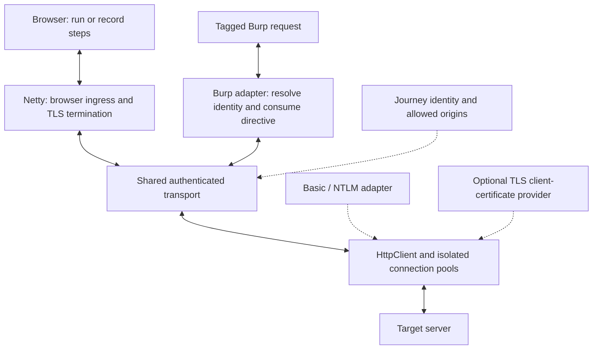

# Per-request HTTP authentication identities

* **Author:** rfrisch
* **Status:** Implemented; native, isolated HTTP acceptance and Linux Burp checks passed; Windows Burp UI qualification remains separate
* **Date:** 2026-11-09

## Overview

Extend saved journeys with optional destination-server HTTP authentication using
Basic, NTLMv1 or NTLMv2. A Burp operator selects a journey's HTTP identity for an
individual request with:

```http
BPSP-HTTP-AUTHENT: <@user-a/>
```

The extension consumes this header and authenticates the request using the selected
identity. A second request to the same application can select user B independently.
The selected identity overrides existing Authorization headers. A selection or
authentication failure must not fall back to the previous authorization.

One saved HTTP identity serves browser login and direct tagged requests. Browser
login uses it when an explicitly configured origin challenges, then continues
configured browser steps and credential capture. A direct identity directive
does not itself launch the browser. Existing cookie/token references request
captured credentials separately.

HTTP-only journeys need neither browser steps nor captured outputs. Mixed journeys
can use HTTP authentication to reach an application and then capture its cookies
or tokens. Test login verifies every enabled authentication requirement and every
configured capture, and reports the actual established HTTP authentication type.

## The Problem

The existing journey model obtains reusable cookie or token values through a
browser and inserts them into requests. That does not represent a request which
must authenticate directly as a chosen Basic or NTLM user without an application
cookie. NTLM authentication is associated with a connection; copying a previous
Authorization value cannot establish the identity on a new connection.

For access-control testing, an operator must be able to send consecutive and
concurrent requests to the same application as different users. A request for
user B must not inherit user A's authenticated connection. Changing Burp-wide
credentials cannot provide this per-request guarantee.

The current successful-login result also expects captured credentials. HTTP-only
authentication needs a truthful completion result without a dummy token. A chosen
protocol, a transmitted header or an HTTP success status alone does not establish
which protocol authenticated the request or which account the server accepted.

## Goals

1. Support destination-server Basic, NTLMv1 and NTLMv2 as explicit choices in one
   HTTP authentication dropdown, enabled through an optional setup checkbox.
   Do not silently fall back to a different protocol.
2. Consume the exact `BPSP-HTTP-AUTHENT` header before application delivery. Resolve
   its journey reference and override all previous Authorization occurrences,
   including differently cased names. An invalid or unresolved reference stops
   the request according to the existing explicit-tag failure contract.
3. Keep user identities isolated for A-to-B, A-to-B-to-A and simultaneous requests
   at the same application, including connection replacement and secret changes.
   No ordinary untagged request may inherit an identity established for a tagged
   request merely because a connection was reused.
4. Use the same saved HTTP identity during browser login and direct tagged
   delivery, with credentials restricted to explicitly configured origins.
   Following a redirect must not extend that permission to a new origin.
5. Support HTTP-only journeys without browser steps or captured outputs. For mixed
   journeys, Test login succeeds only after HTTP authentication and every
   configured capture succeed. Example completion messages are
   "Authentication succeeded — NTLMv2" and
   "NTLMv2 authentication succeeded; 2 credentials captured."
6. Derive the displayed authentication type from the completed exchange. Do not
   report verified authentication when the evidence establishes only anonymous
   access, a configured selection or an unverified protocol variant.
7. Show optional setup tabs only while their options are enabled, including
   Client certificate and HTTP authentication. Preserve the native Swing editor,
   autosave, useful keyboard navigation and completion dialogs.
8. Extend the existing authentication lab with multi-user Basic, NTLMv1 and
   NTLMv2 applications. For each protocol, operational production-path tests and
   actual Burp UI tests must prove authenticated user A followed by user B at the
   same application. Observe the accepted account and protocol independently at
   the server; fixture-only success is insufficient.
9. Test wrong credentials, protocol mismatch, concurrent identities, connection
   retirement, directive removal and origin boundaries. A state-changing request
   must demonstrate that challenge handling or recovery does not execute the
   application action twice.
10. Preserve current project/user journey storage, existing cookie/token tags,
    unfinished drafts, secret persistence/export consent and framework-free core
    contracts. Bound exchange resources and provide cancellation and unload
    cleanup without exposing passwords or authentication payloads in diagnostics.
11. Reuse live authenticated NTLM connections for compatible subsequent requests
    when the server permits persistence. Avoid a new handshake for every request.
    Prove both reuse and isolation with server-side connection and handshake
    observations, including switching A-to-B-to-A and reconnecting after closure.

## Non-Goals

* Configured upstream-proxy authentication, Digest or Kerberos support.
* Switching global Burp credentials to implement per-request identity selection.
* Capturing reusable NTLM Authorization values or transferring a browser's
  authenticated connection to a Burp request.
* Replacing the existing journey registry, secret store or authentication lab.

## Technical-plan decisions and qualification limits

The plan defines Test login, request composition, invalidation, model/storage
ownership, file placement and acceptance.
Its first delivery target is ordinary HTTP/1.1 requests from Repeater, Proxy,
Intruder and Extensions, with exact supported-tool behavior verified in Burp.
The implementation must reject unsupported request forms visibly rather than
silently changing their meaning. HTTP/2 support is not established by the selected
classic client and remains a compatibility gate, not an assumed capability.

Transport feasibility remains an explicit stop condition: direct-request
attribution, identity reuse and the browser bridge must pass before completing
the feature. A failed boundary requires revising the design, not waiving an
approved authentication requirement.

## Critical User Journeys

### Select different users for the same application

* **Given:** Two saved HTTP identities and a lab application that independently
  validates their credentials and reports the authenticated account and protocol.
* **When:** The operator sends a request selecting user A, then an otherwise
  equivalent request selecting user B, using `BPSP-HTTP-AUTHENT`.
* **Then:** The server accepts A and then B, the originating Burp tool receives
  each corresponding response, and the directive is absent upstream. Repeat for
  each supported protocol, overlapping requests and connection replacement.

### Verify an HTTP-only journey

* **Given:** An HTTP identity with no browser steps or configured captures and an
  application that requires the selected HTTP authentication protocol.
* **When:** The operator selects Test login.
* **Then:** Successful establishment produces a completion dialog identifying the
  actual protocol. No cookie or token is needed to complete the test.

### Complete a mixed browser journey

* **Given:** A saved HTTP identity, configured browser steps and capture sources,
  and a login application protected by HTTP authentication at an allowed origin.
* **When:** The operator selects Test login or requests the journey's captured
  credentials through their existing references.
* **Then:** HTTP authentication permits browser access, configured steps execute,
  and all required outputs are captured. The explicit test reports both the
  established HTTP protocol and captured outputs. Selecting only the HTTP
  identity for a direct request does not unnecessarily launch this browser flow.

### Override existing authorization

* **Given:** A request contains an Authorization header and an explicit HTTP
  identity directive selecting another saved user.
* **When:** The operator sends it.
* **Then:** The selected HTTP identity determines authorization. Old Authorization
  values are not sent as competing credentials or restored on failure. Duplicate
  and differently cased Authorization fields obey the same rule.

## Technical Plan (Architecture)

### Selected browser and direct-request architecture

The selected architecture uses Netty for browser-facing HTTP and CONNECT/TLS
handling, and Apache HttpClient 5 for destination delivery. Browser journeys and
recording bind their selected identity before navigation. Direct tagged Burp
requests enter the same destination transport through the Montoya hook, without
passing through the local browser proxy. Their connection scopes remain separate.

Netty owns local channels, HTTP codecs, browser-side TLS, ordering and backpressure.
HttpClient owns destination sockets, pooling, TLS and challenge orchestration.
The BPSH adapter supplies strict Basic/NTLMv1/NTLMv2 policy and observed outcomes.
The shared TLS owner supplies optional client-certificate material; NTLM message
construction has no PKCS#11 dependency.

LittleProxy is removed from the production path. Its synchronous filter API did
not provide the supported asynchronous hand-off this design needs. The lab may
retain it for unrelated fixtures. No second forwarding proxy, private pipeline
patch or browser-managed NTLM fallback is part of this design.

This increases BPSH's responsibility for the browser proxy. CONNECT isolation,
proxy access authentication, request fidelity, cancellation and regressions in
existing browser/mTLS behavior are release gates. The operational qualification section defines the required evidence.

### Authentication state and connection reuse

The cached NTLM state is an authenticated live upstream connection. It is not a
captured Authorization string, an expiry timestamp that can authenticate a new
socket, or data to save in a journey export. Subsequent compatible requests can
use that connection without another handshake while the server permits it.
Connection loss, a renewed challenge or an applicable server instruction to
reauthenticate invalidates that assumption. A renewed 401 requires new authentication; exact protocol handling must be
qualified for the selected implementation.

Connection selection must include the scoped saved identity and effective
credential generation, destination origin, authentication protocol, upstream
route and relevant TLS/client-certificate settings. Equal usernames alone do not
establish compatible identities. A connection used for one identity cannot be
returned to a general unauthenticated pool or borrowed by another identity.

Ownership lasts through the full exchange and response consumption. Do not
interleave another exchange into an NTLM handshake. Concurrent requests may need
additional independently authenticated connections under explicit limits; reuse
does not mean every request must wait behind one busy socket. Pool capacity,
queueing, idle expiry and cancellation semantics remain part of the selected
transport design, with one original deadline covering admission and delivery.

Illustrative required behavior, assuming persistent connections remain usable:

| Request | Expected connection behavior | Authentication work |
| --- | --- | --- |
| First request as A | Establish a connection owned by A | Complete NTLM handshake |
| Next request as A | Reuse A's compatible idle connection | No new handshake |
| Request as B | Use a separate connection owned by B | Authenticate B if needed |
| Next request as A | Reuse A's still-valid connection | No new handshake |
| A after server closure or credential change | Use a newly authenticated connection | New handshake required |

Close or retire affected connections on identity changes, deletion, unavailable
journeys and extension unload. A cancelled or incompletely consumed exchange
cannot be returned as a reusable authenticated connection without proving that
its protocol state is clean. A failure after sending application bytes must not
trigger a blind resend of a potentially completed state-changing operation.

### Entry points and shared transport responsibilities



Two entry points use one shared authenticated transport:
browser requests enter through Netty, while tagged Burp requests enter
through the extension hook and call the transport directly. Browser login and
recording both bind their proxy session to the selected journey before the first
navigation; browser requests do not require the directive header. A protected
login form is fetched only after the shared transport completes the server's
HTTP authentication challenge. That handshake is not a recorded page action.

Browser and direct-request adapters share authentication code and settings;
they do not share their live connection scopes. Framework-free
outcomes describe observed authentication and captured outputs without owning
sockets or exposing passwords. The composition root owns concrete services and
their unload sequence. Existing catalog, storage, secret, tag parsing and
diagnostic owners remain the integration points.

### Selected libraries and protocol responsibility

Pin Apache HttpClient 5.6.5, jcifs-ng 2.1.10 and Netty 4.2.17.Final in the
existing Gradle dependency and verification files. HttpClient supplies its public
AuthScheme integration, Basic scheme and pooled HTTP/1.1 transport. Do not use
Apache's retired built-in NTLM engine. The custom NTLM scheme is restricted to
one selected variant and one exchange; it never falls back to Basic or another
NTLM response variant because the server offers one.

jcifs-ng supplies low-level NTLM response primitives and message serialization.
Use the explicit Type3 constructor so BPSH controls channel binding and negotiated
flags at one adapter boundary. BPSH therefore owns bounded challenge
validation, negotiated flags, target information, MIC and destination TLS channel
binding. It does not introduce another MD4/DES implementation in production.
Public accessibility of the jcifs subpackages is not a stability guarantee;
changes to the pinned engine require new qualification.

NTLMv1 means the strict v1 response, not NTLM2 Session. NTLMv2 uses a fresh nonce,
server timestamp when present, HTTP service identity, MIC and channel binding
when applicable. The current adapter does not negotiate sign, seal or key
exchange. Servers requiring an unsupported negotiation must fail clearly;
unsupported requirements must not be silently removed. Protocol vectors,
malformed inputs, downgrade rejection and independent server interoperability
are mandatory tests, not assumed library capabilities.

For HTTPS, compute tls-server-end-point channel binding from the actual
upstream TLS session's destination certificate, following RFC 5929 and MS-NLMP.
The browser-facing proxy certificate must never be substituted. Verify valid
and tampered bindings and MICs with the independent lab verifier and an external
interoperability target before claiming Extended Protection support.

jcifs-ng's LGPL-2.1-or-later distribution obligations remain an explicit delivery
gate. The packaging plan must identify license/notices, corresponding source and
a practical way to replace/relink the unmodified library in the universal JAR.
Adding a dependency or a notice alone does not close that gate. If packaging or
protocol adaptation requires a broad fork, reconsider the selected message engine.

#### Connection ownership and integration boundaries

Prefer bounded pools owned by an immutable identity generation and effective
network configuration for the initial implementation. A scope includes journey
identity, credential generation, allowed origin, selected protocol, upstream
route and TLS/client-certificate configuration. Use opaque identifiers, not
passwords, as keys. A lazy registry with global and per-scope capacity limits
owns these pools; the HTTP library still implements the actual socket pool.
This permits deterministic retirement of an identity's connections without
depending on a shared pool's ability to evict one user token selectively.

Set the scoped user token before acquisition as an additional library-level
boundary. Do not use the default principal alone as the pool key. Credential
changes retire the old pool, reject new acquisitions against that generation,
and prevent old results from being published as current. Repeated A requests
reuse A's connections; B uses a separate pool. Multiple concurrent A requests
may open multiple independently authenticated connections within the limits.
Browser-attempt pools have separate lifetimes from direct-request pools.

For direct Burp requests, resolve the directive and construct the final request
once, then deliver through the owned client and return its response through
Montoya's `spoof` request action. Verify that this suppresses the original send
and preserves attribution to the initiating tool. Ordinary untagged traffic
continues through Burp. Do not add LittleProxy to this direct-request path solely
because the extension already includes it.

For browser traffic, Netty forwards through the same destination service using
attempt-local scopes. Navigation, redirects, fetch and recording retain browser
semantics; the transport does not follow redirects itself. Proxy callbacks must
never block on the classic client's work. Close the downstream channel or cancel
the browser attempt to abort its owned upstream exchange and retire unsafe sockets.

#### Strongest counter-argument and rejection criteria

An extension-owned client takes tagged traffic out of Burp's normal sending
engine. It can change HTTP version, header formatting, redirect behavior, proxy
routing, TLS decisions and the handling of deliberately unusual requests. This
matters in a testing tool. The proposed classic client uses HTTP/1.1; do not imply
that it preserves HTTP/2 or byte-for-byte malformed-request behavior. Establish
the supported request contract and show any restriction before delivery. If the
required Burp behavior cannot be preserved, reconsider Montoya-managed delivery
rather than silently normalizing the operator's request.

Disable unrelated automatic retries, redirect following, cookie management and
transparent content decoding in the direct-request adapter unless explicitly
required by the agreed contract. Authentication retries still need independent
verification: a repeatable body only permits resending bytes; it does not prove
the server did not already perform a state-changing action. An ambiguous failure
after delivery must not trigger a blind retry. Response size, body consumption,
one overall deadline, cancellation and close-on-unload remain bounded operations.

HttpClient 4.5 remains a fallback with an explicit engine constructor and an older
maintenance policy. AHC's built-in NTLM path requires more invasive changes for
strict version selection. Extending LittleProxy into the full authentication
transport adds connection-management responsibility that a complete client
already handles. These comparisons favor qualifying HttpClient 5 first, but the
browser bridge, request fidelity or message-engine tests can still disqualify it.

### Domain, persistence and service ownership

Add HTTP authentication settings to the existing journey definition and editable
draft: enabled state, one protocol enum, username, optional NTLM domain and
workstation, and explicit allowed origins. The existing authentication URL is
the protected URL for Test login. The UI can initially populate its origin but
must show that permission; later edits must not silently authorize new origins.
Compare normalized scheme, host and effective port, not host suffixes or paths.

Extend `SecretStore.Values` with a separately owned HTTP password. Follow its
copy, comparison, snapshot and disposal rules, including the distinction between
a missing password and an intentionally empty password. Apply existing Remember
secrets and export-consent behavior; never place a password, NT hash or handshake
message in a journey's nonsecret draft, diagnostic string or connection-pool key.
Short-lived Strings required by a dependency cannot be promised to be wiped;
minimize their lifetime and retain no credential-bearing scheme in a global cache.

Use a version 2 document representation because the strict version 1 format
cannot represent HTTP-only execution. Read supported version 1 documents through
the maintained migration boundary; write the current format. Preserve journey
IDs, scopes, aliases and saved drafts. Do not create backup documents or keep a
second implementation. Version 2 allows no capture/injection definition when
HTTP authentication supplies the journey's only authentication requirement.
Validation still rejects an executable journey with no enabled requirement.

Represent observed HTTP authentication separately from captured credentials.
The result carries the identity generation, observed protocol, origin, completion
time and evidence status, with no socket or framework type. A captured-output
result can be absent for HTTP-only Test login. Browser-only and mixed journeys
retain complete-output validation. HTTP success does not enter the token cache
as an empty or synthetic token, and cannot satisfy a cookie/token reference.

Journey cache includes HTTP identity rows even without a captured-output result.
They display protocol, account, allowed origin and the latest observed result/time,
without suggesting that an authenticated connection remains open. Shared transport
progress supplies NTLM negotiate/challenge/response, acceptance, reuse and typed
failure events to the journey's Event log. This applies to direct requests, tests,
browser login and recording. Observations are bounded and session-only, checked
against the current generation and secret revision, and explicitly fenced by Clear
cache. No password, NTLM payload, raw exception or request URL enters an event.

Keep the configuration in `journey`, outcome and service contracts under
`authentication/http`, and the concrete HttpClient/jcifs adapter at a new outer
`transport/httpauth` boundary. The Burp and browser adapters consume that contract;
neither instantiates a client or owns a second credential registry. `Extension`
owns the transport, pool registry and shutdown. Update the architecture allowlist
for these deliberate edges and retain the framework exclusions and cycle checks.

### File placement and responsibilities inside each file

Use the existing feature owners rather than adding a second journey registry,
generic helpers directory or one large HTTP-authentication class. Paths below
are relative to the repository root. The tables describe intended ownership. Some files already exist in the partial
implementation; the status table below distinguishes implementation from qualification.

| File or directory | Placement and responsibility |
| --- | --- |
| `bapp/src/main/java/bpsh/journey/HttpAuthentication.java` | Immutable settings and protocol choices. JDK-only values; no passwords, HTTP client, Swing widgets or network calls. |
| `bapp/src/main/java/bpsh/journey/JourneyDefinition.java` and `JourneyDraft.java` | Integrate executable HTTP settings and unfinished editor input alongside the existing journey fields. Do not embed handshake logic in either model. |
| `bapp/src/main/java/bpsh/journey/JourneyOrigins.java` | Extend the existing origin normalization/permission owner for HTTP and HTTPS; do not copy origin matching into UI, proxy and client code. Preserve the stricter certificate-origin rule. |
| `bapp/src/main/java/bpsh/journey/SecretStore.java` and `JourneySecrets.java` | HTTP-password ownership, presence/empty semantics, copies, validation and disposal alongside existing secrets. |
| `bapp/src/main/java/bpsh/journey/editing/JourneyDraftCompiler.java` | Compile form values and validate whether a draft is executable. Shared validation belongs here or in domain helpers, not in Swing listeners. |
| `bapp/src/main/java/bpsh/journey/persistence/NativeJourneyCodec.java`, `NativeDocumentCodec.java` and `bapp/src/main/resources/journey-registry.schema.json` | Current wire representation, strict validation and maintained version migration. Preserve the existing `JourneyJson` entry boundary. |
| `bapp/src/main/java/bpsh/authentication/http/HttpAuthenticationService.java` | Framework-free port used by browser, Burp and explicit tests; owns the request/result/cancellation contract, not concrete sockets. |
| `bapp/src/main/java/bpsh/authentication/http/HttpAuthenticationEvidence.java` | Immutable observed protocol/origin/generation/evidence status. Shared by the service and combined authentication result without introducing a dependency cycle. |
| `bapp/src/main/java/bpsh/authentication/http/HttpAuthenticationProgress.java` | Fixed handshake stages and typed, sanitized failure descriptions shared by delivery adapters and inspection. |
| `bapp/src/main/java/bpsh/authentication/http/HttpAuthenticationActivity.java` | Bounded current-generation observations, clear-cache fencing and a framework-free event sink; never acquires credentials or connections. |
| `bapp/src/main/java/bpsh/authentication/credentials/AuthenticationResult.java` | Combine optional HTTP evidence and captured outputs; never represent HTTP success with a dummy token. |
| `bapp/src/main/java/bpsh/authentication/session/AuthenticationCoordinator.java` | Existing admission, attempt lifecycle, generation checks and captured-output publication. Consumes core contracts only; no HttpClient configuration or HTTP message parsing. |
| `bapp/src/main/java/bpsh/transport/httpauth/HttpClientAuthenticationTransport.java` | Concrete service implementation and HttpClient setup. Converts between the core contract and library messages, applies deadlines and delivers responses. |
| `bapp/src/main/java/bpsh/authentication/http/HttpIdentityManager.java` and `bapp/src/main/java/bpsh/transport/httpauth/HttpTransportRuntime.java` | Core identity/generation lifecycle and concrete runtime resource ownership respectively. HttpClient owns socket pools; there is no second pool implementation. |
| `bapp/src/main/java/bpsh/transport/httpauth/NtlmAuthScheme.java` | Package-private HttpClient scheme state machine and strict protocol policy for one exchange. |
| `bapp/src/main/java/bpsh/transport/httpauth/NtlmMessages.java` | Package-private jcifs boundary, bounded message parsing, selected-version response construction, MIC and channel-binding encoding. No HTTP delivery or pool management. |
| `bapp/src/main/java/bpsh/transport/tls/` | Shared device/TLS owner described below. No browser or Montoya imports. |
| `bapp/src/main/java/bpsh/browser/proxy/JourneyBrowserProxy.java` and `ProxyCertificateFactory.java` | Netty browser ingress and the existing certificate factory. Forward through the core service; no LittleProxy implementation remains in production. |
| `bapp/src/main/java/bpsh/browser/BrowserSessionLauncher.java`, `BrowserFlowRunner.java` and `BrowserAuthentication.java` | Browser attempt wiring, fresh context, challenge/capture evidence and completion. Concrete HTTP-client construction stays out of these files. |
| `bapp/src/main/java/bpsh/burp/http/HttpAuthenticationDirective.java` | New package-private directive consumption and validated selection, reusing `NativeTagParser` and the catalog. No second tag grammar. |
| `bapp/src/main/java/bpsh/burp/http/HttpAuthenticationDelivery.java` | Existing request orchestration and Montoya response attribution. Delegates directive handling and owned delivery; no NTLM calculations or Swing state. |
| `bapp/src/main/java/bpsh/burp/ui/HttpAuthenticationPanel.java` | New package-private HTTP settings form using `JourneyForms`; snapshot/apply fields and emit edit events. No persistence, protocol validation algorithm or network calls. |
| `bapp/src/main/java/bpsh/burp/ui/JourneyWizardPages.java` | New package-private stable page/component mapping and visibility/focus behavior shared by optional pages. No authentication business logic. |
| `bapp/src/main/java/bpsh/burp/ui/UiController.java` | Compose the form, route edit/test actions and present outcomes. Keep additions to orchestration; do not append transport or serialization helpers to this controller. |
| `bapp/src/main/java/bpsh/Extension.java` | Construct concrete services once, inject ports and close owners in order. Keep protocol work out of the composition root. |
| `test/authentication-lab/src/main/java/lab/auth/HttpAuthenticationFixture.java` | New maintained fixture owner for connection state, account validation and safe observations; registered through existing transport/case lifecycle. No production dependencies or copied production engine. |
| `test/authentication-lab/src/main/java/lab/auth/NtlmChallengeVerifier.java` | Package-private independent fixture validator with known-vector checks. Keep cryptographic validation separate from application routing and evidence emission. |

For each source file, keep its public boundary and lifecycle methods easy to
find, then its cohesive internal operations. Nested records belong in that file
only when they are private implementation state or a small part of its public
contract. Move independently owned algorithms into the named owning class; do
not scatter the same algorithm among event listeners, codecs and adapters. Use
existing naming, visibility and Javadoc conventions. Avoid unrelated file
reordering during the feature change.

#### Shared TLS/device ownership

Direct HTTP delivery and browser login both need the same device selection,
PIN suppression and client-certificate material. Move these existing files from
`bapp/src/main/java/bpsh/browser/mtls/` to
`bapp/src/main/java/bpsh/transport/tls/`:

* `Pkcs11IdentityManager.java`
* `Pkcs11Discovery.java`
* `Pkcs11DiscoveryMain.java`
* `Pkcs11DiscoveryProcess.java`
* `Pkcs11Failures.java`

Keep one shared manager instance. Move only these shared responsibilities;
the generalized proxy and `ProxyCertificateFactory` remain browser-owned under
`browser/proxy`. Keep
common destination trust, hostname verification and client-identity selection
in `transport/tls/JourneyTlsContexts.java`, instead
of copying the current proxy's TLS helpers into the HTTP client. Contexts must
remain scoped to their identity generation and allowed origins.

Move the device unit test to
`bapp/src/test/java/bpsh/transport/tls/Pkcs11IdentityManagerTest.java` and update
its callers. The browser mTLS integration test stays under `browser/mtls` as a
feature integration test. Move the certificate-factory unit test under
`browser/proxy` to mirror its production owner.
Update discovery entry-point references, packaged-helper launch references,
imports, README links and acceptance fingerprints together. No forwarding
classes or historical copies remain at the old device paths.

#### Destination TLS policy

| Entry point | Chain and hostname policy | Setting source |
| --- | --- | --- |
| Browser login/recording without mTLS or HTTP authentication | Existing Chromium behavior | Browser.ignoreHttpsErrors, off by default |
| Browser login/recording with HTTP authentication and no mTLS | Java destination TLS honors the same explicit journey-local bypass; otherwise validates chain and hostname | Existing Browser.ignoreHttpsErrors; no new UI toggle |
| Browser login/recording with mTLS, with or without HTTP authentication | Validate destination chain and hostname; use normal roots plus explicitly configured CA material | Existing mTLS policy; browser consent does not disable destination checks |
| Direct tagged delivery and HTTP-only Test login | Validate destination chain and hostname; optionally apply configured mTLS CA/client identity at its allowed origins | Browser-only bypass does not authorize direct transport bypass |

JourneyTlsContexts receives an explicit effective TLS policy from the composition
root. Both the trust manager and hostname verifier obey that policy; changing
only Chromium's context is insufficient. Include this policy in scope compatibility
and retire affected connections on changes. No process-wide trust changes are made.
Test self-signed and wrong-host destinations with bypass on/off, another journey
unaffected, and mTLS/direct validation remaining active. UI help must describe the
browser-only permission and the mTLS exception.

#### Dependency and test placement checks

The new core `authentication.http` package depends only on `journey` and the
base `authentication` package. `authentication.credentials` may consume HTTP
evidence, but `authentication.http` must not depend back on credentials or the
coordinator. This keeps combined results and service contracts acyclic.

The concrete `transport.httpauth` package can depend on `authentication.http`,
base authentication, journey and `transport.tls`. Shared TLS has no dependency
on browser, Burp or the HTTP transport. Browser and Burp callers receive the
core port; only the composition root instantiates the HTTP implementation.

Extend `bapp/gradle/architecture.gradle.kts` with the exact new packages/edges,
not a blanket adapter exemption. Include `authentication.http` in framework-free
core checks. Restrict Apache HttpClient and jcifs references to
`transport.httpauth`, and prohibit Swing, Playwright and Montoya imports from
the shared transport packages. Preserve path/package agreement and cycle checks.

A captured build copies the exact production source and configuration into an
isolated build and records their hashes. Acceptance overlays add selected test
owners to that captured build; they do not replace production implementation.
Catalog bindings connect requirement IDs to exact test methods, assertions and
source fingerprints. Refreshing a binding updates that mapping; only a later
execution can supply acceptance evidence. The maintained lab contracts at
`docs/designs/authentication-test-lab-contracts.md` define this workflow.

Native unit/integration tests mirror their production owner under
`bapp/src/test/java/bpsh/`. Shared lab fixture tests stay under
`test/authentication-lab/src/test/java/lab/auth/`. Acceptance-only overlays stay
under `test/authentication-lab/production-tests/bpsh/` and execute in captured
builds. Reuse native test owners when the same check already applies; do not
copy a native test into an overlay solely to obtain a second pass label.
`bpsh.support.IntegrationFixtures` remains the native-to-lab adapter.

During implementation, run `verifyArchitecture` after package moves and after
new adapters are wired, then run the required `check` and documentation checks.
Verify the changed source tree; a prior architecture pass does not qualify a
later edit or establish end-to-end behavior.

### Request composition and invalidation

An HTTP identity directive selects explicit authentication for that request.
Resolve exactly one complete reference through the existing tag grammar; reject
duplicates, ambiguous values and unavailable identities. Consume the directive
and remove every Authorization occurrence before resolving remaining explicit
cookie/token references. This avoids acquiring a token for an Authorization
header which the selected HTTP identity will replace anyway.

For such requests, skip automatic session injection and automatic recovery.
Explicit cookie/token references elsewhere still run, so an operator can
deliberately combine an HTTP identity with an application session. Other original
headers, cookies and body data retain their supported semantics. The automatic
"Wait for login" / "Send immediately" policies continue to apply only to automatic
handling; they never cause an unresolved explicit identity request to go out
unauthenticated. HTTP-only journeys do not appear as candidates for automatic
captured-token injection.

One deadline covers all required explicit resolutions, pool admission, challenge
rounds and response delivery. Recheck journey generations and runtime invalidation
epochs before dispatch and before publishing an authentication outcome. Do not
repeat a possibly completed application request to recover a changed generation.

Clear cached credentials invalidates captured outputs and retires the selected
journey's authenticated connections; saved passwords and configuration remain.
Disable, delete, secret changes and unload stop new acquisitions and cancel the
affected owned work. Disabling HTTP authentication retains editable inputs under
the existing secret-persistence rules but makes them unavailable to runtime
requests. Re-enabling starts fresh connections. An explicit invalidation epoch
prevents an in-flight old attempt from repopulating cleared state even when the
saved definition itself has not changed.

### Authentication replay and browser Authorization

Use the HTTP client's normal challenge flow. No preauthentication probe endpoint
or separate application-replay engine is introduced. The configured protocol alone
may answer destination challenges. A complete 401 can lead to another transmission
of the same application request during authentication, including its buffered body.
This relies on the HTTP contract that a 401 means the request was not applied;
it is not a guarantee against a server that performs an action before returning
401. The conforming lab must execute the authenticated action exactly once and
count handshake transmissions separately. An action-before-401 fault demonstrates
this limitation rather than being counted as conforming-server acceptance.

| Event | Selected behavior |
| --- | --- |
| Fresh Basic delivery | Wait for a Basic challenge, then send the selected credentials; return final rejection without restarting |
| Fresh NTLM delivery | Run Type1/Type2/Type3 on one socket; no variant fallback |
| Reused NTLM socket returns 401 | Clear its accepted state and permit one bounded challenge sequence for this request |
| Final selected proof receives 401 | Return that response and mark rejected; never restart authentication indefinitely |
| Complete non-401 response | Return it; no automatic retry because of its status |
| Disconnect, timeout, partial/oversize response after possible application transmission | Report uncertain delivery and stop; no reconnect-and-resend |
| Deadline, cancellation, invalidated selection | Stop owned work; do not start another authentication cycle |

Cap the entire delivery at four outbound authentication-related transmissions,
using the original deadline. A malformed or unsupported challenge terminates with
a safe protocol error. Disable unrelated transport retries, redirects and automatic
session recovery on this explicit path. For Basic, authentication is per request;
NTLM connection reuse avoids another handshake while that socket remains accepted.

Add a bounded AuthorizationPolicy to HttpAuthenticationService.Request:
REPLACE_SELECTED for explicit direct delivery and fresh HTTP-only tests, and
PRESERVE_APPLICATION for browser traffic. REPLACE_SELECTED consumes every original
Authorization field before explicit token resolution. PRESERVE_APPLICATION uses
the selected HTTP identity only when the browser supplied no Authorization field.
When the browser supplied one, forward it unchanged and disable automatic challenge
handling for that request. Multiple application Authorization fields are rejected
as ambiguous before forwarding.

The browser bridge consumes final destination `WWW-Authenticate` headers, including
on unlisted origins. Playwright otherwise offers its local proxy credentials in
response to origin challenges. The Java transport alone handles challenges; the
browser still receives the actual status, body and other response headers. Direct
Burp delivery preserves destination authentication challenges.

A browser Bearer request may use a compatible already-authenticated NTLM connection,
but BPSH does not promise that an arbitrary new connection is already authenticated.
If that request receives 401, return it unchanged, explain the header conflict and
do not replace Bearer with NTLM or add a probe. A destination requiring Basic and
an application Bearer header on the same request is unsupported; BPSH never sends
competing Authorization headers to manufacture success. Bearer-only application
endpoints remain usable because their existing header is forwarded intact.

Tests cover NTLM navigation followed by an application-Bearer fetch on a reused
connection, forced connection replacement, Basic-plus-Bearer rejection by the
server, an ordinary Bearer-only endpoint, and direct-tag replacement of all old
Authorization values. The browser dialog distinguishes this unsupported combination
from a wrong-password claim. This preserves one transport with two explicit input
policies; it does not introduce a generalized authentication-composition system.

### Completed responses and authentication observations

A local failure before dispatch (invalid directive, unavailable identity, forbidden
origin, unsupported request or admission failure) stops the tagged request with a
safe explanation. Never fall back to sending the original credentials or request.
Once the destination returns a complete supported response, the direct adapter
returns its actual status, headers and body through Montoya, including 401, 403
and 5xx. It annotates HTTP authentication separately; it must not turn a genuine
403 into a local drop because Test login would classify that evidence as unconfirmed.

A partial response, timeout or disconnect has no fabricated successful response.
If application bytes might have reached the server, report delivery as uncertain
and do not retry automatically. Clearing or editing an identity after dispatch
cannot undo that delivery: a complete response may still be shown as superseded,
but no outcome or reusable authentication state is published as current.

For a previously accepted NTLM socket, preserve the observed protocol separately
from the application's status. A 403/5xx does not erase the observation that the
connection authenticated; a renewed 401 invalidates that connection's acceptance.
Fresh Test login retains the stricter challenge-and-acceptance rule below.

### Test login and optional editor pages

An HTTP-only Test login issues GET to the configured authentication URL through
a fresh test connection. It does not reuse a previously authenticated connection
as proof of newly supplied credentials, launch a browser or follow redirects
automatically. Describe the URL as a protected page suitable for GET.

Report success only after observing a challenge, generating the selected response
and receiving an accepting response at that origin. A 2xx or redirect after the
completed exchange can establish protocol acceptance; a first anonymous 2xx
cannot. A 401 is rejection; 403 and other ambiguous failures do not confirm the
credential. Distinguish "Authentication was not confirmed: this page did not
request HTTP authentication" from a wrong-password claim. Type is derived from
the actual Basic exchange or generated-and-accepted NTLM response variant.
Generic HTTP does not independently attest an account name; the lab's protected
application supplies that separate A/B proof.

Mixed Test login uses a fresh browser context and attempt-local HTTP transport,
then requires both HTTP authentication evidence and every configured capture.
Its completion dialog separates authentication, captures and failures. Direct
HTTP identity use still does not launch this browser journey.

HTTP authentication and Client certificate pages are present only when enabled.
Replace ordinal tab navigation with stable page identifiers and component lookup,
so error navigation and keyboard shortcuts survive hidden optional pages. Toggle
off returns focus to an available page and preserves editable inputs. The HTTP
page contains the protocol dropdown and only applicable fields; domain and
workstation are NTLM settings. Password remains a masked secret input.
The request example uses the selected journey's actual tag name, updates on
rename, and explains that `BPSP-HTTP-AUTHENT` is a custom header applying HTTP
authentication to that one request; the extension removes it before delivery.
Allowed-origin formatting and credential scope are tooltips on the field and
label. HTTP-only journeys copy the complete header directly; mixed journeys
offer the header alongside formats for their configured token/cookie captures.

### Operational qualification in the existing lab

Extend `TransportFixtures` and the existing `LabRun` case lifecycle with one
HTTP-authentication fixture family. Basic, strict NTLMv1 and strict NTLMv2 are
configurations of that family, each with at least A and B synthetic accounts.
Reuse `LabTls`, invocation ownership, foreground serving, evidence collection
and `bpsh.support.IntegrationFixtures`; do not create a separate lab or launcher.

`ControlledApplication.Origin` currently uses JDK `HttpServer`, whose exposed
`HttpExchange` API
does not provide the connection-close ownership needed for rigorous NTLM state
tracking. Add a specialized Netty listener inside the maintained
transport fixtures, using the lab's existing dependency, with channel-local
handshake and authenticated-account state. A connection observation uses an
opaque per-accept identifier, not merely a remote port which can be reused.
Use channel-close notifications
to retire its state. It must close through the existing case owner and leave no listening channel or
authenticated state after cleanup.

The server validates response bytes using a separate implementation and known
vectors, not production code or jcifs to validate its own output. Shared standard
cryptographic providers are acceptable; sharing the client message-construction
algorithm is not independent evidence. Validate the selected response variant,
challenge freshness, account, MIC and channel binding when required. Reject bad
credentials and mixed handshake state before invoking the application action.
Store only safe account/protocol/connection/count observations in reports.

Expose a protected identity page, a browser login page that yields configured
capture outputs, and a state-changing endpoint with a server-side operation
counter. Controlled faults include renewed challenge, forced connection closure,
stall, malformed challenge, wrong channel binding and closing after an action
has executed but before its response is delivered. Count network handshake
rounds separately from authenticated application executions.

Qualify in this order, with a new captured-build invocation after source changes:

1. **Fixture validity:** good and bad credential vectors, v1/v2 distinction,
   channel-bound TLS, MIC/tampering and complete connection cleanup.
2. **Owned client:** real challenge exchanges, A repeated without a new handshake,
   A-to-B-to-A, concurrent users, reconnection, generation invalidation, bounded
   cancellation and a POST operation count of exactly one. A disconnect after
   execution produces an indeterminate-delivery failure, not a resend.
3. **Burp boundary:** return the owned response to the initiating Repeater,
   Proxy, Intruder and Extensions request; prove no second original send,
   directive removal, authorization override and isolation from ordinary traffic.
4. **Browser boundary:** strict selected variant on navigation and fetch, HTTP
   authentication followed by capture, redirects, TLS/mTLS composition and
   cancellation. Demonstrate the asynchronous Netty-to-client bridge
   without blocking the event loop. Failure here blocks the combined feature.
5. **Actual artifact:** native and architecture checks, isolated production
   acceptance, universal development JAR, then existing-extension refresh and
   A/B UI verification in the Windows and Linux VMs using that exact checksum.

Source checks and individual transport tests do not establish completion of
these five stages. A fixture using a fake accepted username, a separate demo
HTTP client, or UI success text alone cannot satisfy production acceptance.

### Resource and compatibility qualification

Start the feasibility experiment with explicit ceilings: 16 upstream connections
globally, 4 per identity scope, 32 retained scopes, 64 admitted waiting requests
globally and 16 per scope. Idle connections expire after 30 seconds, or sooner
when the peer requires it. These are proposed experiment bounds, not measured
product defaults. Evict only idle scopes; an active scope is never reassigned to
another identity to make capacity available.

Use the existing configured request deadline and the remaining attempt budget,
without restarting either for each challenge. Bound a handshake to four outbound
authentication attempts. Cap decoded authentication challenge material at 64 KiB
and validate lengths before handing it to the library. No HTTP, pool acquisition,
credential generation or shutdown wait runs on Swing's event thread or Netty's
event loop.

For the initial buffered-delivery experiment, bound a request body to 8 MiB, a
response body to 16 MiB and aggregate HTTP-transport-owned message buffers to 64 MiB.
Count actual bytes, including chunked responses, and reserve capacity before
allocating. Never truncate a response and report success. An exceeded response
limit after a state-changing request must retain indeterminate-delivery semantics
and must not resend. Use fixture observations to decide the final supported
limits or whether streaming is required before shipping; do not confuse these
transport limits with the existing credential-extraction limit.

Explicitly test duplicate non-auth headers, cookies, binary bodies, chunked
responses, redirects, proxy failure without direct fallback and cancellation
while consuming a response. Unsupported HTTP versions, upgrades, tunnels and
malformed framing need clear pre-dispatch rejection, not silent conversion.
If these restrictions make the intended Burp workflows impractical, return to
the delivery decision before proceeding with the full editor integration.

## Alternatives Considered

| Alternative | Decision and reason | When to reconsider |
| --- | --- | --- |
| HttpClient 5 plus a focused jcifs adapter | Selected first qualification path. Public authentication hooks and owned pooling avoid implementing an HTTP stack, while lower-level NTLM primitives permit explicit version policy. BPSH still owns protocol adaptation and Burp/browser integration. | Revise if request fidelity, browser bridging, channel binding, packaging or cancellation cannot meet the agreed requirements. |
| Montoya-managed sends with connection IDs | Retained fallback. Preserves Burp's sending path, but inspected APIs alone do not establish exclusive connection ownership, retirement or reconnect behavior. | Prioritize if the owned client's request restrictions are unacceptable and Montoya can prove the required lifecycle semantics. |
| LittleProxy as the full destination-authentication engine | Not selected. The pinned library has no destination NTLM engine or per-saved-identity pool matching the feature; adding these would increase transport ownership. Production browser ingress uses the selected Netty adapter. | Reconsider if a supported integration provides the needed lifecycle with materially less code than the client bridge. |
| Apache HttpClient 4.5 | Not the first choice because it adds a maintenance-only HTTP-client dependency when the current client exposes an appropriate public extension interface. | Fallback only if a demonstrated current-client gap outweighs that dependency cost. |
| AsyncHttpClient's built-in NTLM | Rejected for this implementation path: its fixed engine selects variants from the challenge and exposes no per-journey strict v1/v2 switch at the inspected call site. | An upstream-supported custom-engine/version interface could change the comparison. |
| jcifs-ng's convenience NTLM API | Not selected as the complete HTTP adapter: BPSH requires explicit control over negotiated flags and destination TLS channel binding. | Reconsider after a maintained reproducer qualifies the convenience API against the same flag, MIC and channel-binding contract. |
| A wholly new BPSH NTLM engine | Not selected. It adds message parsing, cryptographic response construction and interoperability maintenance before existing primitives have been exhausted. | Reconsider only after concrete library limitations make the adapter or packaging more costly than a deliberately scoped engine. |
| Basic through ordinary header mutation, NTLM through owned transport | Not selected initially because it splits challenge evidence, origin policy and direct-request behavior. | Reconsider if Basic request fidelity materially benefits and its equivalent acceptance/evidence rules remain satisfied. |
| Global Burp credentials, cached NTLM Authorization strings, or a fresh connection on every request | Rejected by the approved requirements: these respectively lose per-request identity isolation, cannot transfer connection-bound authentication, or discard required reuse. | These do not become fallbacks for a failing implementation. |
| A new lab/harness or duplicated device manager under each adapter | Rejected by repository ownership rules and the author's file-placement requirement. It would split fixtures, PIN state or lifecycle authority. | Extend the existing owners instead. |

## Detailed Implementation Plan

This is a staged production plan, not an implementation report. Browser run and recording enter through the proxy; tagged Burp requests call
the shared transport in-process. NTLM has no PKCS#11 dependency. Optional client-certificate selection
belongs to TLS; enabling HTTP authentication alone never enables a certificate.

The production implementation follows this plan. Five EGM review stages and the
final readiness audit are complete. Verification covers the current source and
an exact universal JAR in Linux Burp; the scope below distinguishes those results
from further platform and interoperability qualification.

### Current implementation and qualification

| Area | Implemented and verified | Remaining qualification limits |
| --- | --- | --- |
| Transport and protocols | Strict variants/flags, independent v1 vector, malformed/mismatch checks, MIC/TLS channel binding, connection reuse and bounded challenges; HTTPS CONNECT separated from target authentication | External-server interoperability, including real IIS/AD deployments |
| Direct delivery | Actual Montoya boundary and Linux Burp Proxy A/B/A plus concurrent A/B for all protocols; Linux Repeater NTLMv2 A/B/A; independent account/type, connection reuse and directive-removal proof; captured complete error responses and POST fidelity | Windows Burp and originating tools outside the exercised Proxy/Repeater cases |
| Browser ingress | Shared asynchronous runtime; protected forms and recording/replay for all protocols; Linux protected browser journeys, repeated fresh-context submission and capture summaries; nine packaged software-token mTLS checks including upstream proxy routing | Current Windows Burp UI and physical-token/platform-specific middleware |
| Configuration/editor | Schema v2, separate session secrets/revisions, explicit origins, checked-only HTTP/form tabs, retained steps and credentials, observed protocol results, inline rejection and password recovery in Linux Burp | Platform-specific editor/device UI outside the exercised cases |
| Limits | Explicit admission, owned chunks, shared body/connection/scope caps, pinning/LRU/expiry and worker-retained cancellation ownership; native and captured boundary evidence | Limits apply to the documented supported request/response subset |
| Lab integration | Independent multi-user fixture; 47 HTTP acceptance owners (34 component and 13 browser), strict safe-observation collectors, three distinct manual host entries | Manual host rows retain their own platform/tool evidence requirements |
| Delivery | Universal development JAR; dependency source/license/provenance and replacement checks; full native/architecture/documentation checks; checksum-bound Linux Burp verification | A different artifact must receive fresh verification; Windows host acceptance is not inferred |

The composition root injects one HttpTransportRuntime into browser execution and
direct identities. BrowserProxyForwarder owns attempt ingress/evidence wiring;
the runtime owns setup, pools, admission, connections and body storage. HTTP
observations retain origin, journey identity, epoch, HTTP status and observation
time. Compatible capture edits retain their original attribution; incompatible
HTTP/secret/route/TLS edits clear only the HTTP observation according to the
existing credential-retention policy.

### Shared runtime, scopes and resource ownership


Add a JDK-only HttpTransportFactory port in authentication.http. Its contract is:

```java
enum Purpose { DIRECT, TEST, BROWSER, RECORDING }
record ScopeSpec(UUID scopeId, Purpose purpose,
                 JourneyDefinition.Identity identity, long invalidationEpoch,
                 BrowserSetup setup, boolean explicitRecovery) {}
CompletableFuture<HttpAuthenticationService> open(
    ScopeSpec spec, SecretStore.Values secrets, long deadlineNanos);
HttpMessageBody.Allocator bodies();
void close();
```

ScopeSpec is immutable. identity may be absent only for an unsaved recording;
that case still has a unique scopeId and explicit attempt ownership. The setup
snapshot supplies HTTP settings, proxy route and TLS/client-certificate settings.
DIRECT/TEST reject destinations outside the selected HTTP origins. BROWSER/
RECORDING may reach other origins with no configured HTTP credentials; TLS client
identity is still restricted to its own origin list. Each purpose selects the
effective TLS policy from the matrix. Scope equality never uses a password.

Extension creates one HttpTransportRuntime implementing this port, injecting the
existing Pkcs11IdentityManager. The factory snapshots input secrets synchronously
before returning; callers may immediately close their copies. Four bounded setup
workers perform certificate selection and TLS/client construction. Secrets and
failed partial scopes are closed on every completion path. The runtime closes a
late-created scope if its open future was cancelled or its selection retired.

HttpIdentityManager keeps catalog/epoch selection and direct-scope reuse, but
removes its duplicate setup executors. It uses this factory. BrowserSessionLauncher
receives the same port and requests a fresh BROWSER or RECORDING scope before
navigation, then passes that service to the public BrowserProxyForwarder facade.
The launcher no longer separately selects the same device identity; selection
occurs once in the factory through the existing shared manager. BrowserProxyForwarder
owns only attempt proxy/evidence wiring, not an HttpClient or worker pool.

Replace the service's implicit exchange admission with an explicit JDK-only
single-use Delivery lease:

```java
Delivery HttpAuthenticationService.admit(long deadlineNanos);
boolean HttpAuthenticationService.isOpen();
boolean HttpAuthenticationService.isIdle(); // no waiting or running delivery work
CompletableFuture<Response> Delivery.exchange(Request request); // exactly once
void Delivery.close(); // cancels queued/running work, or releases unused admission
CompletableFuture<Delivery> HttpIdentityManager.admit(Selection selection,
                                                    long deadlineNanos);
```

Service.admit is nonblocking and acquires global/per-scope admission atomically.
The identity-manager variant first opens/reuses the selected scope asynchronously,
then wraps the lease with selection checks at dispatch and completion. Direct
callers select before capture resolution, await admission afterward, allocate
transport body copies through the shared allocator, then exchange once. Browser
channels admit after header validation and before retaining body chunks. Any error
before exchange closes the unused lease. The old unbudgeted exchange overload is
removed and all callers/tests move together. NativeTagResolver's independently
bounded input/output buffers remain in that existing subsystem's accounting;
the HTTP budget covers additional copies retained by this transport and its adapters.

One logical scope owns one HttpClient manager with four total connections across
its destination routes. Request-specific origin and AuthorizationPolicy determine
whether selected authentication is enabled; the credential provider always checks
exact origins. The direct identity manager retains at most 32 scopes, including
fresh tests; the runtime additionally caps all browser/direct/test scopes at 32.
An open BROWSER or RECORDING attempt pins its logical scope until attempt close,
including periods with no network traffic. At scope admission, evict the
least-recently-used unpinned idle scope if necessary; never an active, queued or
pinned scope. If no eligible scope exists, fail admission before dispatch. A retired facade exposes isOpen() == false. The identity
manager removes a retired facade before opening a replacement for a new selection;
it never resends an application request on that basis.

The runtime owns 16 delivery workers and a 48-slot FIFO queue: at most 64 admitted
deliveries, of which at most 16 belong to one scope. Admission is atomic and
nonblocking; exhaustion fails before dispatch. Setup uses four workers and a
32-slot FIFO queue and shares the scope cap. Waiting in either queue consumes the
original deadline. There is no independently growing queue in either adapter.
A browser channel has at most one active message and four admitted pipelined
messages; excess input receives a safe capacity response and the channel closes.

Enforce the 16 global connection ceiling at the existing public HttpClient builder's
setConnectionFactory hook. Wrap the default connection factory and reserve a global
slot nonblockingly before creating a managed connection; close both delegate and
slot exactly once on disposal or creation failure. A slot covers an unconnected
managed connection, connect attempts, TLS upgrade and the idle live socket, making
the limit conservative. Rebinding/upgrading the same connection does not reserve
another slot. No custom HTTP socket pool or reflection is introduced. The exposed
ManagedHttpClientConnection type is marked Internal upstream; pin this adapter and
qualify it on upgrades rather than claiming a stable API guarantee. Socket evidence
uses that managed interface; remove the current DefaultManagedHttpClientConnection
cast so the accounting wrapper remains compatible.

Before dispatching a new delivery, the runtime may close idle connections in the
least-recently-used idle scope when global slots are exhausted. Perform closes
outside the global accounting lock and outside a connection-factory callback;
recheck capacity afterward. A race that still exhausts slots fails before a new
socket opens. Existing active connections are never taken from another identity.
Idle connections expire after 30 seconds, including in pinned browser scopes.
Unpinned idle scopes expire after 30 seconds or earlier LRU eviction at the scope
cap; isOpen checks handle recreation. A pinned browser scope can create a new
connection on its next request without replacing its identity, TLS policy or
evidence owner. Closing the attempt unpins and closes the scope. Test a live
browser and recording attempt idle beyond 30 seconds and under scope-cap pressure:
their next requests retain the selected account; new admissions fail when every
remaining scope is pinned or busy.

Replace unowned byte-array body records with HttpMessageBody, a JDK-only immutable
owned body used by Request and Response. Its allocator belongs to the one runtime:

```java
Builder builder(int maximumBytes);       // no payload allocation yet
void Builder.append(ByteBuffer source);  // reserve before copying each chunk
HttpMessageBody Builder.finish();        // transfers the lease, no body copy
int HttpMessageBody.length();
List<ByteBuffer> HttpMessageBody.buffers(); // read-only, borrowed until close
void HttpMessageBody.writeTo(OutputStream destination);
HttpMessageBody HttpMessageBody.retain(); // another handle, same payload/reservation
void HttpMessageBody.close();             // idempotent; releases this handle
```

Delivery.exchange retains a request-body handle until its worker exits, so caller
cancellation/close cannot release bytes still in use. The allocator releases the
shared reservation only when the final handle closes. A response whose future
cannot accept completion is closed by its producer.

Builder is AutoCloseable; close releases unfinished chunks. Allocate fixed bounded
chunks after reserving their full capacity, not a growing ByteArrayOutputStream
whose spare capacity and copy are uncounted. The global 64 MiB budget includes
request bodies, response bodies and extension-created materialization/wire copies.
It excludes already-owned Burp messages, bounded HTTP decoder/network buffers and
JVM/provider overhead; it is not a heap/RSS guarantee. Every additional owned copy
requires its own reservation before allocation. The HttpClient entity reads the
same immutable chunks for challenge retransmission without cloning the body.

JourneyBrowserProxy replaces HttpObjectAggregator with incremental message/body
admission: validate bounded headers, acquire a delivery reservation, then reserve
chunks before retaining request content. Use 64 KiB header and 16 KiB request-line
limits, 64 local channels per attempt and the existing 30-second idle timeout.
Do not aggregate 8 MiB on each channel before applying the shared memory budget.
Netty writes read-only chunk views and closes the response body only after write
completion or downstream cancellation. Direct delivery holds its response body
and reserved wire-copy memory through Montoya response construction, then closes
both after host ownership transfers. Caller-owned request bodies close after the
exchange ends; no future completion releases buffers still used by another owner.

| Transition | Ownership and release rule |
| --- | --- |
| Accepted request | Reserve global/per-scope delivery slot, then body capacity; enqueue within the original deadline |
| Queued cancellation | Remove queued work; close request body and release its slot exactly once |
| Running cancellation | Abort the exchange; keep worker/delivery and borrowed-buffer accounting until the worker actually exits |
| Response complete | Transfer the response body to the caller; release worker slot on exit, not the response's buffer lease |
| Scope close/clear | Stop admission, cancel queued/running exchanges, close owned connections; close late-opened clients; other scopes remain usable |
| Runtime close | Stop factory admission, cancel opens/exchanges, close proxies/channels through their attempt owners, close all scopes, then stop executors; close the shared device manager last in Extension |

Cancellation, connection disposal and body close use idempotent state transitions.
A synchronous exception from Delivery.exchange completes the caller's result and
releases admission immediately; it must not leave a promise waiting for its timer.
All blocking TLS/HTTP/disposal waits stay off Swing and Netty event-loop threads.
Tests must measure permits and owned bytes during queued/running cancellation,
slow downstream writes, failed connection creation, idle eviction, secret changes
and unload. Future cancellation alone is not evidence that the work has stopped.

### NTLM message policy to qualify

The following is BPSH's bounded HTTP profile, not a claim to implement every
MS-NLMP option. Client selection determines v1 versus v2; the server cannot
silently select another response variant. Flag meanings and challenge processing
follow [MS-NLMP negotiation flags](https://learn.microsoft.com/en-us/openspecs/windows_protocols/ms-nlmp/99d90ff4-957f-4c8a-80e4-5bfe5a9a9832)
and [challenge processing](https://learn.microsoft.com/en-us/openspecs/windows_protocols/ms-nlmp/c0250a97-2940-40c7-82fb-20d208c71e96).

| Rule | Strict NTLMv1 | NTLMv2 |
| --- | --- | --- |
| Type1 common flags | UNICODE, NTLM, REQUEST_TARGET, ALWAYS_SIGN, VERSION | Same common flags |
| Additional offers | None | EXTENDED_SESSIONSECURITY, TARGET_INFO, 128, 56 |
| Required Type2 support | UNICODE and NTLM | UNICODE, NTLM, EXTENDED_SESSIONSECURITY and valid TARGET_INFO |
| Unsupported negotiation | Reject DATAGRAM, SIGN, SEAL, KEY_EXCH, LM_KEY, REQUEST_NON_NT_SESSION_KEY or selected EXTENDED_SESSIONSECURITY | Reject DATAGRAM, SIGN, SEAL, KEY_EXCH, LM_KEY and REQUEST_NON_NT_SESSION_KEY |
| Response variant | NT response in both LM and NT fields; never LM hash or NTLM2 Session | NTLMv2 proof/blob; LMv2 only without server timestamp, otherwise 24 zero bytes |
| Nonce/time | Server challenge drives the v1 response | Fresh 8-byte cryptographic nonce; server timestamp when supplied, otherwise current NT time |
| MIC | No MIC/CBT claim; reject a challenge requiring those unsupported protections | Always include transcript MIC and AV flag 0x2; derive key with the qualified low-level primitive |
| Channel binding | Not supported by this strict v1 profile | Actual destination TLS certificate binding; HTTP has no TLS binding; never reuse the proxy leaf or another socket's binding |

ALWAYS_SIGN is added to the partial adapter's common offers. Do not confuse it
with negotiating application message SIGN/SEAL. Validate all security buffers,
UTF-16 lengths, duplicate AV IDs and terminators before jcifs parsing. Decode at
most 64 KiB; reject wrong message type, truncated structures and impossible
ranges. Preserve supported server AV values; replace destination binding and
service identity only with values derived for this actual request. A conflicting
server HTTP service name is a terminal authentication error. User/domain casing
must use invariant protocol rules, independent of the JVM default locale.

The allowed state sequence on one socket is fresh -> Type1 sent -> validated
Type2 -> Type3 sent -> accepted or rejected. An unsolicited Type2, repeated Type2,
socket switch inside the handshake or excess round fails and retires the socket.
A reused accepted socket avoids a new handshake. A renewed 401 resets that
socket's authentication state and may initiate the bounded normal challenge flow
defined in Authentication replay and browser Authorization. A rejected final proof is returned without a fresh retry cycle.

NtlmMessagesTest must contain independent known-answer cases for User/Domain/
Password and challenge 0123456789abcdef: v1 NT response
67c43011f30298a2ad35ece64f16331c44bdbed927841f94, and v2 response key
0c868a403bfd7a93a3001ef22ef02e3f. These expected constants are test inputs to be
checked independently, not generated with the production encoder. Add accepted
and rejected fixtures for each flag row, timestamp present/absent, MIC tampering,
wrong CBT, absent v2 target information, bad offsets, duplicate AVs, intentionally
empty passwords and a non-English JVM locale. The external-server qualification
must include strict v1 and v2 separately; a generic NTLM label does not prove either.

### Wire format and secret persistence contract

Keep the current strict native envelope and choose schemaVersion 2 for all writes.
Read version 1 with HTTP authentication disabled and an absent HTTP password;
preserve IDs, aliases, revisions, existing settings, captures and secret consent.
Reject version-1 executable HTTP settings, HTTP password fields and enabled HTTP
draft input; do not silently execute new fields under the old version. Reject
unsupported future versions before any storage rewrite. No downgrade writer or
backup document is introduced.

The executable journey's optional httpAuthentication object has only these fields:

| Field | Wire value and validation |
| --- | --- |
| enabled | Boolean; reader default true for an object omitting it; writer always emits it |
| protocol | Required exact BASIC, NTLM_V1 or NTLM_V2 string; no inferred fallback |
| username | Required nonempty string, at most 1024 characters, no NUL; Basic forbids colon |
| domain, workstation | Required strings, each at most 255 characters, no NUL; empty allowed; only used for NTLM |
| origins | Required 1-64 unique canonical HTTP(S) origins; no userinfo, page path, query or fragment; default ports normalized |

An absent object means disabled/unconfigured. A valid disabled object retains its
fields but cannot supply a runtime identity. Invalid or unfinished settings remain
in the existing draft representation, not a partially executable object. At initial
enablement, populate and show the authentication URL's origin in the editable field;
a later URL edit must not silently change the stored authorization scope.

Examples below are journey fragments inside the unchanged native envelope:

```json
{"httpAuthentication":{"enabled":true,"protocol":"NTLM_V2","username":"user-a","domain":"LAB","workstation":"","origins":["https://app.test"]}}
{"httpAuthentication":{"enabled":false,"protocol":"NTLM_V2","username":"user-a","domain":"LAB","workstation":"","origins":["https://app.test"]}}
{"steps":[],"extraction":null,"injection":{"type":"per_token","tokens":[]},"httpAuthentication":{"enabled":true,"protocol":"BASIC","username":"user-a","domain":"","workstation":"","origins":["https://app.test"]}}
```

HTTP-only execution requires enabled HTTP settings, no steps and null extraction;
injection has the existing per_token shape with an empty tokens array. A disabled
HTTP-only definition with no other requirement is saved as a draft. Mixed journeys
use the unchanged capture/injection schema and require all configured captures.

Draft.text uses httpProtocol, httpUsername, httpDomain, httpWorkstation and
httpOrigins; Draft.flags uses httpAuthentication. The default protocol is NTLM_V2,
other text defaults to empty and enabled defaults false. Preserve invalid raw text
for editing, including when disabled. Passwords never appear in draft.text. A
version-2 draft can own an HTTP password before its username is complete; secret
validation must not discard that explicitly entered draft secret.

HTTP passwords live only in secrets.httpPassword and SecretStore.Values. Missing
means unavailable; an empty string means an intentionally empty password. Writers
must not convert one into the other. Apply the same rules to disabled settings.

| Secret state | Managed save, Remember off | Managed save, Remember on | Export without secret consent | Export with secret consent |
| --- | --- | --- | --- | --- |
| Absent | Omit | Omit | Omit | Report required missing secret under existing complete-export rules |
| Empty | Omit; keep session-owned copy | Write empty string | Omit | Write empty string |
| Nonempty | Omit; keep session-owned copy | Write value | Omit | Write value |

HttpAuthenticationConfigurationTest owns exact v1 migration and v2 fragment
round-trips, strict unknown/duplicate/type rejection, absent/empty distinctions,
disabled retention, incomplete username drafts and JSON-schema/runtime agreement.
JourneyTransfer and final-save paths must preserve copies and consent just like
ordinary autosave. Origin normalization and draft validation stay in shared owners.

### Direct request and response compatibility

| Input or response | Required handling |
| --- | --- |
| HTTP/1.1 origin-form target | Accept with exactly one valid Host matching the Montoya destination origin |
| HTTP/1.1 absolute-form target | Accept only when its origin, Host and Montoya destination agree; normalize to origin-form for the destination route |
| HTTP/2, CONNECT, TRACE, upgrade, asterisk-form or malformed request line | Reject before dispatch with unsupported-request guidance |
| Duplicate Host, duplicate Content-Length, CL/TE ambiguity, folded headers, invalid field syntax | Reject before dispatch; do not repair an ambiguous testing request |
| Transfer-Encoding request or request trailers | Reject initially; do not pretend raw chunk syntax is an entity body |
| Content-Length | If present require one decimal value equal to actual body length; a nonempty body requires explicit framing; regenerate the equivalent length after conversion |
| Directive and original Authorization on direct tagged requests | Consume directive; remove every Authorization occurrence before explicit capture resolution |
| Other end-to-end duplicate headers, cookies and binary entity | Preserve order and values and exact entity bytes; header casing/spacing is not a byte-for-byte contract |
| Hop-by-hop fields and Connection-nominated fields | Remove; regenerate Host and message framing; remove proxy credentials and Expect; disclose these supported semantic transformations |
| Redirect | Return the response; never follow it in direct delivery or carry permission to another origin |
| Complete 401, 403 or 5xx | Return actual response with separate evidence annotation; no automatic recovery replay |
| Chunked response | Decode transfer framing, preserve entity bytes and end-to-end fields, emit valid length framing; do not decompress content encoding |
| Response trailers | Unsupported in initial buffered transport; fail with a clear response-compatibility error, preserving uncertain-delivery semantics where relevant |
| HEAD, 204, 304 | Emit no entity. Preserve permitted HEAD/304 representation length metadata; do not synthesize a body or invalid 204 framing |
| Oversize, truncated or invalid response | Fail without truncated-success output; abort the socket and do not resend |

The existing 4 MiB tagged-message ceiling remains separate from the shared 8 MiB
request-body and 16 MiB response-body limits. The adapter reports which limit was
hit. HttpAuthenticationDirectiveTest owns pre-dispatch rejection and Host/framing
cases, including zero destination sends for rejected TRACE (HttpClient bypasses
normal challenge handling for that method); transport tests own upstream wire observations; the native Burp boundary
test owns response status/header/body fidelity and absence of a second original
send. A complete forbidden response must remain inspectable in Repeater.

### Dependency redistribution and replacement plan

Use one universal development JAR with the unmodified jcifs library classes and
current source bundled as resources. The chosen distribution mechanism supplies
corresponding library source and rebuild instructions, rather than relying only
on a download link or notice. Section 6 of the LGPL describes source/object-code
and relinking provisions; this plan selects a verifiable packaging workflow and
does not claim that the current artifact already meets it. See the
[LGPL 2.1 text](https://www.gnu.org/licenses/old-licenses/lgpl-2.1.en.html).

Add maintained `bapp/third-party/jcifs-ng.md` with version, license, source identity,
local replacement steps and artifact verification. Add
`bapp/third-party/jcifs-source.lock.json` pinning the complete upstream tag source
archive, including build files, size and SHA-256. The existing driver-assets
Gradle assembly retains notices under META-INF/notices and embeds the verified
current source at META-INF/bpsh/third-party/jcifs-ng-source.zip. No dependency
binary/source payload is committed. Normal offline builds require the locked cache.

Extend bapp/gradle/driver-assets.gradle.kts and build.gradle.kts with explicit
local jcifsReplacement and jcifsReplacementSources properties. A replacement
build excludes the original library classes, compiles against the supplied
compatible replacement, includes that replacement's corresponding source/notices
and labels its provenance in the artifact manifest. Keep normal locked builds
unchanged and fail if either replacement input is absent. Rebuild directly to
the standard dev.jar path; no preserved original or candidate extension JAR.

The qualification recipe builds a recipient-supplied compatible replacement from
the included source, rebuilds the extension using both properties, and verifies
one jcifs implementation, its changed provenance, matching source and notices,
and passing focused HTTP transport tests. No alternate classloader or runtime
Python requirement is introduced. Preserve one pinned Bouncy Castle 1.86 provider
set; dependency checks must reject a competing old provider jar. If the complete
source, replacement build or notice audit fails, packaging remains blocked and
the dependency decision must be revisited before feature implementation resumes.

### Evidence retention and invalidation admission

HttpIdentityManager owns an invalidation epoch for each JourneyKey under its
existing lifecycle lock. Add an immutable Selection containing the catalog entry's
identity generation and the current epoch. select(entry) captures it before the
Burp adapter begins resolving dependent cookie/token references.
HttpIdentityManager.admit takes that Selection rather than capturing a new epoch
after those waits. The returned Delivery rechecks it at dispatch and completion. Test login
captures a new Selection when invoked. The same lock checks generation/epoch and
admits or creates a scope; dispatch and publication recheck both. invalidate first
increments the epoch, then retires scopes and cancels work. Epoch entries persist
until extension close so a delayed pre-clear request cannot create a fresh scope.

HttpAuthenticationEvidence carries the actual observed identity generation, epoch,
origin, protocol, status and observation time. HttpIdentityManager and the browser
attempt attach identity provenance at their boundaries; the transport supplies
socket/exchange facts and origin. TokenSnapshot stores optional immutable HTTP
observations alongside captured outputs. finishAttempt publishes them atomically.
reconfigure and reconcileConfiguration preserve the original observation identity
and time for compatible captured-output edits, never relabel an old exchange as a
new authentication. HTTP identity/secret/origin/route/TLS changes clear current HTTP
observations and retire scopes; token retention continues under its existing
separate rules. UI shows retained observations as belonging to their recorded
attempt rather than claiming the current identity authenticated again.

Required race tests stop a tagged request during dependent capture resolution,
clear its credentials, then release the wait: no new HTTP scope or destination
request may start. Also cover clear during scope creation and after dispatch,
compatible token remapping, incompatible HTTP edits and unload.

### Acceptance routing and observation schema

Add HTTP.auth groups to the existing catalog; do not route them through TLS.* or
make ordinary HTTP authentication depend on a PKCS#11 token. The initial exact
requirement IDs and task owners are:

| Requirement IDs | Task | Assertions |
| --- | --- | --- |
| HTTP.auth.basic.identity; HTTP.auth.ntlm-v1.identity; HTTP.auth.ntlm-v2.identity | :authLabComponentTest | A/B/A, concurrent users, independently validated account/variant, reuse/reconnect and no directive leak |
| HTTP.auth.basic.direct; HTTP.auth.ntlm-v1.direct; HTTP.auth.ntlm-v2.direct | :authLabComponentTest | Real Montoya-hook path with host boundary doubles, original suppressed, complete 401/403/5xx returned and exactly one authenticated action on the conforming fixture |
| HTTP.auth.basic.browser; HTTP.auth.ntlm-v1.browser; HTTP.auth.ntlm-v2.browser | :authLabBrowserTest | Protected form, all configured captures and HTTP evidence from the actual browser path |
| HTTP.auth.basic.recording; HTTP.auth.ntlm-v1.recording; HTTP.auth.ntlm-v2.recording | :authLabBrowserTest | Protected recording starts after HTTP authentication and records only page actions |
| HTTP.auth.lifecycle.{early-epoch,cancel-own,retire-setup,observation-remap,secret-revision} | :authLabComponentTest | Stale selection, single-delivery cancellation, pending setup retirement and observation retention |
| HTTP.auth.resources.{scopes,setup-snapshot,setup-shutdown,admission,running-ownership,pin-expiry,connections,body-budget} | :authLabComponentTest | Shared scope, setup, delivery, connection and byte ownership limits |
| HTTP.auth.resources.response-headers-{basic,ntlm-v1,ntlm-v2} | :authLabComponentTest | Header limits before intermediate challenges and final responses |
| HTTP.auth.fidelity.{errors,no-entity} | :authLabComponentTest | Actual error statuses, duplicate cookies, binary bytes and HEAD/204/304 framing |
| HTTP.auth.configuration.{schema-two,secrets,invalid,schema-one,disabled} | :authLabComponentTest | Schema migration, secret ownership, explicit origin retention and rejected invalid settings |
| HTTP.auth.protocol.{v1-vector,protection-flags,variant-requirements,malformed,no-downgrade} | :authLabComponentTest | Independent vector, variant constraints, malformed input and all six protocol mismatch pairs |
| HTTP.auth.browser-authorization.{fresh,reused}-{basic,ntlm-v1,ntlm-v2}; HTTP.auth.browser-trust.scoped | :authLabBrowserTest | Application Authorization on fresh/established connections and browser-only trust consent |
| HOST.http-auth.basic; HOST.http-auth.ntlm-v1; HOST.http-auth.ntlm-v2 | Existing manual host workflow | Exact artifact in actual Windows/Linux Burp, A/B account and protocol, originating-tool responses and UI test result |

LabHttpAuthenticationEvidence and LabHttpBoundaryEvidence own supports(id), task(id), valid(id,observations)
and facts(id,observations). The `http-auth` profile selects all 47 protocol,
lifecycle, resource, fidelity, configuration and browser-policy cases through the
existing component/browser tasks. LabProductionEvidence uses that owner in selection, support checks, fact
conversion and validity checks. Lifecycle/resource/fidelity/configuration/protocol
and browser-policy gates have their own captured owners and measured observations;
a native test label alone does not establish an acceptance claim. LabTransportEvidence remains the
TLS-only owner and receives no HTTP.auth cases; no changes to its case switch are
required. Existing TLS/mTLS composition cases retain their explicit token prerequisite.

HTTP captures use the existing version-2 component-observation envelope with
invocation, requirement, task, production revision, configuration fingerprint,
timings and cleanup outcome. The current invocation's report context and JUnit
join bind that capture to the production artifact digest. Safe observed facts
include server-accepted account/protocol, opaque connections, methods, fixture
paths, byte counts, handshakes, application-action counts and directive leaks.
Boundary captures retain the measured counts and states from their existing owning tests, after their resource scopes close. They do not turn a test label into evidence of unrelated behaviors.
Direct captures additionally retain actual Montoya actions and response statuses;
browser captures retain expected-account equality, reported protocol and actual
process cleanup. They never retain cookie values, Authorization payloads,
passwords, NT hashes or raw request bodies. Unknown observation fields fail
validation. Host records add OS/Burp version, tool and exact JAR checksum;
screenshots or a dropdown cannot replace independent server facts.

Refresh bindings only after source owners and evidence validators are updated,
inspect the catalog diff, then run acceptance in a new invocation. Component
boundary doubles prove hook behavior but cannot satisfy any HOST requirement.

### Phase entry and exit gates

The current code is partial integration. Keep it buildable while correcting it;
do not follow a sequence that requires absent future wiring to pass an early test.
The inventory stage numbers identify work groups; the gates below determine order.

| Gate | Required owners before running | Exit evidence |
| --- | --- | --- |
| 0 - Resolve design | This design and current review/resolution reports | Replay choice settled; exact runtime admission contract complete; one readiness re-audit, no silently accepted Major findings |
| 1 - Dependencies and core contract | Gradle locks/verification/packaging, core HTTP contract, configuration/secret codec owners, architecture allowlist | compileJava, focused configuration/protocol tests and verifyArchitecture; source/replacement packaging qualification recorded |
| 2 - Executable end-to-end slice | Runtime, TLS, proxy, Extension, handler, launcher, existing fixture adapter, new fixture/verifier and native transport/proxy/hook tests; catalog/evidence dispatch for selected slice | Native A/B/A and cancellation checks; refreshBindings then separate authLabComponentTest invocation for actual captured slice; browser test for protected form |
| 3 - Editor and recorder | HTTP panel, stable page mapping, explicit test/cancel/status, retained evidence, recorder, remaining catalog/evidence cases | Focused UI lifecycle tests; separate authLabBrowserTest invocation proving run and record, including trust/header composition |
| 4 - Regression and delivery | Documentation and source inventory reconciled, all selected bindings current | check verifyNativeDocumentation, required browser/native mTLS suites, isolated acceptance; universal dev.jar built directly |
| 5 - Actual host | Gate-4 artifact transferred with matching checksum | Existing extension refreshed by Loaded toggle; Windows/Linux UI and real-tool A/B evidence for each protocol |

Run Gradle from the repository root with .\bapp\gradlew.bat -p bapp. Focused
checks use the exact native test classes in the inventory; absence or zero selected
tests fails the gate. The early slice explicitly pulls composition, native test
owners and capture selection forward from their work groups. Final host acceptance
still requires the later exact artifact; early component results do not satisfy it.

### Completion sequence

1. **Prepare boundaries and dependencies.** Qualify jcifs redistribution and
   universal-JAR packaging, pin dependencies and check the Bouncy Castle graph.
   Add core request/evidence contracts and exact architecture edges. Keep network
   and cryptographic library types at outer adapters.
2. **Implement shared delivery and browser ingress.** Move device owners
   atomically and rename the generalized browser proxy with its callers. Add the
   strict message adapter, isolated pools, one-deadline delivery, destination TLS
   channel binding and asynchronous proxy forwarding. Keep browser and direct
   scopes distinct. Bound parsing, bodies and worker admission.
3. **Prove the slice through the existing lab.** Add independent server validation
   and controlled HTTP/HTTPS fixtures. Fetch a protected form through Netty,
   then use the same transport through the Burp hook. Prove Basic/v1/v2, A-to-B-to-A,
   concurrent identities, reconnect, MIC/CBT, cancellation and exactly one
   authenticated application execution. Fixture-only success does not unlock
   the full integration; require production-boundary captured execution.
4. **Integrate definitions, results and requests.** Add schema migration, secret
   lifecycle and shared validation. Use the HTTP identity manager for fresh explicit HTTP-only tests and typed
   completion without token-cache publication;
   captured-credential acquisition still requires captures. Mixed completion
   requires both. Inject the attempt dispatch from the composition root so the
   browser-only factory does not become the owner of direct HTTP execution.
   Preserve automatic policies and explicit-tag failure behavior.
5. **Wire the editor and recorder.** Snapshot fields on the EDT; validate and do
   I/O off it, then return presentation updates on it. BrowserSetup includes HTTP
   configuration before captures or steps exist. The shared launcher binds the
   identity before first navigation. Authentication failures must not synthesize
   recorded steps or automatically overwrite an incomplete recording.
6. **Verify behavior and regressions.** Add the tests named below against independent
   fixtures. Cover directives/Authorization, header/body fidelity, no anonymous
   fallback, stale state, clear/disable, secret consent, migration, optional-page
   navigation, recording and existing browser/mTLS behavior. Run architecture
   checks after moves and wiring, not only before changing the source tree. Assert
   uncertain delivery after a post-execution disconnect and exactly one authenticated
   application operation on the conforming fixture.
7. **Integrate acceptance ownership.** Register requirements and exact test owners,
   update the existing manual probe, refresh bindings and inspect the diff. Run
   acceptance in a separate invocation. Independently record account, protocol,
   connection and handshake facts; dropdown text alone is not proof.
8. **Deliver the actual artifact.** Run required checks, build directly to the
   universal development JAR and run operational acceptance. Transfer that exact
   checksum-verified artifact to the Windows/Linux VMs and refresh the existing
   Burp Loaded checkbox. Exercise tagged A/B, protected-form execution and
   recording through the actual UI. Update current docs without historical copies.

### File inventory

Each row names an intended source owner; Add/Modify describe the feature delta,
not unfinished work. Stage numbers refer to the completion sequence. Generated
outputs are not committed. Reconcile the partial implementation with this inventory
and remove obsolete owners rather than retain compatibility or historical copies.

| Stage | Action | File | Change and reason |
| --- | --- | --- | --- |
| 1 | Add | `bapp/third-party/jcifs-ng.md` | Current library attribution, source identity and reproducible local replacement instructions. |
| 1 | Add | `bapp/third-party/jcifs-source.lock.json` | Lock complete corresponding upstream source and build files; no source payload committed. |
| 1 | Modify | `bapp/gradle/driver-assets.gradle.kts` | Embed current corresponding source/notices, reject duplicate library classes and support explicit qualified replacement inputs. |
| 1 | Modify | `bapp/build.gradle.kts` | Pin and qualify dependencies; register nonempty browser HTTP-auth integration execution. |
| 1 | Modify | `bapp/gradle.lockfile` | Lock the reviewed production and test dependency graph. |
| 1 | Modify | `bapp/gradle/verification-metadata.xml` | Verify new artifacts while preserving current verification. |
| 1 | Modify | `bapp/gradle/architecture.gradle.kts` | Register exact packages and edges; enforce core and transport framework boundaries. |
| 1 | Modify | `bapp/gradle/auth-lab.gradle.kts` | Expose cases through existing lab commands and foreground serving. |
| 1 | Modify | `bapp/gradle/auth-lab-production.gradle.kts` | Capture the maintained design and exact new test owners without bypassing capture integrity. |
| 2 | Add | `bapp/src/main/java/bpsh/journey/HttpAuthentication.java` | Immutable protocol, enabled state, identity fields and origins; no password. |
| 2 | Add | `bapp/src/main/java/bpsh/authentication/http/HttpTransportFactory.java` | Framework-free purpose/scope snapshot, asynchronous open, body allocator and runtime lifecycle port. |
| 2 | Add | `bapp/src/main/java/bpsh/authentication/http/HttpMessageBody.java` | Immutable chunked bodies and allocator/builder lease ownership; reserve each owned buffer before allocation. |
| 6 | Add | `bapp/src/test/java/bpsh/authentication/http/HttpMessageBodyTest.java` | Exact reservation, immutable borrowing, builder failure, transfer and idempotent release. |
| 6 | Add | `bapp/src/test/java/bpsh/transport/httpauth/HttpTransportRuntimeTest.java` | Global connection/queue/body limits, late creation, LRU retirement and cancellation accounting. |
| 2 | Add | `bapp/src/main/java/bpsh/authentication/http/HttpAuthenticationService.java` | Framework-free scopes, explicit single-use delivery admission, exchanges and cancellation contract. |
| 2 | Add | `bapp/src/main/java/bpsh/authentication/http/HttpAuthenticationEvidence.java` | Observed origin, generation, protocol and acceptance evidence. |
| 2 | Modify | `bapp/src/main/java/bpsh/transport/httpauth/HttpTransportRuntime.java` | Single concrete resource owner; inject browser/direct scope factory, enforce shared admission and release resources on close. |
| 2 | Modify | `bapp/src/main/java/bpsh/transport/httpauth/TlsChannelBinding.java` | Destination-session certificate digest and NTLM binding encoding; qualified digest algorithms and rejection tests. |
| 4 | Modify | `bapp/src/main/java/bpsh/authentication/credentials/TokenSnapshot.java` | Retain full immutable HTTP observations through publication and compatible capture edits without rewriting observed identity or time. |
| 2 | Add | `bapp/src/main/java/bpsh/transport/httpauth/HttpClientAuthenticationTransport.java` | Shared HTTP/TLS delivery, bounded message conversion and cancellation. |
| 2 | Add | `bapp/src/main/java/bpsh/transport/httpauth/BoundedResponseEntity.java` | Apply the response ceiling before library challenge draining; abort the socket on overflow. |
| 6 | Add | `bapp/src/test/java/bpsh/transport/httpauth/BoundedResponseEntityTest.java` | Verify exact-limit draining, declared and streamed overflow, and bounded close after a read failure. |
| 2 | Add | `bapp/src/main/java/bpsh/authentication/http/HttpIdentityManager.java` | Core identity generations, invalidation, admission and scope retirement; delegates concrete pools. |
| 2 | Add | `bapp/src/main/java/bpsh/transport/httpauth/NtlmAuthScheme.java` | Package-private challenge state machine and strict selected protocol. |
| 2 | Add | `bapp/src/main/java/bpsh/transport/httpauth/NtlmMessages.java` | Package-private bounded jcifs adaptation, MIC and channel-binding encoding. |
| 2 | Add | `bapp/src/main/java/bpsh/transport/tls/JourneyTlsContexts.java` | Shared outbound trust and optional certificate policy, independent of NTLM. |
| 2 | Add | `bapp/src/main/java/bpsh/browser/proxy/BrowserProxyForwarder.java` | Public browser-attempt facade, callable from BrowserSessionLauncher; receives the service opened by BrowserSessionLauncher from the injected factory, with workers owned by the runtime. Proxy owns ordering and downstream cancellation. |
| 2 | Move to | `bapp/src/main/java/bpsh/transport/tls/Pkcs11IdentityManager.java` | Retain the existing device/discovery responsibility under shared TLS ownership. |
| 2 | Move to | `bapp/src/main/java/bpsh/transport/tls/Pkcs11Discovery.java` | Retain the existing device/discovery responsibility under shared TLS ownership. |
| 2 | Move to | `bapp/src/main/java/bpsh/transport/tls/Pkcs11DiscoveryMain.java` | Retain the existing device/discovery responsibility under shared TLS ownership. |
| 2 | Move to | `bapp/src/main/java/bpsh/transport/tls/Pkcs11DiscoveryProcess.java` | Retain the existing device/discovery responsibility under shared TLS ownership. |
| 2 | Move to | `bapp/src/main/java/bpsh/transport/tls/Pkcs11Failures.java` | Retain the existing device/discovery responsibility under shared TLS ownership. |
| 2 | Move to | `bapp/src/main/java/bpsh/browser/proxy/JourneyBrowserProxy.java` | Generalized browser ingress and its ephemeral browser-side certificates. |
| 2 | Move to | `bapp/src/main/java/bpsh/browser/proxy/ProxyCertificateFactory.java` | Generalized browser ingress and its ephemeral browser-side certificates. |
| 3 | Add | `test/authentication-lab/src/main/java/lab/auth/HttpAuthenticationFixture.java` | Connection-owned Basic/v1/v2 apps, A/B accounts, operation counters and faults. |
| 3 | Add | `test/authentication-lab/src/main/java/lab/auth/NtlmChallengeVerifier.java` | Independent server validation and known vectors; no production or jcifs engine reuse. |
| 3 | Add | `test/authentication-lab/src/main/java/lab/auth/LabHttpAuthenticationEvidence.java` | Safe invocation-bound account/protocol/connection/handshake/action facts. |
| 3 | Modify | `test/authentication-lab/src/main/java/lab/auth/TransportFixtures.java` | Expose the HTTP-auth fixture family through existing case lifecycle and close all owned listeners/channels. |
| 3 | Modify | `test/authentication-lab/src/main/java/lab/auth/LabRun.java` | Own the new fixture lease for each invocation/case and collect terminal cleanup observations. |
| 3 | Modify | `test/authentication-lab/src/main/java/lab/auth/LabMain.java` | Expose Basic/v1/v2 multi-user applications through the existing foreground serving command. |
| 3 | Modify | `test/authentication-lab/src/main/java/lab/auth/ScenarioCatalog.java` | Select HTTP-auth requirements explicitly and route component/browser cases without implicit PKCS#11 prerequisites. |
| 3 | Modify | `test/authentication-lab/src/main/java/lab/auth/LabTls.java` | Supply lab CA and destination certificates for HTTP-auth TLS and channel-binding cases. |
| 3 | Modify | `test/authentication-lab/src/main/java/lab/auth/LabProductionEvidence.java` | Dispatch HTTP-auth observations to their dedicated reader and convert accepted facts per case. |
| 3 | Modify | `test/authentication-lab/src/main/java/lab/auth/LabBuildInputs.java` | Include the maintained HTTP-auth design and fixture/verifier/evidence inputs in captured source fingerprints. |
| 4 | Modify | `bapp/src/main/java/bpsh/journey/JourneyDefinition.java` | Attach HTTP settings and allow validated HTTP-only execution. |
| 4 | Modify | `bapp/src/main/java/bpsh/journey/JourneyDraft.java` | Preserve unfinished nonsecret HTTP fields and disabled inputs. |
| 4 | Modify | `bapp/src/main/java/bpsh/journey/BrowserSetup.java` | Carry HTTP settings to execution and recording before navigation. |
| 4 | Modify | `bapp/src/main/java/bpsh/journey/JourneyOrigins.java` | Centralize origin normalization; preserve HTTPS-only certificate policy. |
| 4 | Modify | `bapp/src/main/java/bpsh/journey/JourneySecrets.java` | Validate missing versus intentionally empty HTTP passwords. |
| 4 | Modify | `bapp/src/main/java/bpsh/journey/SecretStore.java` | Own HTTP secret snapshots, comparison, retention and disposal. |
| 4 | Modify | `bapp/src/main/java/bpsh/journey/JourneyRecording.java` | Carry HTTP setup and actionable recording failure fields. |
| 4 | Modify | `bapp/src/main/java/bpsh/journey/editing/JourneyDraftCompiler.java` | Compile HTTP-only/mixed settings once, outside Swing. |
| 4 | Modify | `bapp/src/main/java/bpsh/journey/editing/BrowserSetupCompiler.java` | Validate recording setup independently of steps/captures. |
| 4 | Modify | `bapp/src/main/java/bpsh/journey/editing/JourneyWorkspace.java` | Publish identity generation changes and retain disabled editable inputs. |
| 4 | Modify | `bapp/src/main/java/bpsh/journey/editing/JourneyTransfer.java` | Preserve settings and existing import/export secret consent. |
| 4 | Modify | `bapp/src/main/java/bpsh/journey/persistence/NativeJourneyCodec.java` | Strict HTTP fields, optional captures and password secret encoding. |
| 4 | Modify | `bapp/src/main/java/bpsh/journey/persistence/NativeDocumentCodec.java` | Version 1 migration and current version 2 output; no backups. |
| 4 | Modify | `bapp/src/main/java/bpsh/authentication/AuthenticationFailure.java` | Safe protocol, capacity, rejection and indeterminate-delivery causes. |
| 4 | Modify | `bapp/src/main/java/bpsh/authentication/AuthenticationStage.java` | Safe authentication progress without handshake payloads. |
| 4 | Modify | `bapp/src/main/java/bpsh/authentication/credentials/AuthenticationResult.java` | Optional HTTP evidence independent of captured outputs. |
| 4 | Modify | `bapp/src/main/java/bpsh/authentication/session/AuthenticationCoordinator.java` | Captured-output lifecycle and mixed HTTP evidence; HTTP-only tests use the identity manager, never fake tokens. |
| 4 | Modify | `bapp/src/main/java/bpsh/authentication/session/JourneyEventLog.java` | Safe protocol evidence and failure observations. |
| 4 | Modify | `bapp/src/main/java/bpsh/browser/BrowserAuthentication.java` | Expose browser attempt/PIN-gate wiring without owning direct HTTP execution. |
| 4 | Modify | `bapp/src/main/java/bpsh/browser/BrowserSessionLauncher.java` | Bind identity and proxy scope before the first navigation. |
| 4 | Modify | `bapp/src/main/java/bpsh/browser/BrowserFlowRunner.java` | Require HTTP acceptance plus every configured capture for mixed completion. |
| 4 | Modify | `bapp/src/main/java/bpsh/browser/BrowserJourneyRecorder.java` | Share configured launcher and report failures without recording NTLM steps. |
| 4 | Modify | `bapp/src/main/java/bpsh/browser/BrowserFailureClassifier.java` | Keep authentication causes instead of generic navigation errors. |
| 4 | Modify | `bapp/src/main/java/bpsh/browser/AuthTrafficGuard.java` | Preserve owned-traffic provenance for the generalized proxy. |
| 4 | Modify | `bapp/src/main/java/bpsh/burp/http/HttpAuthenticationDelivery.java` | Handle directives, bypass automatic recovery and return the owned response through Montoya. |
| 4 | Modify | `bapp/src/main/java/bpsh/burp/http/NativeTagResolver.java` | Resolve remaining explicit references within one deadline, excluding discarded Authorization values. |
| 4 | Modify | `bapp/src/main/java/bpsh/burp/http/Diagnostics.java` | Safe directive, protocol and delivery-ambiguity diagnostics. |
| 4 | Modify | `bapp/src/main/java/bpsh/Extension.java` | Construct/inject services and attempt dispatch; check spoof support and retire/close owned resources. |
| 4 | Add | `bapp/src/main/java/bpsh/burp/http/HttpAuthenticationDirective.java` | Reuse NativeTagParser; reject duplicate/ambiguous directives and remove competing Authorization fields. |
| 4 | Modify | `bapp/src/main/resources/journey-registry.schema.json` | Current strict HTTP settings/secrets and HTTP-only shape with maintained reader migration. |
| 5 | Add | `bapp/src/main/java/bpsh/burp/ui/HttpAuthenticationPanel.java` | Package-private fields and edit events using existing form components. |
| 5 | Add | `bapp/src/main/java/bpsh/burp/ui/JourneyWizardPages.java` | Stable page IDs, optional visibility, focus and error navigation. |
| 5 | Modify | `bapp/src/main/java/bpsh/burp/ui/UiController.java` | Compose forms and asynchronous test actions; present typed outcomes. |
| 5 | Modify | `bapp/src/main/java/bpsh/burp/ui/JourneyValidationMessages.java` | Map shared validation to relevant fields/pages. |
| 5 | Modify | `bapp/src/main/java/bpsh/burp/ui/AuthenticationTagMenu.java` | Insert the exact directive using existing journey aliases/scopes. |
| 5 | Modify | `bapp/src/main/java/bpsh/burp/ui/AutomaticRulesPanel.java` | Exclude HTTP-only journeys from captured-token injection choices. |
| 5 | Modify | `bapp/src/main/java/bpsh/burp/ui/JourneyCachePanel.java` | Separate HTTP observations from captured credentials and describe invalidation. |
| 5 | Modify | `bapp/src/main/java/bpsh/burp/ui/SessionStatusBar.java` | Report HTTP-only/mixed states without implying a token exists. |
| 5 | Modify | `bapp/src/main/java/bpsh/burp/ui/CertificatePresentation.java` | Update shared-device imports without changing certificate presentation. |
| 5 | Modify | `bapp/src/main/java/bpsh/burp/ui/SecurityDevicePicker.java` | Update shared discovery owner and preserve off-EDT work. |
| 6 | Add | `bapp/src/test/java/bpsh/transport/httpauth/NtlmMessagesTest.java` | Vectors, strict flags, MIC/CBT, malformed and oversized input, no downgrade. |
| 6 | Add | `bapp/src/test/java/bpsh/transport/httpauth/HttpClientAuthenticationTransportTest.java` | Real fixture exchanges, A/B reuse, reconnect, action counts and cancellation. |
| 6 | Add | `bapp/src/test/java/bpsh/authentication/http/HttpIdentityManagerTest.java` | Concurrent leases, generation/epoch retirement, capacity and shutdown. |
| 6 | Add | `bapp/src/test/java/bpsh/transport/tls/JourneyTlsContextsTest.java` | Trust, allowed origins and optional certificate selection. |
| 6 | Add | `bapp/src/test/java/bpsh/journey/persistence/HttpAuthenticationConfigurationTest.java` | v1/v2 round trips, strict fields, HTTP-only forms and consent. |
| 6 | Add | `bapp/src/test/java/bpsh/journey/HttpAuthenticationSettingsTest.java` | Origin and selected-protocol rules. |
| 6 | Add | `bapp/src/test/java/bpsh/journey/SecretStoreTest.java` | New password ownership, missing/empty semantics and disposal. |
| 6 | Add | `bapp/src/test/java/bpsh/burp/http/HttpAuthenticationDirectiveTest.java` | Grammar reuse, duplicate/case handling and authorization override. |
| 6 | Add | `bapp/src/test/java/bpsh/burp/http/HttpAuthenticationDeliveryTest.java` | Real handler/service composition, spoof attribution, one send and policy separation. |
| 6 | Add | `bapp/src/test/java/bpsh/burp/ui/HttpAuthenticationUiTest.java` | Optional fields and truthful test-result/type presentation. |
| 6 | Add | `bapp/src/test/java/bpsh/burp/ui/JourneyWizardPagesTest.java` | Hidden pages, focus, keyboard/error navigation. |
| 6 | Add | `bapp/src/test/java/bpsh/browser/BrowserHttpAuthenticationIntegrationTest.java` | Protected initial form, mixed captures, recording and per-attempt isolation. |
| 6 | Move to | `bapp/src/test/java/bpsh/transport/tls/Pkcs11IdentityManagerTest.java` | Preserve existing behavior coverage at the new owner. |
| 6 | Move to | `bapp/src/test/java/bpsh/browser/proxy/ProxyCertificateFactoryTest.java` | Preserve existing behavior coverage at the new owner. |
| 6 | Modify | `bapp/src/test/java/bpsh/support/IntegrationFixtures.java` | Connect the new lab fixture to native/isolated suites; update device imports. |
| 6 | Modify | `bapp/src/test/java/bpsh/authentication/session/AuthenticationBoundaryTest.java` | Keep explicit HTTP-only dispatch framework-free without fake token publication. |
| 6 | Modify | `bapp/src/test/java/bpsh/authentication/session/AuthenticationCoordinatorTest.java` | Typed tests, mixed completion, cancellation and existing automatic-policy regression. |
| 6 | Modify | `bapp/src/test/java/bpsh/browser/BrowserJourneyIntegrationTest.java` | Update device imports and protect existing browser/capture behavior. |
| 6 | Modify | `bapp/src/test/java/bpsh/browser/BrowserFailureMessagesTest.java` | Update helper imports and preserve authentication failure causes. |
| 6 | Modify | `bapp/src/test/java/bpsh/browser/AuthTrafficGuardTest.java` | Prevent recursion and unrelated-traffic exemption. |
| 6 | Modify | `bapp/src/test/java/bpsh/browser/mtls/Pkcs11JourneyIntegrationTest.java` | Adapt moved imports while retaining browser-mTLS integration ownership. |
| 6 | Modify | `bapp/src/test/java/bpsh/burp/http/NativeTagPipelineTest.java` | HTTP identity plus explicit captures; unchanged ordinary tags. |
| 6 | Modify | `bapp/src/test/java/bpsh/burp/http/OrderedSessionHandlingTest.java` | Directive and override ordering; no automatic resend. |
| 6 | Modify | `bapp/src/test/java/bpsh/burp/ui/JourneyRegistryTest.java` | Fields, secrets, persistence and new helper locations. |
| 6 | Modify | `bapp/src/test/java/bpsh/burp/ui/ClientCertificateUiTest.java` | Relocated device imports and optional-certificate UI regression. |
| 6 | Modify | `bapp/src/test/java/bpsh/burp/ui/JourneyRecordingTest.java` | HTTP-authenticated recording without fabricated steps. |
| 6 | Modify | `bapp/src/test/java/bpsh/burp/ui/AutoSaveLoginTest.java` | Persist before execution and keep I/O off EDT. |
| 6 | Modify | `bapp/src/test/java/bpsh/burp/ui/DiagnosticsTest.java` | Redact new credentials and handshake payloads. |
| 6 | Modify | `bapp/src/test/java/bpsh/burp/ui/UxControlMatrixTest.java` | Optional pages and applicable controls remain reachable. |
| 6 | Modify | `bapp/src/test/java/bpsh/burp/ui/UxRequestMenuTest.java` | Correct HTTP identity insertion through the existing menu. |
| 6 | Modify | `bapp/src/test/java/bpsh/journey/editing/BrowserSetupCompilerTest.java` | Recording setup works before captures/steps exist. |
| 6 | Modify | `bapp/src/test/java/bpsh/journey/persistence/UserLibraryStoreTest.java` | Storage conflict and migration regression. |
| 6 | Add | `test/authentication-lab/src/test/java/lab/auth/HttpAuthenticationFixtureTest.java` | Independent fixture/validator positive and negative proof, with connection cleanup. |
| 6 | Add | `test/authentication-lab/src/test/java/lab/auth/NtlmChallengeVerifierTest.java` | Independent fixture/validator positive and negative proof, with connection cleanup. |
| 6 | Modify | `test/authentication-lab/src/test/java/lab/auth/CatalogContractTest.java` | Check new registration, capture bindings and existing transport lifecycle. |
| 6 | Modify | `test/authentication-lab/src/test/java/lab/auth/ProductionCaptureTest.java` | Check new registration, capture bindings and existing transport lifecycle. |
| 6 | Modify | `test/authentication-lab/src/test/java/lab/auth/TransportFixtureTest.java` | Check new registration, capture bindings and existing transport lifecycle. |
| 6 | Modify | `test/authentication-lab/production-tests/bpsh/browser/BrowserJourneyIntegrationTest.java` | Adapt the existing affected captured-acceptance owner to new contracts/imports; do not duplicate native owners. |
| 6 | Modify | `test/authentication-lab/production-tests/bpsh/browser/mtls/Pkcs11JourneyIntegrationTest.java` | Adapt the existing affected captured-acceptance owner to new contracts/imports; do not duplicate native owners. |
| 6 | Modify | `test/authentication-lab/production-tests/bpsh/burp/ui/JourneyRegistryTest.java` | Adapt the existing affected captured-acceptance owner to new contracts/imports; do not duplicate native owners. |
| 6 | Modify | `test/authentication-lab/production-tests/bpsh/authentication/session/AuthenticationCoordinatorTest.java` | Adapt the existing affected captured-acceptance owner to new contracts/imports; do not duplicate native owners. |
| 6 | Modify | `test/authentication-lab/production-tests/bpsh/burp/http/NativeTagPipelineTest.java` | Adapt the existing affected captured-acceptance owner to new contracts/imports; do not duplicate native owners. |
| 6 | Modify | `test/authentication-lab/production-tests/bpsh/burp/ui/DiagnosticsTest.java` | Adapt the existing affected captured-acceptance owner to new contracts/imports; do not duplicate native owners. |
| 6 | Modify | `test/authentication-lab/production-tests/bpsh/support/ProductionLabAdapter.java` | Adapt the existing affected captured-acceptance owner to new contracts/imports; do not duplicate native owners. |
| 7 | Modify | `test/authentication-lab/src/main/resources/catalog/transport.json` | Bind real protocol, reuse, isolation and fault requirements. |
| 7 | Modify | `test/authentication-lab/src/main/resources/catalog/browser.json` | Bind protected form, recording and mixed capture. |
| 7 | Modify | `test/authentication-lab/src/main/resources/catalog/burp.json` | Require actual tool response and server-account observations. |
| 7 | Modify | `test/authentication-lab/src/main/resources/catalog/registry.json` | Bind storage, secrets and optional-page contracts. |
| 7 | Modify | `test/authentication-lab/src/main/resources/catalog/assessments.json` | Reconcile Basic/NTLM assessment status only with scoped evidence. |
| 7 | Modify | `test/authentication-lab/src/main/resources/catalog/catalog.json` | Update current requirement membership. |
| 7 | Modify | `test/authentication-lab/src/main/resources/production-policy.json` | Review exact production-native/overlay owner selection. |
| 7 | Modify | `test/authentication-lab/src/main/resources/production-selection.json` | Keep selected owners aligned with policy and catalog. |
| 7 | Modify | `test/authentication-lab/src/main/resources/configuration-inputs.json` | Fingerprint new relevant fixture and evidence sources. |
| 7 | Modify | `test/authentication-lab/build.gradle.kts` | Keep fixture crypto/test dependencies lab-only. |
| 7 | Modify | `test/authentication-lab/gradle.lockfile` | Lock reviewed lab dependency changes. |
| 7 | Modify | `test/authentication-lab/src/hostProbe/java/lab/auth/HostProbeExtension.java` | Add safe identity/protocol/connection proof to the existing manual helper; no auth implementation. |
| 8 | Modify | `README.md` | Describe HTTP identity headers, HTTP-only testing, protocol results and supported request limitations. |
| 8 | Modify | `docs/README.md` | Index the maintained HTTP authentication design and remove superseded draft links. |
| 8 | Modify | `docs/product.md` | Record normal challenge handling, complete server responses, optional tabs and HTTP-only identity behavior. |
| 8 | Modify | `docs/designs/interface.md` | Document HTTP fields, contextual tabs, browser Authorization conflict guidance and explicit test/cancel outcomes. |
| 8 | Modify | `docs/designs/code-structure.md` | Map authentication.http, transport.httpauth, transport.tls and browser.proxy with their enforced dependency edges. |
| 8 | Modify | `docs/designs/bapp-owned-authentication.md` | Describe direct HTTP identity admission, invalidation epochs and interaction with existing captured-token references. |
| 8 | Modify | `docs/designs/browser-journey-recording.md` | Describe HTTP setup before navigation, protected-page failures and recording scope ownership. |
| 8 | Modify | `docs/designs/authentication-test-lab.md` | Describe HTTP fixture ownership, scope lifecycle and independent identity observations. |
| 8 | Modify | `docs/designs/authentication-test-lab-contracts.md` | Specify HTTP observation schema, production routing and refreshed binding rules. |
| 8 | Modify | `docs/designs/authentication-test-lab-cases.md` | Map Basic/v1/v2 identity, browser, recording and host requirement IDs to tests. |
| 8 | Modify | `docs/designs/capability-assessments.md` | Separate unit, production-boundary and artifact-bound host qualification for HTTP authentication. |
| 8 | Modify | `bapp/README.md` | Document build and dependency replacement properties, source payloads and HTTP verification commands. |
| 8 | Modify | `test/authentication-lab/README.md` | Document new lab/host cases, lifecycle and evidence without overstating coverage. |
| 8 | Modify | `test/authentication-lab/src/main/java/lab/auth/README.md` | Document new lab/host cases, lifecycle and evidence without overstating coverage. |
| 8 | Modify | `test/authentication-lab/src/main/resources/README.md` | Document new lab/host cases, lifecycle and evidence without overstating coverage. |
| 8 | Modify | `test/authentication-lab/src/hostProbe/java/lab/auth/README.md` | Document new lab/host cases, lifecycle and evidence without overstating coverage. |
| 8 | Modify | `bapp/src/main/java/bpsh/README.md` | Map composition-root ownership of HTTP runtime, identity manager and shutdown. |
| 8 | Modify | `bapp/src/main/java/bpsh/journey/README.md` | Describe HTTP settings, origins and owned password values. |
| 8 | Modify | `bapp/src/main/java/bpsh/journey/editing/README.md` | Describe shared HTTP draft validation, transfer consent and disabled-input retention. |
| 8 | Modify | `bapp/src/main/java/bpsh/journey/persistence/README.md` | Describe schema v2, v1 migration and password serialization rules. |
| 8 | Modify | `bapp/src/main/java/bpsh/authentication/README.md` | Link framework-free HTTP ports and their relationship to captured credentials. |
| 8 | Modify | `bapp/src/main/java/bpsh/authentication/credentials/README.md` | Describe full immutable HTTP observations retained by TokenSnapshot. |
| 8 | Modify | `bapp/src/main/java/bpsh/authentication/session/README.md` | Describe atomic mixed-result publication and compatible-edit observation retention. |
| 8 | Modify | `bapp/src/main/java/bpsh/browser/README.md` | Describe launcher-owned HTTP scopes shared by browser run and record. |
| 8 | Modify | `bapp/src/main/java/bpsh/burp/http/README.md` | Describe directive selection before capture waits, delivery admission and spoofed response ownership. |
| 8 | Modify | `bapp/src/main/java/bpsh/burp/ui/README.md` | Describe optional HTTP editor pages, explicit test/cancel results and authenticated-type presentation. |
| 8 | Add | `bapp/src/main/java/bpsh/authentication/http/README.md` | Document the new package boundary, lifecycle and verification. |
| 8 | Add | `bapp/src/main/java/bpsh/transport/README.md` | Document the new package boundary, lifecycle and verification. |
| 8 | Add | `bapp/src/main/java/bpsh/transport/httpauth/README.md` | Document the new package boundary, lifecycle and verification. |
| 8 | Add | `bapp/src/main/java/bpsh/transport/tls/README.md` | Document the new package boundary, lifecycle and verification. |
| 8 | Add | `bapp/src/main/java/bpsh/browser/proxy/README.md` | Document the new package boundary, lifecycle and verification. |
| 8 | Delete | `bapp/src/main/java/bpsh/browser/mtls/README.md` | Remove obsolete production-package documentation after its files move; keep the separately owned browser-mTLS integration test. |
| 8 | Modify | `docs/designs/http-authentication.md` | Keep the selected architecture and qualification status aligned with implementation evidence. |

### Completion evidence and remaining qualification

A milestone is complete only when its production-boundary observations pass.
Measure the experiment bounds before making them final product defaults. The
browser bridge is an early go/no-go test. If it fails qualification, stop
integration and revise the transport design.

Required evidence includes native tests, strict document/secret regression,
architecture and documentation checks, real HTTP exchanges, mixed browser
capture/recording and reviewed isolated production owners. Existing commands
remain the entry points:

`.\bapp\gradlew.bat -p bapp check verifyNativeDocumentation`

After intentional harness changes, run `:auth-lab:refreshBindings`, inspect the
catalog diff and invoke acceptance separately. Resolve and verify new dependencies
before requesting offline runs. Register explicit browser suites so zero-test or
skipped-only execution fails instead of claiming coverage.

Deliver `bapp/build/libs/browser-powered-session-handler-dev.jar` directly. Never
build a candidate JAR, commit generated payloads or qualify a new binary with an
old VM report. Real Burp observations must match the
originating tool and independently accepted A/B account for each protocol.

The current-state table is the qualification baseline. Tests run on partial code
are not release evidence; rerun affected checks against the final source and bind
all operational/UI claims to the delivered artifact.

## Design inputs

The selected context for this review is the current product, UI, architecture,
lab and implementation owners listed in `bapp/build/egm-http-auth/design-context.md`.
The current EGM resolution is in that working directory. All five review stages
and one readiness re-audit completed. Two residual Major findings (browser-scope
pinning and TRACE rejection) and editorial Nits were repaired after that re-audit
and checked by the primary agent; those final edits were not independently
re-reviewed. Native, packaging, captured HTTP and Linux host checks passed; Windows
host and external-server interoperability retain their separate qualification scope.

## Current callback ownership

HttpAuthenticationDelivery owns directive orchestration and actual-response
materialization. GlobalHttpSessionAdapter consumes that result through Montoya
spoofing. ProxyHttpSessionAdapter defers explicit directives unchanged so direct
identity selection occurs once; automatic URL/listener rules do not select a
Basic or NTLM account. SessionRequestProcessor handles ordinary captured
credentials, with RecoveryReplayDelivery owning application-session replays.
The direct identity operation stays outside that replay path. Failed direct delivery retains native global DROP; ordinary Proxy drop enforcement
is best effort and introduces no extra header or direct-identity selection.
