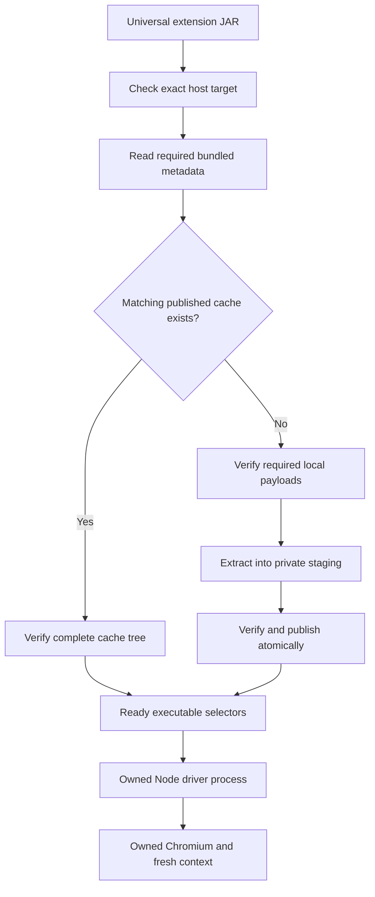

# One offline JAR for Windows, Linux and Intel macOS

* **Author:** rfrisch
* **Status:** Author-approved design; the five-stage EGM review is complete. All six review findings were accepted and resolved by the author on 2026-11-06. Production implementation is complete; Windows/Linux installation checks are recorded in [the validation report](../implementation/universal-packaging-validation.md). Native Intel macOS execution remains unrun.
* **Date:** 2026-11-06
* **Predecessor:** Approved concept brief
* **Review evidence:** Seven-lens brainstorm report
* **Predecessor reconciliation:** No divergence from the approved concept brief. D1, D2 and the approved sections resolve the brief's remaining design questions without adding a runtime dependency or changing its scope.

## Overview

Distribute Browser Powered Session Handler as one Java extension JAR containing the application and the browser components needed for Windows x64, Linux x64 and Intel macOS. Users load the same JAR into Burp on any of those targets. At first authentication, the extension prepares only the matching host's bundled Chromium and driver files in its verified local cache. Browser setup uses local files and does not download a browser or locate Burp's own browser installation.

The change replaces the earlier one-JAR-per-platform distribution decision while retaining the native Java authentication implementation. Journeys, token extraction, request tags, credential caching, session recovery, proxy routing and PKCS#11 behavior retain their existing responsibilities. The source implementation was copied into this worktree from the local `java-playwright` worktree, which remains untouched.

A native journey is a login configuration saved by the Java extension: browser actions plus rules for capturing tokens or cookies. A request tag such as `<@employee-login/>` is a placeholder in an HTTP request; the extension replaces it with the selected captured value and authenticates when needed. A journey using JSON response capture reads a field such as `access_token` from a login response. See [Create an authentication journey](../../README.md#create-an-authentication-journey) and [Use request tags](../../README.md#use-request-tags).

The initial package covers exactly three x64 targets. It contains no ARM payload and makes no Apple Silicon support claim. Chromium remains the only selected browser engine. Burp, its compatible Java runtime, required host-system libraries and optional vendor PKCS#11 middleware remain prerequisites; "offline" means browser/driver preparation from the complete extension JAR requires no additional download.

## The Problem

The native development build currently has a Windows-oriented browser producer and a platform-specific artifact name. Simply loading that artifact on Linux or macOS does not provide a verified matching native runtime. Users otherwise need to choose the right platform JAR, and the project must maintain several distribution artifacts.

Reusing Burp's embedded Chromium would reduce the extension's size, but would make authentication depend on discovering its executable and on compatibility with browser versions controlled by Burp updates. The author selected bundled, pinned Chromium builds to keep that dependency within the extension's release inputs.

One offline JAR necessarily includes compressed bytes for platforms a particular user will not execute. Those bytes cannot be eliminated while keeping all three native runtimes available in a single self-contained download. Native executables also need an extracted host cache. The space objective is therefore to avoid unnecessary copies and extract only what the host needs, rather than imply that the JAR is the whole installed footprint.

Measured source inputs give an estimated compressed package baseline of 761.1 decimal MB. The selected host source tree expands to approximately 537–570 MB, depending on platform. That suggests roughly 1.30–1.33 GB for the JAR and one extracted host tree, before filesystem allocation, metadata and authentication temporary files. The current extraction process also needs a temporary copy of the selected compressed archive, and upgrades can retain earlier caches. These are planning estimates, not measurements of a completed universal JAR; final artifact, installed and peak-space figures must be recorded separately.

The original practical objective remains to build the actual extension and verify it inside a Linux VM using Burp. The prepared Ubuntu 24.04 x64 VM is an available test environment, not evidence that the extension already works there. Browser payload presence, packaged bootstrap, real Burp behavior, software-token checks and physical-token compatibility are distinct evidence levels.

## Goals

1. **One distribution artifact.** Produce one extension JAR containing exactly the Windows x64, Linux x64 and macOS x64 payloads. Package checks must verify that inventory and reject accidental ARM inclusion or omission of a required target.
2. **Offline browser setup.** With Burp and documented host prerequisites already present, first use and later use prepare the matching pinned browser/driver entirely from the JAR or verified local cache. Runtime setup must neither download browser components nor fall back to an installed browser.
3. **Host-only preparation.** Select the exact supported host target and extract only its required files. Unsupported targets must fail with a specific explanation before extraction; a missing payload for a supported target must be identified separately from an unsupported host.
4. **Preserved integrity and ownership.** Retain the existing strict source/manifest/archive/tree validation, safe link and executable handling, private staging, atomic publication and immutable-cache rules. Cancellation and the original authentication budgets must remain effective during local setup and browser startup.
5. **Practical space minimization.** Identify the required copies of Node, driver JavaScript, Chromium and helpers; remove unjustified duplicates only after the delivered artifact proves the remaining bootstrap works. Measure the final JAR, selected expanded cache, temporary extraction peak and upgrade footprint. Do not present a compression estimate as an installed-size guarantee.
6. **Stable authentication behavior.** Preserve fresh browser/context state, attempt-owned processes, request handling and existing storage/credential boundaries. This packaging change must not require users to recreate native journeys or alter unrelated authentication semantics.
7. **Understandable local preparation.** Report the actual setup stage and positively identified failures using safe diagnostics. Users must be able to distinguish unsupported targets, cache/integrity failures and identified launch/prerequisite problems from a failed login without exposing credential values or raw authentication output.
8. **Evidence from the delivered JAR.** Adapt existing focused checks to the universal artifact and run the actual packaged bootstrap and authentication flow in the Linux VM/Burp environment. Record the artifact identity with results. Make verified-platform claims only for environments actually exercised; keep other bundled targets' acceptance status explicit.

## Non-Goals

* ARM binaries or initial Apple Silicon, Linux ARM or Windows ARM support.
* Firefox, WebKit or another browser engine.
* Burp-browser path discovery, attachment to the user's active browser session, or fallback to a separately installed browser.
* Runtime browser downloads, a general OS dependency installer or another end-user Java installation.
* Changes to journey formats, token/request-tag semantics, recovery behavior or secret storage beyond what the packaging boundary requires.
* A new authentication lab, broad acceptance suite or stress framework; those remain owned by the separate `test-suite` worktree under repository instructions.
* A physical hardware-token support claim inferred from successful software-token tests.
* Unmeasured commitments to a stronger compression codec, a shared-content cache, configurable cache roots, automatic cache eviction or an additional preparation action. These are not required by the approved concept and need a separate design rationale if proposed.

## Open Questions

The author has settled the resource layout and build arrangement through D1 and D2. The Technical Plan now carries forward existing ZIP, timeout and cache-lifecycle behavior. The remaining items are verification questions for implementation, rather than reasons to reopen the one-JAR/three-x64 decision:

* Required classloader resources: a focused Windows scratch probe passed with root `driver/` resources removed; [its evidence and limits](../implementation/driver-resource-probe.md) are recorded. The final universal artifact must still prove the pinned bootstrap and exercised operations on each tested platform.
* Measured acceptance: determine final JAR bytes, expanded allocation, extraction peak and cold/upgrade acquisition time on the actual Windows and Ubuntu test environments. These measurements do not exist yet.
* Native macOS evidence: no Intel macOS test environment has been established in this session. Its payload may be packaged and structurally checked, but native acceptance remains pending until that environment runs the delivered artifact.

The approved Overview & Goals are above. The approved Technical Plan records D1-A and D2-A and preserves the existing setup/cache lifecycles. The approved Alternatives Considered documents the evaluated paths. Detailed Implementation below makes the selected contracts and file changes concrete.

## Technical Plan (Architecture)

### Boundaries retained from the approved concept

Keep the existing separation between the build-time asset producer, `BrowserRuntimeManager`, its verified `Ready` selectors, `PlaywrightDriverAdapter`, and `BrowserFlowRunner`. The producer prepares the universal JAR; it does not run inside Burp. At runtime, the manager prepares local files, the adapter owns the Node driver process, and the runner owns the browser/context for a login attempt. No replacement Python service, external installer or Burp-browser discovery layer is introduced.

The release target inventory is exactly `windows-x64`, `linux-x64` and `macos-x64`. Normalize the JVM's existing OS/CPU observations and check this inventory before opening browser resources or creating extraction/cache paths. Recognizing an ARM architecture for an error message must not accept an ARM target. The observation describes the running JVM ABI; this change does not add translation detection or make an Apple Silicon support claim.

The runtime must distinguish an unsupported target from a supported target missing from a damaged/incomplete JAR. It must also keep integrity failures, cache contention, cancellation and positively identified native-startup/prerequisite failures separate. Error text must refer to the complete universal JAR rather than an alternate platform-specific download.

### Selected runtime flow



The selected layout must preserve the manager's bounded manifest/archive reads, file digests, path and filesystem-collision checks, contained-link resolution, executable modes, private staging, per-target locking and atomic publication. The manager must not write through a source symlink or modify an existing published cache. It opens and extracts only resources required by the selected host; other platforms remain compressed inside the JAR.

Published cache identity must depend on the selected host's manifest and payload bytes, not on unrelated foreign-platform payloads or the overall application JAR hash. Driver JavaScript is included in each selected host payload, so a change to that JavaScript changes the affected host bundle identity. The final JAR hash is still useful for verification records; it is not the cache key.

The `Ready` handle continues to supply the exact verified Node, driver JavaScript and browser paths. The adapter must not invoke the public Playwright installer, search PATH for a browser, mutate JVM-wide Playwright settings or replace the existing per-attempt ownership/cancellation boundaries. Any removal of dependency classloader resources must be checked with the delivered JAR's isolated bootstrap and exercised browser operations before it is accepted as safe.

### D1: Ownership of common driver JavaScript — A selected by the author

Each target needs different Chromium, helper and Node binaries. The Playwright driver JavaScript is common to all three targets. The locked JavaScript source subtree measures 13,656,167 bytes expanded and 3,209,873 compressed member bytes. Storing three copies instead of one costs about **6.4 MB of additional compressed source content** before final packaging. It does not add three installed copies on a computer: that host needs one extracted JavaScript tree in either option.

The author selected **A — Three self-contained platform archives** on 2026-11-06. This settles how those files are stored and verified inside the one JAR; it does not change browser engines, CPU coverage, offline behavior or the user's authentication workflow. The comparison below records the considered alternative; B was not selected.

| Option | Mechanism | Space and maintenance tradeoffs | Conditions that can fail |
| --- | --- | --- | --- |
| **A — Three self-contained platform archives** | Package a separately verified ZIP and manifest for each of the three targets. Each archive includes its Chromium, helpers, Node and driver JavaScript. A host reads one manifest/archive and uses the existing one-tree cache model. | Repeats the small JavaScript subtree in the JAR; avoids an additional shared-payload composition relationship. Only one JavaScript copy is extracted on each host. The producer must enforce that all three copied driver trees match the same locked version. | A target can be incomplete or drift from the locked compatibility set if producer checks are insufficient. Such a payload must fail verification. Removing a required dependency classloader resource can still break a lazy library lookup; packaged execution checks remain necessary. |
| **B — Three platform archives plus one common driver archive** | Package platform-specific Chromium/helpers/Node archives and one verified common JavaScript archive in the same JAR. For the selected host, verify and combine its native payload and the common payload into one private staging tree, then publish one complete cache. | Removes two repeated JavaScript copies, saving about 6.4 MB of compressed source content. Requires a strict contract binding both payloads, disjoint destination ownership, a combined host-cache identity and two-payload extraction/cancellation checks. The extracted host footprint is effectively unchanged. | A missing, mismatched or overlapping common/native pair must fail before publishing `Ready`. Incomplete identity binding could reuse an incompatible cache; weak merge checks could overwrite entries. Composition must never borrow mutable files from another published cache. |

Required Java classes and legal notices remain in the universal JAR. Keep extra native or JavaScript classloader representations only where the pinned library demonstrably needs them; selecting A does not establish that every existing `driver/` resource can be discarded without evidence.

Selected option A extends the current single-archive consumer contract with target-scoped resource lookup. The shared-payload composition contract described under B will not be added. This decision does not approve stronger compression, a cross-version shared cache, hard-link deduplication or automatic cache eviction.

### Self-contained resource layout and integrity

Use one universal artifact name, `browser-powered-session-handler-<version>.jar`, with three resource pairs:

```text
META-INF/bpsh/windows-x64/browser-assets.json
META-INF/bpsh/windows-x64/browser-assets.zip
META-INF/bpsh/linux-x64/browser-assets.json
META-INF/bpsh/linux-x64/browser-assets.zip
META-INF/bpsh/macos-x64/browser-assets.json
META-INF/bpsh/macos-x64/browser-assets.zip
```

Each ZIP contains the selected target's complete `browsers/` and `driver/` execution tree. The manifest describes only that tree, including its browser, Node and JavaScript selectors, required helpers, regular-file digests/sizes, executable flags and contained symlinks. The `archive.resource` field must identify that target's exact physical resource path in the JAR. The producer, schema and consumer must agree on that value; the runtime must reject another target's path, an external location or an arbitrary classpath resource. This replaces the old flat archive-resource assumption without introducing a shared-payload layer.

Preserve the existing per-target cache location, `user.home/.bpsh/cache/<platform>/<bundleDigest>/`. Continue deriving the bundle identity from the exact selected manifest and archive digest and verifying the completion marker/tree before returning `Ready`. A changed manifest/archive gets a separate cache; old caches are not relabeled or modified in place. The detailed implementation must specify the updated resource validation and its compatibility with existing cache markers.

For native metadata, use the existing strict file/link model rather than a separate extractor per OS. Windows executability includes the required `.exe` files. Linux and macOS executable declarations must cover Node, Chromium, subprocesses and helpers using the verified source modes and any explicitly audited source-specific requirements. Preserve safe macOS framework symlinks as links. Reject unsafe links and special-file entries; retain the runtime's bounded link resolution and deferred link creation. Do not flatten links, preserve set-user-ID behavior or relax extraction ceilings as an incidental packaging change.

The pinned Playwright Java version, JavaScript package version, Node version, Chromium revision and helper revisions are checked together. The source lock remains the authority for measured upstream source hashes, sizes and selected member mappings. Exactly the three selected target records participate in production packaging; the preliminary ARM records must not silently expand the artifact.

### D2: Universal assembly and native verification — A selected by the author

The author selected **A — Assemble all targets on one host; verify the delivered JAR on matching hosts** on 2026-11-06. The existing producer executes the selected Node binary and requires its target to match the build host. The selected arrangement separates structural/source verification from native execution evidence. It does not alter D1: the final JAR contains the same three self-contained platform archives. The comparison below retains the considered alternative; B was not selected.

| Option | Mechanism | Build and verification tradeoffs | Conditions that can fail |
| --- | --- | --- | --- |
| **A — Assemble all targets on one host; verify the delivered JAR on matching hosts** | One build host verifies the locked sources and produces all three target ZIP/manifest pairs and the universal JAR. It performs no foreign-binary execution. Separate native checks consume that finished JAR in each matching test environment and record its digest with their results. | Can create the universal artifact without requiring all three native builders. Keeps one producer and source-verification path. Structural checks still cannot establish that a foreign browser actually starts; test/support claims must follow recorded native results. | The package may pass structural checks and fail a later native startup, metadata or classloader check. Missing native test environments leave those targets unverified; they must not be reported as passed. |
| **B — Prepare payloads on their native hosts; combine them into the universal JAR** | Windows, Linux and Intel macOS builders each create a locked self-contained payload and perform native input checks. A final assembly verifies the three payload identities, source/version alignment and complete JAR inventory. Delivered-JAR bootstrap checks still run on the matching hosts. | Keeps native preparation close to its execution check, but adds three builder environments, intermediate artifacts and a composition/provenance contract before a universal artifact can be assembled. | A missing builder, incomplete payload set, unverifiable provenance or mismatched runtime versions prevents assembly. Passing a standalone payload's check does not prove its integration into the final JAR, so final native artifact checks remain necessary. |

The selected single-host assembler does not run foreign binaries. The required Linux VM/Burp check applies to the finished universal JAR. Shipping the macOS payload does not turn absent macOS execution evidence into a pass. Native verification remains developer/release work, with no change to the offline end-user setup.

### Single-host build and delivered-artifact checks

Extend the existing producer to prepare all three selected self-contained resource pairs from the measured source lock. Resolve and verify each distinct Maven/HTTPS source by its locked identity, size and digest before transforming members. Shared upstream inputs, such as the Maven driver bundle, need one verified source-cache object rather than three downloads. Runtime setup in Burp still has no network/install path.

Keep `prepareBrowserAssets` as explicit packaging/integration work. Ordinary compilation and unit tests must not acquire browser sources or start native processes. If Gradle is offline and a required locked source is absent, fail with a build-cache explanation. Build-time proxy settings remain separate from journey proxy configuration.

Produce each target's archive and manifest independently, with stable entry ordering, timestamps, metadata and JSON serialization. The selected target's source and compatibility facts determine its output; another target's unrelated changes must not alter its manifest or archive. No build-host absolute paths, build time or target-wide aggregate digest belong in a runtime manifest.

The universal assembly verifies the exact three resource pairs, their archive/entry integrity and the pinned Java/JavaScript/Node/browser/helper relationships. Retain existing checks for duplicate JAR names, host/test API leakage, signatures/descriptors, required notices and merged dependency resources. Treat redundant classloader Node payloads as removal candidates, then verify the retained resource set by executing the actual packaged bootstrap. Do not preserve a duplicate solely because an old Windows-specific test checks that it exists.

Move the producer's native Node version assertion into explicit host-native verification rather than weaken it or execute foreign binaries. The existing packaged-browser check must use the universal artifact name and the host's scoped resources. Verify the extracted host Node version and Chromium version, exercise the pinned driver adapter and browser operations, and confirm the private Playwright driver singleton/JVM settings remain unchanged. Record the universal JAR SHA-256, selected target, JVM/OS versions and exercised checks with each result.

Building a second JAR inside the Linux VM is not proof that the artifact produced on Windows works there. Copy and test the same completed JAR for the required VM/Burp check. If its bytes change, previous results apply only to the previously recorded digest. Broader authentication-lab and stress evidence still comes from the separate `test-suite` worktree; this feature adapts the existing focused checks.

### Runtime metadata and prerequisite boundary

The manifest retains the existing strict single-tree declarations: complete regular-file metadata, safe symlink targets, selectors, helpers, total sizes and one archive digest. The detailed implementation will spell out the schema's target-scoped `archive.resource` validation and the synthetic-fixture updates. The existing completion marker and content-derived cache relationship remain the cache model; no shared-payload marker is introduced.

Use the pinned upstream runtime's supported OS baseline for prerequisites, while keeping application verification claims separate:

| Bundled target | Upstream OS baseline to document | Evidence in this task |
| --- | --- | --- |
| Windows x64 | Windows 11+ or Windows Server 2019+, compatible with the pinned runtime | Run focused checks and Burp with the completed universal JAR on the available Windows host. Earlier tests of another artifact do not establish this artifact's result. |
| Linux x64 | Supported glibc-based Debian 12/13 or Ubuntu 22.04/24.04/26.04, with the pinned Chromium system libraries | Ubuntu 24.04 x64 VM is prepared. Actual packaged-browser, Burp and software-token results remain to be produced. |
| macOS x64 | Intel macOS 14 Sonoma or later | Source bytes, executable modes and framework links can be checked during assembly. Native execution remains unverified until an Intel Mac runs the delivered JAR. |

The upstream baseline comes from [Playwright Java system requirements](https://playwright.dev/java/docs/intro#system-requirements) for the currently pinned release. It is not an application test matrix. Burp supplies the extension's JVM; the current implementation requires Java 21+ and the Montoya capabilities it probes at startup. PKCS#11 journeys additionally require a compatible installed vendor module; software-token tests do not certify physical devices. Linux prerequisite installation is documented developer/operator setup, not an automatic extension behavior.

### Cold setup, progress and existing budgets

Retain the current lazy preparation lifecycle: a login attempt obtains a verified runtime before starting the driver/browser. Setup remains inside that attempt's original deadline and the journey cycle's original deadline. Existing defaults are a 60-second attempt and a 300-second cycle, with configured values remaining authoritative. Cache-lock waiting continues to use the shorter existing lock bound or remaining caller budget. Do not reset, pause or silently enlarge deadlines during extraction.

Report small, nonsecret local stages through the existing attempt/event/status path: waiting for the cache, verifying cached files, extracting bundled browser files, starting the driver and starting Chromium. Attribute observations to the captured journey generation and attempt so a late event cannot replace a newer editor/attempt state. Keep callbacks bounded and avoid filesystem or process work on Swing's event thread. Do not log raw Node/Playwright channel output, login values, token responses or PINs. Only positively identified launch/prerequisite failures receive specific recovery claims.

Measure a genuinely cold acquisition and the first complete validation of a published cache under the configured/default budgets; do not pre-acquire the runtime with a larger test budget and call that a normal cold-start result. Cancellation must clean only this invocation's owned temporary work. If selected-payload preparation cannot complete in the existing supported defaults on the measured test host, report that failure and revisit the design with evidence; do not conceal it with a longer test-only deadline. No additional preparation screen or background lifecycle is introduced by this plan.

Retain ordinary ZIP and the existing compression dependency for this first implementation. Stronger codecs and direct-from-JAR extraction are not introduced without a separate measured case. Report the finished artifact size and its difference from the 761.1 MB estimate, identify justified retained duplicates, and measure cache/temporary allocation. The estimate is a planning reference, not a user-approved hard size ceiling.

### Cache transition, rollback and manual recovery

Retain immutable published caches across unload and upgrade. Reuse a cache only when its identity, marker and complete file/link tree pass the new artifact's required checks. If the target manifest or archive changes, publish a new host cache alongside the old one. Do not translate or relabel an old cache under a different identity, or mutate a published tree to match a new release. Old artifacts can continue to use their own unchanged caches for rollback.

Normal cancellation/error cleanup removes only the current invocation's checked archive/staging paths. The extension does not automatically delete older published generations or another process's abandoned work. The existing setup lock proves extraction ownership, not that a published tree has no active users, so this packaging change does not add automatic eviction.

Document precise manual inventory and recovery for old or abandoned cache material. Before manual removal, stop all Burp instances that could use the affected cache. Instructions must identify the relevant cache or staging path and keep `user.home/.bpsh/library-v3.json` and other user data out of the cleanup scope. Confirmed corrupt caches retain the existing close-users/remove-that-cache/reload workflow. A generic launch failure must not imply that cache removal will fix a missing OS library.

For JAR bytes J, selected compressed payload C, expanded host tree E and retained caches R, report steady space as approximately J + E + R and extraction peak as J + C + E + R, plus filesystem allocation, metadata and attempt files. Include a real upgrade measurement, not only a fresh install. This retained/manual lifecycle preserves current behavior and rollback; automatic reclamation or cross-version file sharing remains outside this implementation.

### Component responsibilities and verification boundaries

| Existing boundary | Required responsibility in the universal design |
| --- | --- |
| `bapp/browser-assets.lock.json` and `bapp/gradle/browser-assets.gradle.kts` | Describe and verify exactly the selected three target inputs; preserve native metadata; produce the selected self-contained layout with reproducible target outputs and consistent pinned versions. Reconcile the preliminary five-target lock and Windows-only producer. |
| `bapp/build.gradle.kts` and JAR packaging checks | Produce one universal artifact, retain required shared Java resources/notices, detect unjustified native duplication, and verify the exact three-target inventory and each embedded payload's integrity. |
| `BrowserRuntimeManager` and the browser-assets schema | Check target eligibility before resource access; enforce the selected metadata/layout contract; verify, extract and publish only the selected host's complete execution tree. |
| `PlaywrightDriverAdapter` | Start the pinned extracted Node/JavaScript, preserve attempt-owned temporary files and process cancellation, and expose only bounded, safe setup diagnostics. |
| `BrowserFlowRunner` and existing local setup/event presentation | Continue using verified selectors and fresh contexts; report preparation separately from login actions without silently extending attempt/cycle deadlines. |
| Existing focused asset and packaged-browser checks | Verify actual universal-resource selection, successful executable/link preservation, offline cache preparation, cancellation and isolated bootstrap from the final JAR. Broader lab and stress ownership stays with `test-suite`. |

Universal assembly and host-native verification follow selected D2-A. D1-A keeps each host archive self-contained. The plan retains the existing ZIP format, lazy attempt-bounded setup and immutable/manual cache lifecycle, adding the required target-aware metadata, safe setup observations and artifact checks. The alternatives below record the considered paths; Detailed Implementation specifies the exact file/API/test changes.

## Alternatives Considered

These alternatives come from the approved predecessor's Alternatives Weighed section and the author's subsequent D1/D2 choices. Author rejections and deferred optimizations are identified separately.

### Separate platform JARs

**Mechanism:** distribute one extension JAR per operating-system/CPU target, each containing only its matching Chromium, Node and driver files.

**Benefits:** smaller individual downloads and fewer unused native bytes on each machine; each target can be packaged independently.

**Costs and failure conditions:** users or distribution tooling must choose the right artifact. Installing a mismatched JAR cannot supply the required native runtime, and releases require several distributable files.

**Disposition — Rejected by author:** the author replaced the earlier platform-JAR decision with one distributable JAR for all three selected x64 targets. The chosen package accepts compressed foreign-platform bytes to remove artifact selection from installation.

### Add the measured ARM targets

**Mechanism:** include Linux arm64 and macOS arm64 alongside the three x64 payloads. The same runtime would select among five bundled targets.

**Benefits:** broader native CPU coverage, including Apple Silicon, without runtime browser downloads.

**Costs and failure conditions:** browser/helper archives and Node binaries for all five measured targets total approximately 1.221 GB compressed before the shared application baseline. Each added target also needs its own metadata and native verification; bundling its bytes does not prove that it works. This measured five-target set does not include Windows ARM64.

**Disposition — Rejected by author for the initial scope:** when asked about ARM coverage, the author chose the bare minimum against the stated three-x64 baseline. The selected package therefore contains Windows x64, Linux x64 and Intel macOS only; it makes no ARM or Apple Silicon support claim.

### Reuse Burp's installed Chromium

**Mechanism:** bundle the extension's driver components but locate and launch Chromium already supplied by the user's Burp installation, with separately owned browser state.

**Benefits:** removes most browser payload bytes from the extension while potentially retaining offline operation. A focused Windows probe showed that the pinned driver could automate the installed Burp Chromium in visible and headless modes when given its executable path.

**Costs and failure conditions:** the probe did not establish reliable discovery. No documented browser-path getter was found in the checked Montoya API, so native, standalone-JAR and distribution-package layouts need discovery rules or a user override. A path can remain valid while a Burp browser update becomes incompatible with the pinned driver. A local smoke test does not establish cross-platform or cross-version support.

**Disposition — Rejected by author:** after considering browser reuse and its path/version dependency, the author selected the Burp standalone-JAR style of bundling the main platform browsers. The extension consequently controls its pinned browser inputs and does not need Burp-browser discovery.

### Download the matching browser at first use

**Mechanism:** ship a smaller driver/application JAR and fetch only the selected host's Chromium/helper payload during local setup.

**Benefits:** avoids downloading unused browser platforms and keeps the initial JAR smaller.

**Costs and failure conditions:** first use depends on network access, upstream availability and any required proxy configuration. Copying the JAR to an offline machine would no longer be sufficient to prepare its browser runtime.

**Disposition — Rejected by author:** additional browser downloads violate the approved offline setup requirement. Explicit build-time acquisition of locked sources remains developer packaging work and is not this alternative.

### One shared driver JavaScript archive

**Mechanism:** keep native files in three target archives and put the common driver JavaScript in a fourth, shared archive inside the same universal JAR. The manager combines the common and selected native files into one verified host cache.

**Benefits:** removes two repeated JavaScript representations, approximately 6.4 MB of compressed source content before final packaging. Both layouts still install one JavaScript tree on the host.

**Costs and failure conditions:** requires a composition contract binding both payload identities, non-overlapping destination ownership and a complete combined-cache check before publication. A missing or mismatched pair must fail; incomplete identity/merge checks could reuse or publish an incompatible tree.

**Disposition — Rejected by author at D1:** the author selected three self-contained platform archives. The chosen arrangement retains the existing one-manifest/one-archive execution-tree model and accepts the small repeated JavaScript content instead of adding the shared-payload relationship.

### Prepare each payload on a native builder before assembly

**Mechanism:** Windows, Linux and Intel macOS builders each produce their target payload and perform native input checks. A final assembler verifies and combines the three outputs into one JAR.

**Benefits:** native preparation and its input checks run together on a matching OS.

**Costs and failure conditions:** requires all three builder environments, intermediate artifacts and source/version/provenance checks before universal assembly. A missing builder or mismatched payload prevents assembly. Passed standalone-payload checks still do not establish that the final JAR boots correctly, so native checks of the delivered artifact remain necessary.

**Disposition — Rejected by author at D2:** the author selected assembly of all three payloads on one host, followed by native verification of that finished JAR. This keeps one producer while preserving the distinction between structural assembly checks and runtime evidence from each tested platform.

### Deferred space and lifecycle optimizations

The predecessor also identified stronger compression and further resource deduplication as measured candidates rather than selected mechanisms. Stronger codecs might reduce the JAR, but may increase cold-extraction time, memory, dependency maintenance or validation work inside the existing login budget. Direct-from-JAR extraction could avoid a temporary archive copy, but changes the current verified-spool/extraction boundary. Neither saving is established by the current source-size measurements.

Automatic old-cache eviction or cross-version file sharing could reduce retained space, but needs an active-use/rollback contract that the existing setup lock does not provide. A separate preparation lifecycle could change first-use timing, but would introduce another operation and cancellation/ownership path. These are future proposals if implementation measurements demonstrate a need.

**Disposition — Deferred in the approved Technical Plan:** retain ordinary ZIP, selected-host extraction, lazy setup within existing deadlines and the immutable/manual cache lifecycle for this implementation. Remove unjustified duplicate classloader native resources only with evidence from the delivered artifact; D1's deliberate JavaScript copies are not an accidental duplicate to remove. Any new codec, shared-cache relationship, eviction mechanism or separate preparation flow needs a measured rationale and a subsequent design decision.

## Critical User Journeys

### First authentication on a supported host

* **Given:** the complete universal JAR is loaded in compatible Burp, documented host prerequisites are installed, a valid native journey exists, and this host bundle has no published cache.
* **When:** Test login or an eligible request starts authentication.
* **Then:** report local preparation stages, read only the matching target's payload, publish a fully verified host cache, and run the login with fresh browser state within the original attempt/cycle budgets. No browser download or foreign-platform extraction occurs.

### Restart, upgrade and rollback

* **Given:** an earlier host cache exists, and the extension is restarted or replaced using Burp's Loaded off/on workflow.
* **When:** the new instance obtains its runtime.
* **Then:** verify and reuse the matching immutable cache, or publish a separate one if manifest/archive identity changed. Preserve older published caches and user journeys. Rollback can use the prior artifact's own cache; manual cleanup occurs only after its users have stopped.

### Unsupported or locally blocked setup

* **Given:** the JVM target is unsupported, a supported payload is missing/corrupt, another instance holds its setup lock, or a positively identified local execution/access failure occurs.
* **When:** authentication attempts to prepare/start the runtime.
* **Then:** retain the appropriate typed failure and safe stage-specific guidance. Unsupported hosts fail before resource/cache access. Cancellation and bounded waiting remain effective; no fallback browser, download, partial publication or raw authentication output is introduced.

## Non-Functional Requirements

Integrity, ownership and finite deadlines remain required outcomes. All platform input/output work is off Swing's event thread, and the existing browser-worker admission bounds remain authoritative. Observability contains only fixed stage descriptions, target/runtime identity and safe classified failures, never credentials, selectors, response bodies or arbitrary process output. This change adds no remote telemetry, new runtime dependency or automatic cache deletion.

The implementation records measured package, steady-state, upgrade and extraction-peak space separately. The current estimates are not a hard size ceiling. Browser/driver versions are one pinned compatibility unit; source hashes alone do not prove native execution, and a software token does not prove physical-device support.

## Detailed Implementation Plan

### Implementation baseline and order

Make production changes only in this checkout, using its imported native source snapshot. Leave the source `java-playwright` and separate `test-suite` worktrees untouched. The two existing preliminary changes—five-target source-lock data and partial resource mapping—must be reconciled rather than treated as an already working universal implementation. Generated downloads, VM images, private fixtures and scratch executables stay outside versioned source.

Implement the work groups below in order. The file inventory remains the single implementation list. No dependency upgrade, new production source file, journey-schema migration or separate test framework is planned.

### Work groups and required checks

Each group includes its matching tests. Complete its checks before starting the next group; a failed check stops progress until the same group is repaired. The inventory below remains the single file list. A file used in more than one group is edited in stages, with the earlier group's behavior preserved.

| Group | Files from the implementation inventory | Required check before proceeding |
| --- | --- | --- |
| 1. Agree on the bundled files and produce the universal JAR | `browser-assets.lock.json`, `browser-assets.gradle.kts`, `build.gradle.kts`, `browser-assets.schema.json`, `BrowserRuntimeManager.java`, `BrowserAssetsTest.java` | Change the source lock, scoped resource/schema rules, producer, shared runtime staging and synthetic consumer fixtures together. Run `gradlew.bat classes test verifyBrowserAssetProducer --offline --console=plain`, then `gradlew.bat jar --offline --console=plain`. Both must pass; the JAR gate must find exactly three valid target pairs and no root `driver/` data. No native integration result is claimed at this point. |
| 2. Report setup and startup safely | `BrowserRuntimeManager.java`, `PlaywrightDriverAdapter.java`, `BrowserFlowRunner.java`, `AuthenticationCoordinator.java`, `UiController.java`, `Extension.java`, `BrowserAssetsTest.java`, `AuthenticationCoordinatorTest.java`, `UxControlMatrixTest.java`, `BrowserFailureMessagesTest.java` | Run `gradlew.bat classes test verifyBrowserAssetProducer verifyNativeDocumentation --offline --console=plain`. Require passing tests for current-attempt stages, late/cancelled callbacks, safe errors, cleanup and unchanged deadlines. Keep the original method overloads working. |
| 3. Test the actual delivered JAR | `build.gradle.kts`, `BrowserJourneyIntegrationTest.java`, `IntegrationFixtures.java` | Run `gradlew.bat browserIntegrationTest --offline --console=plain`, supplying `-PoldPackagedJar=<existing-host-compatible-old.jar>` when an old artifact is available. Require real discovered tests, mandatory cold/cache probes, version/bootstrap assertions and passing existing browser assertions. Preserve the delivered JAR's hash. Check external-artifact task dependencies and classpaths: the supplied JAR is used without invoking `jar` or `prepareBrowserAssets`. |
| 4. Verify Linux and record the result | `README.md`, `bapp/README.md`, `bapp/CLAUDE.md`, `test/mTLS-app/README.md`, `docs/designs/bapp-owned-authentication.md`, `docs/implementation/universal-packaging-validation.md` | Document only implemented behavior. In Ubuntu run ordinary unit/producer/doc checks, then both existing integration tasks against the copied, hash-matched JAR; complete the Burp and offline checks below. Record failures and unrun cases. Intel macOS remains unverified until a matching environment runs the delivered artifact. If production fixes change the JAR, issue a new hash and rerun the affected checks. |

Ordinary unit/producer/doc checks do not require real browser-source preparation. The phase-1 JAR command and explicit integration tasks do require prepared real sources. Developer dependencies must already be available for the displayed offline commands. At each checkpoint retain the normal Gradle results; place the final counts and artifact identities in the validation report. The separate `test-suite` worktree and its broader lab remain untouched.

### Exact resource, schema and cache contract

1. The supported runtime target set is exactly `windows-x64`, `linux-x64`, `macos-x64`. Keep existing OS/JVM-architecture normalization, but reject any other normalized result in `acquire` before calling `Resources.open`, creating cache parents or mapping resource paths. Return `Phase.SETUP` / `Cause.UNSUPPORTED_PLATFORM` with the detected target and the three supported payload targets. The helper used to construct resource names may reject invalid programmatic inputs, but it must not be the user-facing unsupported-host classifier.
2. Keep `formatVersion: 1` and the current strict lock/manifest object shapes. Constrain platform values to the three targets; the producer additionally requires the complete, unique three-record lock inventory. Each bundled manifest's `archive.resource` is the exact physical path `META-INF/bpsh/<its-platform>/browser-assets.zip`. The schema uses three platform-specific conditions to bind that field to the matching platform, and the runtime independently requires exact equality. Reject the former flat path, another platform's archive, unknown fields, duplicate JSON members and trailing values.
3. `Resources.open(name)` accepts actual physical resource names. The default classloader boundary opens that name unchanged. Construct the scoped manifest/archive names at their call sites with the existing `platformResource` helper and restrict that helper to the three targets and the two fixed asset filenames. Remove the preliminary default-loader remapping that would otherwise scope an already scoped name twice. Synthetic test bundles must supply those same physical names.
4. Keep the existing v1 completion marker fields and bundle identity: SHA-256 of UTF-8 `bpsh-assets-v1` plus LF, raw manifest SHA-256 bytes and raw archive SHA-256 bytes. Keep the per-target cache root and all current extraction ceilings: manifest 32 MiB, archive 2 GiB, expanded regular bytes 4 GiB, file 1 GiB, 100,000 entries, UTF-8 paths/targets 4,096 bytes, depth 32 and 16 link hops. Scope the manifest before deriving its identity; the overall JAR hash and other platform manifests are not cache inputs.
5. The new physical `archive.resource` value changes existing flat-manifest identity. Publish a new cache when needed; do not migrate an older directory in place. The old marker format remains meaningful for rollback by an older artifact. Normal current-invocation cleanup stays unchanged; no old-cache or abandoned-work scavenger is added.

### Producer and shared-Java rules

* Retain the measured Windows/Linux/macOS x64 source records and their pinned digests/byte counts; remove the two preliminary ARM records from the production lock. Chromium stays revision 1248 / version 156.0.8078.4, Playwright Java 1.64.0, driver package 1.64.1, Node 24.22.1 and ffmpeg 1013. Only Windows requires the locked winldd 1007 helper. Select Node from `driver/win32_x64`, `driver/linux` or `driver/mac` respectively and place the selected subtree at the payload's `driver/` root.
* `prepareBrowserAssets` prepares all three pairs, independently, under `build/generated/browser-assets/META-INF/bpsh/<platform>/`. Reuse verified digest-addressed source-cache objects. When `gradle.startParameter.isOffline` is true, a missing HTTPS source fails before constructing/sending a download request. Existing locked HTTPS/proxy behavior applies only to explicit online developer preparation.
* Preserve strict source ZIP read limits, mapping-prefix checks, copy completeness, collision checks and whole-source hash/size checks. Use the existing Commons Compress dependency for ZIP input/output so Unix link metadata survives. Accept regular entries with no Unix type bits or regular-file type, contained symlinks on POSIX targets, and implicit directories; reject devices and other special types. Symlink payloads use bounded strict UTF-8. Validate declared link destinations and selector resolution with the existing runtime manifest validator after the candidate manifest is complete and before outputs are published.
* Mark Windows `.exe` files executable. For POSIX regular files, derive the executable flag from source execute bits; include subprocess/helper executables, not only the two main selectors. Output regular modes are 0755/0644, links retain link metadata/target bytes, and set-user-ID/group-ID bits are not propagated. Keep deferred link creation, target-filesystem collision checks and all runtime containment checks.
* Sort mapped entries by final path, fix timestamps and output metadata, and use stable UTF-8 JSON serialization. Prepare and validate temporary outputs before replacing the target pair. A failed task must not leave a pair eligible for JAR assembly. Do not delete unrelated build outputs, and bound any staging cleanup to the checked owned build subdirectory.
* The task may depend on compiled main classes and use a short-lived isolated classloader containing those classes plus runtime dependencies solely to call `BrowserRuntimeManager.parseManifest` for the selected target. Close it after validation. Loading this validator must not instantiate a runtime, create caches, launch Node/browser processes or call the public Playwright factory. This reuses the consumer's path/link/selector rules instead of implementing another resolver in Kotlin. Ordinary `classes`/`test` tasks do not depend on asset preparation.
* `assemblePlatformRuntime` retains its task name but stages shared Java/dependency content for the universal artifact. Exclude all root classpath `driver/` data from dependency JARs while retaining the actual Java classes under `com/microsoft/playwright/`, notices and existing service/Netty/multi-release merges. Complete Node and JavaScript execution files remain inside each selected asset ZIP. The [focused removal probe](../implementation/driver-resource-probe.md) supports this exact exclusion; the final packaged checks are still required.
* Name the development artifact `browser-powered-session-handler-dev.jar` and release artifacts `browser-powered-session-handler-<releaseVersion>.jar`. Keep existing safe release-version validation. The packaging contract is universal; reject a supplied legacy `bundlePlatform` property with an explanation rather than silently produce a narrowed or mislabeled artifact. Verify exactly the three resource pairs, each archive digest/size and its manifest/tree declarations, no root `driver/` data, no ARM payload directory and the existing forbidden/duplicate entries. Do not execute foreign Node binaries during this task.

### Focused checks of the asset producer

Keep these checks in `bapp/gradle/browser-assets.gradle.kts` as the new Gradle verification task `verifyBrowserAssetProducer`. `bapp/build.gradle.kts` makes `check` depend on it. It is also independently callable as `gradlew.bat verifyBrowserAssetProducer --offline --console=plain` or `./gradlew verifyBrowserAssetProducer --offline --console=plain`. It does not depend on `jar`, `prepareBrowserAssets`, real browser sources or native execution. Its only compiled-main dependency is `compileJava`, plus the already pinned dependencies needed by the isolated manifest validator. No test framework or dependency is added.

Move the existing transformation out of the `prepareBrowserAssets.doLast` body into shared script functions. Both the real preparation task and this verification task call the same source loader, mapper/writer, validator and publication functions; there is no second test implementation of mapping or link resolution. The boundary is:

* `loadVerifiedSource` accepts a validated source record, an explicit source-cache root, offline flag, resolved Maven inputs and a download callback. It returns a whole-source size/hash-verified local ZIP. Offline cache misses fail before invoking that callback. The real task supplies the existing locked HTTPS/proxy downloader; the verification task supplies a callback that counts calls and fails immediately.
* `prepareTargetPayload` accepts the validated target record, verified source ZIPs, the matching driver JAR, a private staging directory and the existing manifest-validator callback. It writes the scoped ZIP/manifest candidate using the production mapping and mode/link rules. It accepts file/data inputs and does not execute Node, Chromium, a shell or the public Playwright installer.
* The same publication function validates both candidate files before making the target output available. Candidate construction failures leave previous valid outputs unchanged and expose no mixed/new pair. A failed preparation task prevents dependent JAR assembly. Cleanup remains restricted to the resolved owned staging directory.

The verification task creates its own directory under `build/tmp/verifyBrowserAssetProducer` and generates tiny local source ZIPs, a tiny driver JAR and synthetic target records with measured fixture hashes/sizes. It uses the same strict record parser and the same pinned metadata labels; it never alters the production lock or source cache. The driver fixture includes the required package label, browser registry, JavaScript entry and three selected Node paths. Node/browser bytes are deliberately non-executable sample data: successful preparation must preserve them without attempting to run them. The manifest validator checks metadata/selectors without instantiating a runtime. Report a failed assertion as a failed Gradle task and write a bounded summary of case names, counts and outcomes to `build/reports/browser-asset-producer/results.json`; omit file contents and network credentials.

Required cases are fixed:

1. Produce each of the three targets from local fixtures. Check the exact scoped archive resource, selectors/helper copies, file bytes/hashes, Windows executable flags and POSIX source-derived execute flags. Include an executable helper beyond the main selectors, a non-executable JavaScript file, implicit directories and safe macOS-style relative links/chains.
2. Reject traversal, invalid/missing copy prefixes, duplicate and target-filesystem case collisions, file/directory conflicts, escaping or cyclic links, invalid UTF-8 link targets, special Unix file types and missing selectors. Check that set-user-ID/group-ID bits are never propagated. These checks inspect ZIP/manifest metadata on Windows; successful real link/mode extraction is separately required in Linux consumer tests.
3. Fail whole-source hash/size mismatches and an offline cache miss. For the miss assert zero download-callback calls and no published candidate. For valid cached sources assert that the callback remains unused. Fixture bytes and the task dependency graph require no downloaded browser or native program.
4. Run unchanged fixture preparation twice in separate private staging directories and compare exact manifest/ZIP bytes. Change only one target's fixture input and confirm the other target pairs remain identical. This uses the same ordering/timestamp/JSON policy as production.
5. Feed a failing fixture after a valid output and compare the old pair byte-for-byte; verify that no partial replacement is visible and owned temporary work is cleaned. Exercise publication failure using an owned unwritable/conflicting destination and require a failed task with no newly usable pair.

These are producer checks. `BrowserAssetsTest` continues to check the runtime consumer with its existing small in-memory bundles. Both are required; successful consumer extraction alone does not prove that the producer mapped upstream files correctly.

### Setup observation and safe failure contract

Add a nested `BrowserRuntimeManager.SetupStage` enum with `WAITING_FOR_CACHE`, `VERIFYING_CACHE`, `EXTRACTING_BROWSER`, `STARTING_DRIVER`, `STARTING_BROWSER` and `AUTHENTICATING`. These values are fixed metadata, not strings taken from the browser. Add `acquire(deadlineNanos, cancelled, Consumer<SetupStage>)`; retain the existing two-argument overload by delegating with a no-op observer. The manager emits its cache stages, while the runner emits startup stages and `AUTHENTICATING` when local preparation ends or the browser proceeds to the journey. Repeated lock-poll iterations must not flood events. An observation callback failure must not prevent mandatory cleanup or change authentication policy.

Add an observer overload of `BrowserFlowRunner.run` while keeping its existing signature/lifecycle constructor behavior. The production coordinator uses it through an additional default observer overload on the existing four-argument `Attempt` interface. Its default implementation calls the original abstract method, preserving existing lambda-based test doubles. The production adapter implements both overloads, keeps the existing secret snapshot ownership, and forwards the observer to the runner.

The coordinator captures the exact `Cycle` object and attempt number in the observer. Under its existing monitor it accepts an update only if the extension is open, the cycle is uncancelled and current for the same state/generation, its phase is RUNNING and its attempt number still matches. Keep an optional setup stage on that cycle and expose it as the final nullable component of `Status`; use null outside an active RUNNING attempt. Append only distinct fixed descriptions through the existing bounded `JourneyEventLog`. Clear/ignore observations on cancellation, backoff, completion, replacement and unload. Existing retry counts, deadlines, slot ownership and token publication are unchanged.

`UiController` maps those accepted stages onto the existing active status text—waiting for browser setup, verifying bundled files, extracting bundled browser files, starting the browser driver, starting Chromium, and the existing signing-in state. Its current editor/generation checks and timer remain in place. Do not add a setting, preparation button, new event panel, remote telemetry or a new authentication coordinator phase.

Keep `AuthenticationFailure`'s existing enums and retry classification. Known missing resources remain ASSET_MISSING, malformed/integrity-invalid content remains ASSET_CORRUPT, and contention/cancellation/timeouts retain their existing causes. A typed access denial may return CONFIGURATION with safe cache/executable access guidance. An unrelated I/O or native launch failure remains UNKNOWN with a local setup/startup description; do not label every I/O error as corruption. A best-effort free-space observation may identify insufficient space only when a successful read reports less than the selected archive plus expanded-byte requirement. Unsupported or failed space queries do not establish disk exhaustion. No parsing of arbitrary localized OS text is needed.

While the manager is performing local preparation, reattribute an elapsed TIMEOUT to that setup operation using a fixed message; preserve its deadline and cause. Driver and Chromium launch have narrow stage-specific catch boundaries. Report a known missing executable/access failure or a driver process that exited during initialization without retaining its stdout/stderr or raw exception text. Keep Node stderr discarded for this implementation. Unknown Chromium startup directs users to the documented prerequisite boundary without claiming that a missing library was proved. Browser/navigation/action failures after launch retain their existing classification and precedence.

### Target files to create or modify

All links are relative to this design directory. Every planned production, test, schema and documentation edit is listed; no deletion of a source file or dependency version upgrade is planned. Verified checksum additions needed for fresh Linux resolution are recorded below.

| File | Action | Change and rationale |
| --- | --- | --- |
| [.gitattributes](../../.gitattributes) | Create | Keep the Unix Gradle launcher in LF text format on Windows checkouts. This fixes the Linux setup failure found during implementation. |
| [bapp/gradlew](../../bapp/gradlew) | Modify | Normalize the Unix launcher to LF so its shebang works on Linux; the guest/developer instructions retain the explicit executable-permission step. |
| [bapp/browser-assets.lock.json](../../bapp/browser-assets.lock.json) | Modify | Keep exactly the three measured x64 records, matching source hashes/versions/selectors and target helper sets; remove accidental ARM packaging scope. |
| [bapp/gradle/browser-assets.gradle.kts](../../bapp/gradle/browser-assets.gradle.kts) | Modify | Implement all-target pure-data preparation, POSIX metadata, scoped resources, shared Java staging without root `driver/` data, offline-source failure, deterministic output and universal JAR gates. Reuse the isolated manifest validator; remove producer-side native execution. Define the shared source/transformation/publication functions and `verifyBrowserAssetProducer` synthetic verification task specified below. |
| [gradle/verification-metadata.xml](../../bapp/gradle/verification-metadata.xml) | Modify | Add verified checksums for four metadata files requested by a fresh Linux dependency resolution. Confirm Maven Central published checksums; retain all resolved dependency versions and strict verification. |
| [bapp/build.gradle.kts](../../bapp/build.gradle.kts) | Modify | Wire `check` to producer verification, the existing integration tasks to the delivered artifact, and the external-artifact mode below. Supply the explicit probe classpath/results directory and optional old artifact; require cold/cache probes on every explicit browser run. Preserve unit/native suite separation, prerequisite failures and doclint. |
| [browser-assets.schema.json](../../bapp/src/main/resources/browser-assets.schema.json) | Modify | Keep the v1 record shapes, restrict the three platform values and bind each manifest's archive resource to its own scoped path. Preserve strict fields, types and extraction limits. |
| [BrowserRuntimeManager.java](../../bapp/src/main/java/BrowserRuntimeManager.java) | Modify | Apply exact target validation before resource/cache access, use physical scoped names once, validate the scoped manifest, preserve cache/extraction semantics and expose bounded setup observations and safe local failure attribution. |
| [PlaywrightDriverAdapter.java](../../bapp/src/main/java/PlaywrightDriverAdapter.java) | Modify | Keep the owned extracted Node/JS bootstrap and private ABI; distinguish narrow, positively identified startup failures without raw process output or global property/environment changes. |
| [BrowserFlowRunner.java](../../bapp/src/main/java/BrowserFlowRunner.java) | Modify | Forward setup observations and identify driver/browser startup boundaries while preserving native TLS, traffic guards, fresh contexts, extraction and cleanup. |
| [AuthenticationCoordinator.java](../../bapp/src/main/java/AuthenticationCoordinator.java) | Modify | Add the backward-compatible `Attempt` observer overload, production forwarding, cycle/attempt/generation-checked stage state, bounded event descriptions and nullable status component without altering admission/retry/storage policy. |
| [UiController.java](../../bapp/src/main/java/UiController.java) | Modify | Display accepted setup stages in the existing status surface and retain current editor/attempt guards, controls and EDT boundaries. |
| [Extension.java](../../bapp/src/main/java/Extension.java) | Modify | Replace the obsolete matching-platform-JAR startup recovery text with the complete universal-JAR terminology. Keep current service graph, capability checks and unload order. |
| [BrowserAssetsTest.java](../../bapp/src/test/java/BrowserAssetsTest.java) | Modify | Generalize the small in-memory resource boundary for scoped target names; exercise exact target selection, no foreign extraction, typed unsupported/missing/corrupt cases, successful POSIX link/mode extraction, cancellation, callback safety and unchanged cache/marker invariants. |
| [BrowserJourneyIntegrationTest.java](../../bapp/src/test/java/BrowserJourneyIntegrationTest.java) | Modify | Test the selected delivered JAR, absence of root `driver/` resources, exact host resources, Node/browser versions, isolated bootstrap, cold/warm behavior and actual browser operations. Preserve existing focused journey assertions. Add the required parent test that invokes and validates cold/cache/update/rollback subprocess results. |
| [IntegrationFixtures.java](../../bapp/src/test/java/IntegrationFixtures.java) | Modify | Resolve the explicit artifact input and implement the nested `RuntimeProbe` entry point with the fixed modes, 60-second budget, ownership/evidence contract and existing loopback fixture helpers described below. |
| [AuthenticationCoordinatorTest.java](../../bapp/src/test/java/AuthenticationCoordinatorTest.java) | Modify | Verify current-attempt stage acceptance, stale/cancelled/replaced/old-attempt rejection, terminal clearing and unchanged captured deadlines using existing deterministic clocks/workers. |
| [UxControlMatrixTest.java](../../bapp/src/test/java/UxControlMatrixTest.java) | Modify | Extend existing UI/status coverage for the fixed setup-stage text and prevent stale work from replacing another selected journey or a later attempt. |
| [BrowserFailureMessagesTest.java](../../bapp/src/test/java/BrowserFailureMessagesTest.java) | Modify | Check the narrow setup/startup classifications, unknown-cause preservation and absence of injected secret-bearing exception/process text; retain current network-symbol cases. |
| [README.md](../../README.md) | Modify | Document the one-JAR install, three bundled targets, no ARM claim, prerequisite boundary, local setup stages and measured/candidate support status. |
| [bapp/README.md](../../bapp/README.md) | Modify | Document universal build/native commands, external-artifact verification, pinned inputs, cache identity/retention and precise manual recovery/space accounting. |
| [bapp/CLAUDE.md](../../bapp/CLAUDE.md) | Modify | Link the finalized packaging design and explain the universal artifact and preserved ownership boundaries for future work. |
| [test/mTLS-app/README.md](../../test/mTLS-app/README.md) | Modify | Update native task/artifact wording and show explicit Linux tool/module paths for the existing disposable fixture helper. Keep Python/SoftHSM clearly developer-only and do not change fixtures or stored keys. |
| [bapp-owned-authentication.md](bapp-owned-authentication.md) | Modify | Add a narrowly scoped approved-packaging amendment linking the finalized universal design, superseding only earlier platform-JAR distribution paragraphs. Preserve historical implementation/acceptance evidence and other authentication decisions. |
| [universal-packaging-validation.md](../implementation/universal-packaging-validation.md) | Create | Record the actual source/test snapshot, delivered JAR hash/inventory, executed checks, OS/JVM/runtime versions, space/time results, Burp observations and explicitly unrun platform/provider cases. Never include fixture PINs, credentials or license contents. |

The current design draft, approved concept brief, review artifacts and [removal probe evidence](../implementation/driver-resource-probe.md) are design records. That finalization is documentation work, not an implementation change to the running extension. Generated `build/` outputs are task-owned artifacts, not extra source files to add to this inventory.

### Delivered-artifact execution mode

Add optional Gradle property `packagedJar` for the two existing explicit integration tasks. Without it, they depend on `jar` and use `build/libs/browser-powered-session-handler-dev.jar` (or the selected release version). With it, validate the given existing JAR and do not depend on `jar` or `prepareBrowserAssets`; compiling the existing test classes remains allowed. Pass its canonical path to test JVMs as `bpsh.packagedJar`.

In both modes, execute main classes/resources from that candidate JAR, not `sourceSets.main.output` or `build/generated/browser-assets`. Use test output plus the candidate JAR and only test/host-API dependencies from `testRuntimeClasspath` that are not already production `runtimeClasspath` artifacts. This retains JUnit and Montoya while preventing Maven Playwright/Node resources or freshly compiled main output from hiding a packaging defect. Keep fail-closed class discovery and native fixture checks. `IntegrationFixtures.packagedJar()` reads the required property, verifies that it is a regular JAR, and computes its digest for evidence; there is no silent fallback to another artifact.

The existing isolated packaged probe uses only the candidate JAR, compiled probe/test classes needed for that check and the JDK platform parent. Assert that no root `driver/` execution resources are available, while the selected scoped manifest/archive and extracted selectors are present. Capture the private Driver singleton and JVM properties before/after as the current check does. Execute host Node `--version` with a bounded timeout and output limit and compare the manifest's pinned version; compare Chromium's version too. Exercise local form/JSON/cookie operations and cleanup, not only JavaScript evaluation.

### Exact first-use and update test invocation

`BrowserJourneyIntegrationTest` adds the required test `coldAndUpgradeProbesUseNormalBudgets`. It uses the candidate returned by `IntegrationFixtures.packagedJar()` and the existing fixture utility's nested `RuntimeProbe` entry point. This test runs on every explicit `browserIntegrationTest` invocation in both local-build and external-`packagedJar` modes; the task is not considered up-to-date for an explicit run. Existing pre-acquired suite setup may remain, because these probes use separate homes and JVMs.

`bapp/build.gradle.kts` supplies `bpsh.packagedJar`, `bpsh.probeClasspath` and `bpsh.probeResultsDir` to the test JVM. The probe classpath is explicitly constructed from test output, that candidate JAR and the allowed test/host-API dependencies described above; it excludes loose main output, generated browser resources and duplicate production dependency JARs. Do not derive it from the Gradle worker's `java.class.path`. The result directory is `build/reports/bpsh-runtime/<host>/<candidate-sha256>/<new-run-id>/`. A new directory per run prevents an old result from satisfying this run.

The parent test launches the Java executable under the current `java.home`, with `-Duser.home=<new-private-home>`, `-Dbpsh.packagedJar=<candidate>` and the explicit probe classpath, followed by `IntegrationFixtures$RuntimeProbe <mode> <result-json>`. Arguments are passed as process arguments, without shell interpolation. The allowed modes are `cold-probe`, `cache-probe` and `upgrade-probe`. A parent-created ownership marker binds the home to the run ID; the child refuses a missing/mismatched marker. This sets the home only at child process startup and does not mutate the test/Burp JVM's global properties.

For the mandatory first-use check, the parent creates a fresh owned home and runs `cold-probe`; its selected host cache must initially be absent. The child creates the existing loopback login fixture, one runtime manager and one deadline exactly 60 seconds from the start of local preparation. It calls `acquire` and completes form/JSON authentication with the same remaining deadline; it never resets the budget between extraction and login. Keep the current two-argument runtime and original runner overloads in this entry point so the imported old artifact can also be measured. Node/browser sample values remain inside the local fixture and only success flags enter evidence.

After that child exits and its runtime is closed, run `cache-probe` in a second fresh JVM against the same private home. A newly created manager must validate/reuse the published cache and complete the same local login within a new normal 60-second attempt budget. Assert the bundle identity and published tree are reused, no second bundle/staging tree appears, and no other platform was extracted. The existing five-minute suite preparation cannot satisfy either probe.

Each child has a 90-second parent wall limit, allowing process startup/evidence writing around its genuine 60-second preparation/login deadline. A nonzero exit, timeout, missing/invalid result, wrong artifact/run ID or failed assertion fails the JUnit test. Stop only that child's processes on timeout and clean only its resolved owned paths. Process output is not used as an error message or evidence payload. Normal runtime cancellation/cleanup checks remain in the existing suite.

The child result JSON has `formatVersion: 1`, run ID, mode, status, artifact SHA-256, host target, selected bundle identity, selected cache-relative path, declared archive/unpacked bytes, preparation milliseconds, login milliseconds, total attempt milliseconds, logical regular-file bytes and cache inventories before/after. Include OS allocation data only when an actual supported measurement succeeds; otherwise use null and an explicit unavailable reason. A free-space difference is a filesystem observation, not a cache allocation measurement. Record any sampled temporary-space maximum with its sampling method, separately from measured allocation. Store no tokens, cookies, PINs, license contents, raw process output or raw exception text. The parent validates these fields and writes an aggregate `cold-cache.json`; failures remain failed results, never successful stale files.

For update measurements, add optional developer property `-PoldPackagedJar=<existing-host-compatible-old.jar>` to `browserIntegrationTest`, passed as canonical `bpsh.oldPackagedJar`. Validate and hash it without rebuilding it. With that input, the same parent test uses another private home and runs four subprocesses in order: old JAR `cold-probe`, candidate JAR `upgrade-probe`, candidate JAR `cache-probe`, and old JAR `cache-probe` for rollback. Each subprocess gets that step's artifact/classpath and its own normal deadline. `upgrade-probe` allows the earlier published cache but applies the candidate's normal identity rules; unchanged identities may reuse it, changed identities must publish another tree. Verify earlier published files and a private user-library sentinel remain unchanged. Record each step's artifact/bundle identity, timings and retained logical/allocated bytes in `upgrade.json`. A supplied invalid/incompatible artifact or failed step fails the test. When no old artifact is supplied, mandatory cold/cache testing still runs and `upgrade.json` records `NOT_RUN` with reason `OLD_ARTIFACT_NOT_SUPPLIED`; the validation report must preserve that status.

Commands from `bapp` are `gradlew.bat browserIntegrationTest -PoldPackagedJar=<existing-host-compatible-old.jar> --offline --console=plain` on Windows, and `./gradlew browserIntegrationTest -PpackagedJar=<copied-candidate.jar> -PoldPackagedJar=<copied-compatible-old.jar> --offline --console=plain` on a matching guest. Omit only the old-artifact property when no compatible old JAR exists. The external candidate/old paths are immutable inputs; neither command rebuilds them. Copy aggregate probe results into the implementation validation record with the artifact hashes and test counts.

### Verification plan and acceptance evidence

| Layer | Required assertions and evidence |
| --- | --- |
| Source and producer | Exact three x64 records; unchanged pinned source identities; complete required member copies; safe executable/link metadata; rejected unsafe paths/cycles/collisions/special files; no browser-source download in offline mode; no native process during pure-data preparation. |
| Universal artifact | Exactly three scoped manifest/ZIP pairs; matching target/archive bindings and digests; no ARM payload or root `driver/` data; required Java classes/notices/service merges; all existing forbidden/duplicate/signature checks. Repeated unchanged preparation on the same controlled toolchain yields identical target outputs. |
| Synthetic runtime | Unsupported targets cause zero resource/cache access; supported-missing differs from corrupt; selected platform is the only opened/extracted payload; success preserves safe POSIX links and modes on a POSIX host. Keep corruption, lock, containment, size, cancellation and atomic-publication negatives. On Windows, test POSIX declarations without pretending real symlink/mode extraction passed there; that extraction assertion must execute in Linux. |
| Observation and UI | Constant stage text appears only for the current RUNNING attempt; no stale generation/attempt leaks into status; terminal states clear it; observer errors do not change cleanup; original attempt/cycle deadlines are unchanged. Injected raw exception/output secrets never appear in diagnostics. |
| Packaged runtime | The final JAR alone supplies main runtime classes/resources. Pinned Node and Chromium launch and complete existing browser flows; no shared Driver singleton/JVM mutation; cancellation stops owned work and cleans its paths. Cold and first-cache-validation checks use genuine normal budgets, not a prewarmed fixture. |
| Linux VM / Burp | Copy the same Windows-assembled JAR and verify its SHA-256 before running it. Use the prepared Ubuntu VM and a temporary Burp project. With the existing loopback mock app, create a native journey using JSON response capture for `/start` and `access_token`, run Test login and use its tag in Repeater against `/jwt-protected` or `/whoami`; expect authenticated 200. Repeat cookie capture using `/cookie-start` and `/cookie-protected`. Exercise visible and headless modes, cache reuse, reload, cancellation and safe failure presentation. Legacy API `saved_steps` files belong to the former Python service; create the native journey with the current Java extension wizard. |
| Software-token regression | Create a fresh owned store with the existing `test/pkcs11_fixture.py` and explicit Linux SoftHSM/OpenSC/OpenSSL paths. Run the existing native suite against the same JAR for identity isolation, proxy/TLS, PIN and cleanup checks. Missing prerequisites or skipped native cases are not passes; no physical-token claim follows. |
| Footprint and rollout | Record final JAR bytes, selected compressed/expanded bytes, observed allocation, cold/warm/upgrade time, peak temporary use and retained versions. Show only one host tree was installed. Preserve the old cache and user-library file during upgrade/rollback. The estimate is not the acceptance result. |

After developer dependencies, browser sources, system libraries and any authorized Burp activation have been prepared, run a guest-local offline test with new outbound internet connections denied while retaining loopback fixtures and the established SSH control channel. Record the restriction and restore the disposable guest's test networking afterward. This changes no host Windows security settings. Success requires local browser/driver preparation and fixture authentication without an external download. Network-dependent licensing/update behavior is separate from browser setup and must not be misreported as an extension download requirement.

Representative commands, from `bapp`, after implementation and prerequisite preparation:

```text
gradlew.bat classes test verifyBrowserAssetProducer verifyNativeDocumentation --offline --console=plain
gradlew.bat jar --offline --console=plain
gradlew.bat browserIntegrationTest --offline --console=plain
./gradlew browserIntegrationTest -PpackagedJar=/home/tester/bpsh/browser-powered-session-handler-dev.jar --offline --console=plain
./gradlew pkcs11IntegrationTest -PpackagedJar=/home/tester/bpsh/browser-powered-session-handler-dev.jar -Ppkcs11Fixture=/home/tester/bpsh-fixtures/run/fixture.json --offline --console=plain
```

The guest test source/classes and developer dependencies must match the recorded snapshot. Preparing those developer dependencies can use the network before the offline runtime proof. Test counts, failures and skipped/not-run cases belong in the validation report. macOS native checks remain not run until a matching Intel environment is available; structural archive verification is the available evidence meanwhile. If artifact bytes change after a fix, rerun affected checks and identify the new digest instead of carrying forward results for the old JAR.

For an extension already installed in Burp, follow `AGENTS.md`: toggle Loaded off before replacing the candidate path, confirm unload if prompted, then toggle it on. Do not remove/re-add the extension or delay refresh to preserve disposable journey drafts. Runtime cache recovery and rollback remain separate from deleting journeys or user-library data.

*Drafted with EGM*

## Implementation adjustment found during Linux setup

The Windows checkout stored `bapp/gradlew` with CRLF line endings. Linux rejected its shebang before Gradle started. Normalize this launcher to LF and add the scoped `.gitattributes` rule; these two build-support files extend the inventory to 24 before the checksum addition below. This changes no production dependency, packaged runtime or authentication policy. The copied JAR and test/source identities remain recorded separately.

Fresh Linux resolution requested four Maven metadata files absent from the existing verification list: Bouncy Castle BOM 1.84 module, Guava parent 33.7.1-jre POM, and JUnit BOM 5.13.4/5.14.1 modules. Verify their bytes against Maven Central HTTPS and published checksums, then add their SHA-256 values. This extends the inventory to 25 files; no dependency version or Gradle lock is upgraded, and verification stays enabled.
